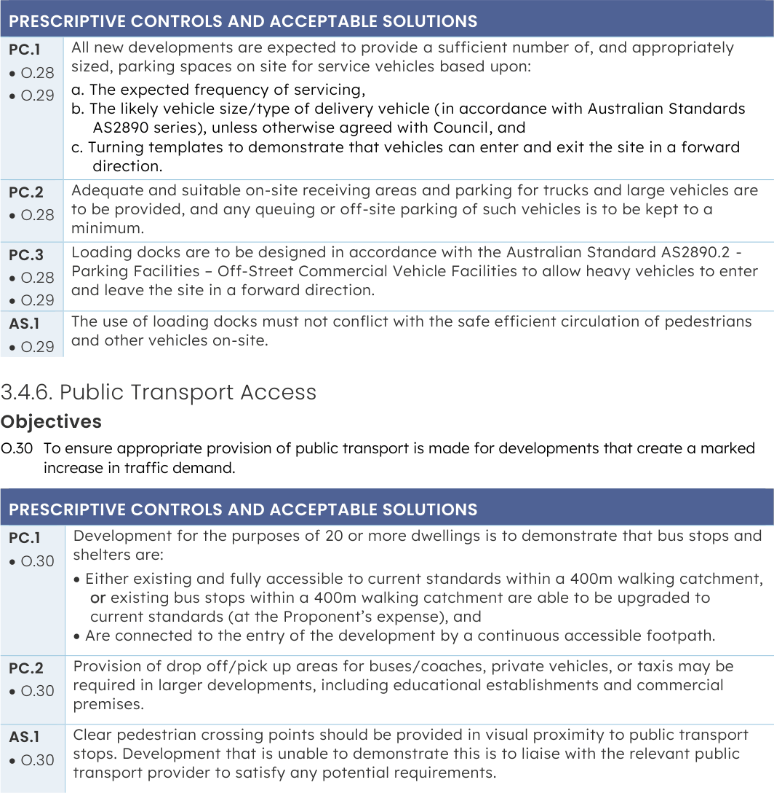

#### 3.4.5. Loading/Unloading & Servicing Facilities

#### Objectives

O.28 To ensure that the location and design of, loading / unloading bays, and servicing facilities, function efficiently in a manner that is safe, convenient, appropriately visually screened, and integrated into a development’s design.

O.29 To provide suitable loading / unloading, servicing, and waste management areas for development.

> [Picture on page 25: a picture, saved as a picture (images/ch-03-00-site-requirements-page-25-7.gif, 150 dpi).]
> Words printed on the picture (title and legend, copied from the PDF):
> • O.28
> • O.29
> direction.
> • O.28
> • O.28
> • O.29
> • O.29

#### PRESCRIPTIVE CONTROLS AND ACCEPTABLE SOLUTIONS

#### PC.1

All new developments are expected to provide a sufficient number of, and appropriately sized, parking spaces on site for service vehicles based upon:

a. The expected frequency of servicing,

b. The likely vehicle size/type of delivery vehicle (in accordance with Australian Standards

AS2890 series), unless otherwise agreed with Council, and

c. Turning templates to demonstrate that vehicles can enter and exit the site in a forward

#### PC.2

Adequate and suitable on-site receiving areas and parking for trucks and large vehicles are to be provided, and any queuing or off-site parking of such vehicles is to be kept to a minimum.

#### PC.3

Loading docks are to be designed in accordance with the Australian Standard AS2890.2 - Parking Facilities – Off-Street Commercial Vehicle Facilities to allow heavy vehicles to enter and leave the site in a forward direction.

#### AS.1

The use of loading docks must not conflict with the safe efficient circulation of pedestrians and other vehicles on-site.
