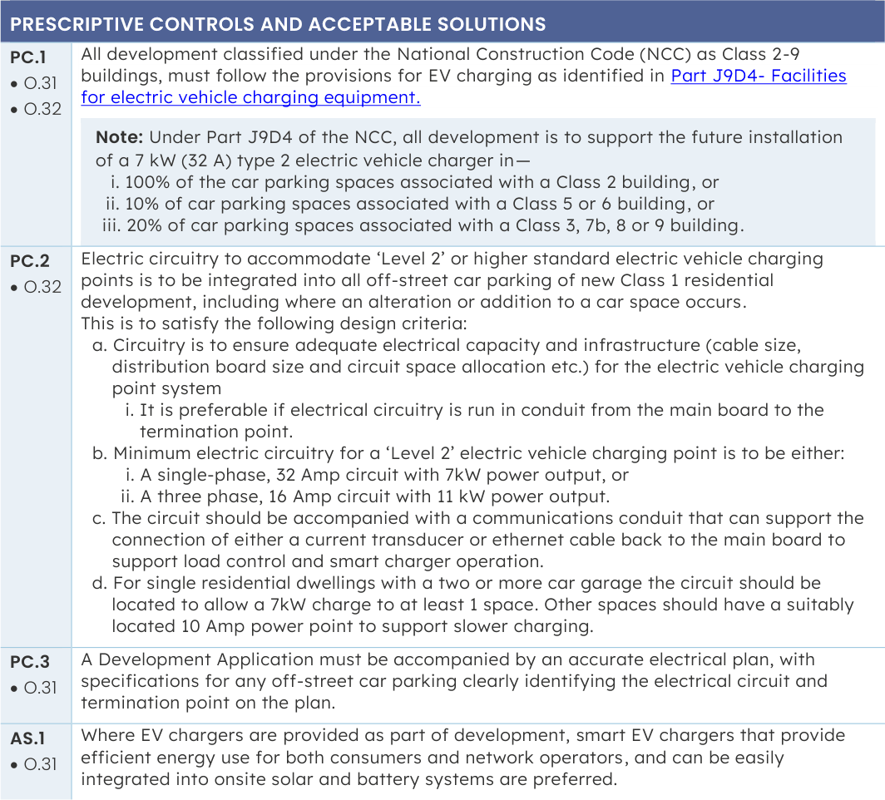

#### 3.4.7. Electric Vehicle Parking

#### Objectives

O.31 To ensure sufficient infrastructure is available to support increased demand for road registered passenger electric vehicles in new and upgraded Class 1 Residential dwellings.

O.32 Ensure the requirements for provisioning for Electric Vehicles within the National Construction for each respective building class are adhered to.

> [Picture on page 26: a picture, saved as a picture (images/ch-03-00-site-requirements-page-26-7.gif, 150 dpi).]
> Words printed on the picture (title and legend, copied from the PDF):
> • O.31
> • O.32
> • O.32
> termination point.
> • O.31
> • O.31

#### PRESCRIPTIVE CONTROLS AND ACCEPTABLE SOLUTIONS

#### PC.1

All development classified under the National Construction Code (NCC) as Class 2-9 buildings, must follow the provisions for EV charging as identified in Part J9D4- Facilities for electric vehicle charging equipment.

Note: Under Part J9D4 of the NCC, all development is to support the future installation of a 7 kW (32 A) type 2 electric vehicle charger in—

i. 100% of the car parking spaces associated with a Class 2 building, or

ii. 10% of car parking spaces associated with a Class 5 or 6 building, or

iii. 20% of car parking spaces associated with a Class 3, 7b, 8 or 9 building.

#### PC.2

Electric circuitry to accommodate ‘Level 2’ or higher standard electric vehicle charging points is to be integrated into all off-street car parking of new Class 1 residential development, including where an alteration or addition to a car space occurs. This is to satisfy the following design criteria:

a. Circuitry is to ensure adequate electrical capacity and infrastructure (cable size, distribution board size and circuit space allocation etc.) for the electric vehicle charging point system

i. It is preferable if electrical circuitry is run in conduit from the main board to the

b. Minimum electric circuitry for a ‘Level 2’ electric vehicle charging point is to be either:

i. A single-phase, 32 Amp circuit with 7kW power output, or

ii. A three phase, 16 Amp circuit with 11 kW power output.

c. The circuit should be accompanied with a communications conduit that can support the connection of either a current transducer or ethernet cable back to the main board to support load control and smart charger operation.

d. For single residential dwellings with a two or more car garage the circuit should be located to allow a 7kW charge to at least 1 space. Other spaces should have a suitably located 10 Amp power point to support slower charging.

#### PC.3

A Development Application must be accompanied by an accurate electrical plan, with specifications for any off-street car parking clearly identifying the electrical circuit and termination point on the plan.

#### AS.1

Where EV chargers are provided as part of development, smart EV chargers that provide efficient energy use for both consumers and network operators, and can be easily integrated into onsite solar and battery systems are preferred.
