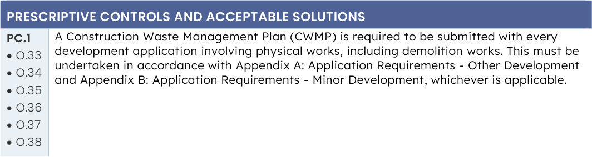

### 3.5. Waste Management

#### 3.5.1. Construction Waste Management

#### Objectives

O.33 To ensure that waste collection vehicles can easily access all waste collection points in a safe and reliable manner throughout the development stages.

O.34 To provide suitably designed and constructed waste storage and collection areas for all development which enable effective servicing for all waste types.

O.35 To ensure that an appropriate waste service solution is provided to all new development. O.36 To minimise resource requirements, demolition waste, construction waste through reuse, recycling, selection, and use of materials.

O.37 To facilitate sustainable waste management and minimisation practices and processes for development in a manner that is consistent with ESD principles.

O.38 To encourage building designs, construction and demolition methods which seek to minimise overall waste generation.

> [Picture on page 27: a picture, saved as a picture (images/ch-03-00-site-requirements-page-27-15.gif, 150 dpi).]
> Words printed on the picture (title and legend, copied from the PDF):
> • O.33
> • O.34
> • O.35
> • O.36
> • O.37
> • O.38

#### PRESCRIPTIVE CONTROLS AND ACCEPTABLE SOLUTIONS

#### PC.1

A Construction Waste Management Plan (CWMP) is required to be submitted with every development application involving physical works, including demolition works. This must be undertaken in accordance with Appendix A: Application Requirements - Other Development and Appendix B: Application Requirements - Minor Development, whichever is applicable.
