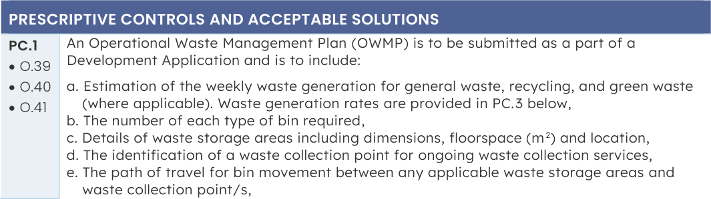
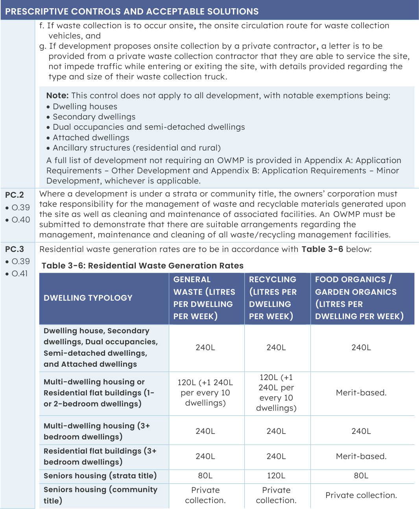

#### 3.5.2. Operational Waste Management

Note: Further criteria pertaining to operational waste management can be found in the Waste Servicing sections of Chapter 6, 7, 8, and 9.

#### Objectives

O.39 To encourage solid waste minimisation through appropriate resource use, re-use/recovery and recycling for the protection of the environment and longevity of solid waste disposal depots.

O.40 To ensure that waste collection is safe, unobstructed and efficient. O.41 To ensure that residential and non-residential waste streams are separated in mixed-use developments.

> [Picture on page 27: a picture, saved as a picture (images/ch-03-00-site-requirements-page-27-31.gif, 150 dpi).]
> Words printed on the picture (title and legend, copied from the PDF):
> • O.39
> • O.40
> • O.41
> waste collection point/s,

#### PRESCRIPTIVE CONTROLS AND ACCEPTABLE SOLUTIONS

#### PC.1

An Operational Waste Management Plan (OWMP) is to be submitted as a part of a Development Application and is to include:

a. Estimation of the weekly waste generation for general waste, recycling, and green waste (where applicable). Waste generation rates are provided in PC.3 below,

b. The number of each type of bin required,

c. Details of waste storage areas including dimensions, floorspace (m 2) and location,

d. The identification of a waste collection point for ongoing waste collection services,

e. The path of travel for bin movement between any applicable waste storage areas and

> [Picture on page 28: a picture, saved as a picture (images/ch-03-00-site-requirements-page-28-1.gif, 150 dpi).]
> Words printed on the picture (title and legend, copied from the PDF):
> vehicles, and
> • O.39
> • O.40
> PC.3 Residential waste generation rates are to be in accordance with Table 3-6 below:
> • O.39
> • O.41

Table 3-6: Residential Waste Generation Rates

f. If waste collection is to occur onsite, the onsite circulation route for waste collection

g. If development proposes onsite collection by a private contractor, a letter is to be provided from a private waste collection contractor that they are able to service the site, not impede traffic while entering or exiting the site, with details provided regarding the type and size of their waste collection truck.

Note: This control does not apply to all development, with notable exemptions being:

• Dwelling houses

• Secondary dwellings

• Dual occupancies and semi-detached dwellings

• Attached dwellings

• Ancillary structures (residential and rural) A full list of development not requiring an OWMP is provided in Appendix A: Application Requirements – Other Development and Appendix B: Application Requirements – Minor Development, whichever is applicable.

#### PC.2

Where a development is under a strata or community title, the owners’ corporation must take responsibility for the management of waste and recyclable materials generated upon the site as well as cleaning and maintenance of associated facilities. An OWMP must be submitted to demonstrate that there are suitable arrangements regarding the management, maintenance and cleaning of all waste/recycling management facilities.

| DWELLING TYPOLOGY | GENERAL WASTE (LITRES PER DWELLING PER WEEK) | RECYCLING (LITRES PER DWELLING PER WEEK) | FOOD ORGANICS / GARDEN ORGANICS (LITRES PER DWELLING PER WEEK) 240L |
|---|---|---|---|
| Dwelling house, Secondary | 240L | 240L |  |
| dwellings, Dual occupancies, |  |  |  |
| Semi-detached dwellings, |  |  |  |
| and Attached dwellings |  |  |  |
| Multi-dwelling housing or Residential flat buildings (1- or 2-bedroom dwellings) | 120L (+1 240L per every 10 dwellings) | 120L (+1 240L per Merit-based. every 10 dwellings) |  |
| Multi-dwelling housing (3+ | 240L | 240L 240L |  |
| bedroom dwellings) |  |  |  |
| Residential flat buildings (3+ | 240L | 240L Merit-based. |  |
| bedroom dwellings) |  |  |  |
| Seniors housing (strata title) | 80L | 120L 80L |  |
| Seniors housing (community | Private collection. | Private Private collection. collection. |  |
| title) |  |  |  |

| PRESCRIPTIVE CONTROLS AND ACCEPTABLE SOLUTIONS |  |
|---|---|
| PC.4 • O.39 • O.41 | Commercial waste generation rates are to be in accordance with Table 3-7 below: Table 3-7: Commercial Waste Generation Rates GENERAL WASTE (LITRES RECYCLING (LITRES PER PREMISES TYPE PER 100M 2 FLOOR AREA 100M 2 FLOOR AREA PER PER DAY OR AS STATED) DAY OR AS STATED) Accommodation Backpackers accommodation 80L per unit per week 80L per unit per week Boarding house 80L per unit per week 80L per unit per week Hotel and motel 10L per bed per day 5L per bed per day accommodation Food Restaurant 200L 200L Food retail 180L 180L General Offices 10L 10L Tourist & Community facilities 300L 150L Retail 80L 80L Educational establishments 25L 15L Early education and care 80L 80L facilities Health services facilities 60L 60L Shopping centres 15L 10L |
| PC.5 • O.39 • O.41 | Industrial waste generation rates are to be in accordance with Table 3-8 below: Table 3-8: Industrial Waste Generation Rates GENERAL WASTE (LITRES PER RECYCLING (LITRES PER 100M 2 PREMISES 2 100M FLOOR AREA PER DAY OR FLOOR AREA PER DAY OR AS TYPE AS STATED) STATED) Industrial 200L 150L Note: In some circumstances waste generation rates may be varied due to the nature of the industrial development, such as resource recovery facilities. These will be assessed on a merit basis. |
