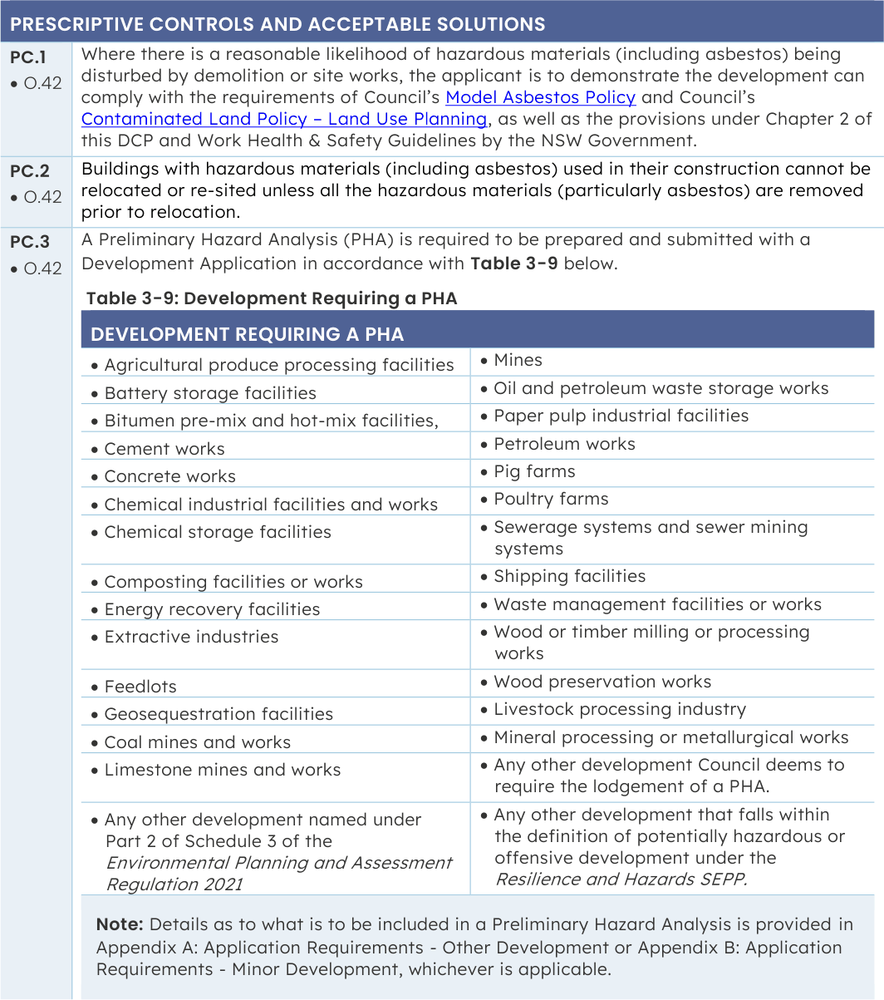

#### 3.5.3. Hazardous Goods Storage

#### Objectives

O.42 To ensure appropriate management of hazardous waste materials (including asbestos) during demolition, construction, and use of sites that protects human health and ensures the site is suitable

for its intended use.

> [Picture on page 30: a picture, saved as a picture (images/ch-03-00-site-requirements-page-30-6.gif, 150 dpi).]
> Words printed on the picture (title and legend, copied from the PDF):
> • O.42
> • O.42
> • O.42

Table 3-9: Development Requiring a PHA

#### PRESCRIPTIVE CONTROLS AND ACCEPTABLE SOLUTIONS

#### PC.1

Where there is a reasonable likelihood of hazardous materials (including asbestos) being disturbed by demolition or site works, the applicant is to demonstrate the development can comply with the requirements of Council’s Model Asbestos Policy and Council’s Contaminated Land Policy – Land Use Planning, as well as the provisions under Chapter 2 of this DCP and Work Health & Safety Guidelines by the NSW Government.

#### PC.2

Buildings with hazardous materials (including asbestos) used in their construction cannot be relocated or re-sited unless all the hazardous materials (particularly asbestos) are removed prior to relocation.

#### PC.3

A Preliminary Hazard Analysis (PHA) is required to be prepared and submitted with a Development Application in accordance with Table 3-9 below.

| DEVELOPMENT REQUIRING A PHA |  |
|---|---|
| • Agricultural produce processing facilities | • Mines |
| • Battery storage facilities | • Oil and petroleum waste storage works |
| • Bitumen pre-mix and hot-mix facilities, | • Paper pulp industrial facilities |
| • Cement works | • Petroleum works |
| • Concrete works | • Pig farms |
| • Chemical industrial facilities and works | • Poultry farms |
| • Chemical storage facilities | • Sewerage systems and sewer mining systems |
| • Composting facilities or works | • Shipping facilities |
| • Energy recovery facilities | • Waste management facilities or works |
| • Extractive industries | • Wood or timber milling or processing works |
| • Feedlots | • Wood preservation works |
| • Geosequestration facilities | • Livestock processing industry |
| • Coal mines and works | • Mineral processing or metallurgical works |
| • Limestone mines and works | • Any other development Council deems to require the lodgement of a PHA. |
| • Any other development named under Part 2 of Schedule 3 of the | • Any other development that falls within the definition of potentially hazardous or |
| Environmental Planning and Assessment Regulation 2021 | offensive development under the Resilience and Hazards SEPP. |

Note: Details as to what is to be included in a Preliminary Hazard Analysis is provided in Appendix A: Application Requirements - Other Development or Appendix B: Application Requirements - Minor Development, whichever is applicable.
