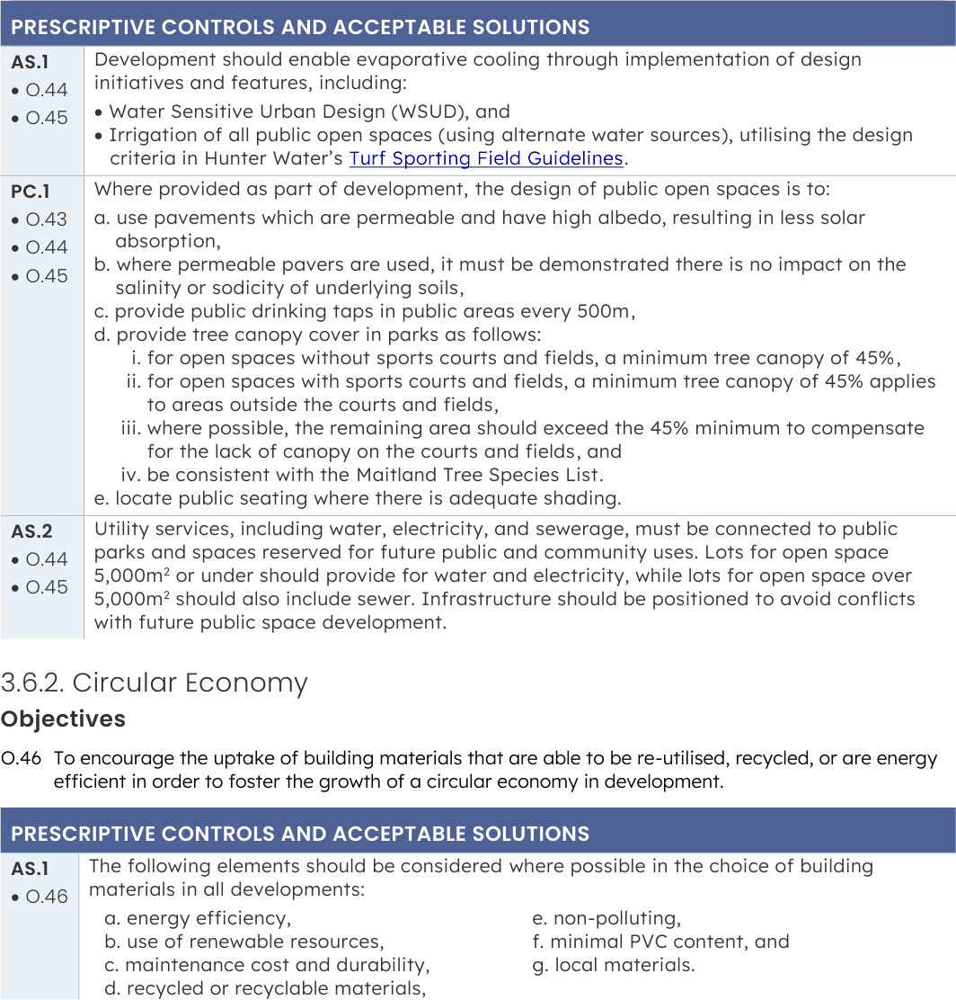

### 3.6. Sustainability

#### 3.6.1. Liveable and resilient communities

#### Objectives

O.43 To reduce heat absorption and urban heat island effects of urban development in Maitland LGA. O.44 To identify design and engineering approaches to improve sustainable management of development for public open space.

O.45 To apply sustainable design principles to reduce environmental impacts and operating costs on new and improved facilities.

> [Picture on page 31: a picture, saved as a picture (images/ch-03-00-site-requirements-page-31-9.gif, 150 dpi).]
> Words printed on the picture (title and legend, copied from the PDF):
> • O.44
> • O.45
> • O.43
> • O.44
> absorption,
> • O.45
> • O.44
> • O.45

#### PRESCRIPTIVE CONTROLS AND ACCEPTABLE SOLUTIONS

#### AS.1

Development should enable evaporative cooling through implementation of design initiatives and features, including:

• Water Sensitive Urban Design (WSUD), and

• Irrigation of all public open spaces (using alternate water sources), utilising the design criteria in Hunter Water’s Turf Sporting Field Guidelines. Where provided as part of development, the design of public open spaces is to:

#### PC.1

a. use pavements which are permeable and have high albedo, resulting in less solar

b. where permeable pavers are used, it must be demonstrated there is no impact on the salinity or sodicity of underlying soils,

c. provide public drinking taps in public areas every 500m,

d. provide tree canopy cover in parks as follows:

i. for open spaces without sports courts and fields, a minimum tree canopy of 45%,

ii. for open spaces with sports courts and fields, a minimum tree canopy of 45% applies to areas outside the courts and fields,

iii. where possible, the remaining area should exceed the 45% minimum to compensate for the lack of canopy on the courts and fields, and

iv. be consistent with the Maitland Tree Species List.

e. locate public seating where there is adequate shading.

#### AS.2

Utility services, including water, electricity, and sewerage, must be connected to public parks and spaces reserved for future public and community uses. Lots for open space 5,000m2 or under should provide for water and electricity, while lots for open space over 5,000m2 should also include sewer. Infrastructure should be positioned to avoid conflicts with future public space development.
