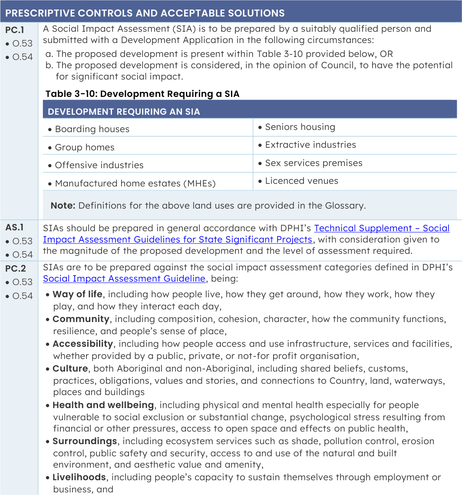
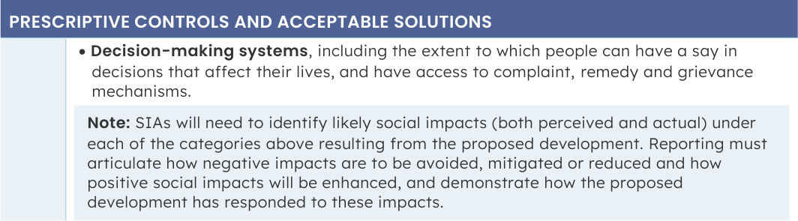

### 3.8. Social Impact Assessment

#### Objectives

O.53 To ensure that development with the propensity to cause social impacts take into consideration both benefits and detriments to their local and regional context.

O.54 To ensure that development occurs in locations appropriate to their uses and can be provided for through existing and proposed services and facilities.

> [Picture on page 33: a picture, saved as a picture (images/ch-03-00-site-requirements-page-33-7.gif, 150 dpi).]
> Words printed on the picture (title and legend, copied from the PDF):
> • O.53
> • O.54
> for significant social impact.
> • O.54 • Way of life, including how people live, how they get around, how they work, how they
> business, and

Table 3-10: Development Requiring a SIA

#### PRESCRIPTIVE CONTROLS AND ACCEPTABLE SOLUTIONS

#### PC.1

A Social Impact Assessment (SIA) is to be prepared by a suitably qualified person and submitted with a Development Application in the following circumstances:

a. The proposed development is present within Table 3-10 provided below, OR

b. The proposed development is considered, in the opinion of Council, to have the potential

|  | DEVELOPMENT REQUIRING AN SIA |
|---|---|
|  | • Boarding houses • Seniors housing |
|  | • Group homes • Extractive industries |
|  | • Offensive industries • Sex services premises |
|  | • Manufactured home estates (MHEs) • Licenced venues |
|  | Note: Definitions for the above land uses are provided in the Glossary. |
| AS.1 | SIAs should be prepared in general accordance with DPHI’s Technical Supplement – Social |
| • O.53 | Impact Assessment Guidelines for State Significant Projects, with consideration given to |
| • O.54 | the magnitude of the proposed development and the level of assessment required. |
| PC.2 • O.53 | SIAs are to be prepared against the social impact assessment categories defined in DPHI’s Social Impact Assessment Guideline, being: |

play, and how they interact each day,

• Community, including composition, cohesion, character, how the community functions, resilience, and people’s sense of place,

• Accessibility, including how people access and use infrastructure, services and facilities, whether provided by a public, private, or not-for profit organisation,

• Culture, both Aboriginal and non-Aboriginal, including shared beliefs, customs, practices, obligations, values and stories, and connections to Country, land, waterways, places and buildings

• Health and wellbeing, including physical and mental health especially for people vulnerable to social exclusion or substantial change, psychological stress resulting from financial or other pressures, access to open space and effects on public health,

• Surroundings, including ecosystem services such as shade, pollution control, erosion control, public safety and security, access to and use of the natural and built environment, and aesthetic value and amenity,

• Livelihoods, including people’s capacity to sustain themselves through employment or

> [Picture on page 34: a picture, saved as a picture (images/ch-03-00-site-requirements-page-34-1.gif, 150 dpi).]

• Decision-making systems, including the extent to which people can have a say in decisions that affect their lives, and have access to complaint, remedy and grievance mechanisms. Note: SIAs will need to identify likely social impacts (both perceived and actual) under each of the categories above resulting from the proposed development. Reporting must articulate how negative impacts are to be avoided, mitigated or reduced and how positive social impacts will be enhanced, and demonstrate how the proposed development has responded to these impacts.

> [Picture on page 35, not reproduced as text; see the original PDF.]
> Words on this picture, read by OCR (may contain errors): m maitland CITY COUNCIL
