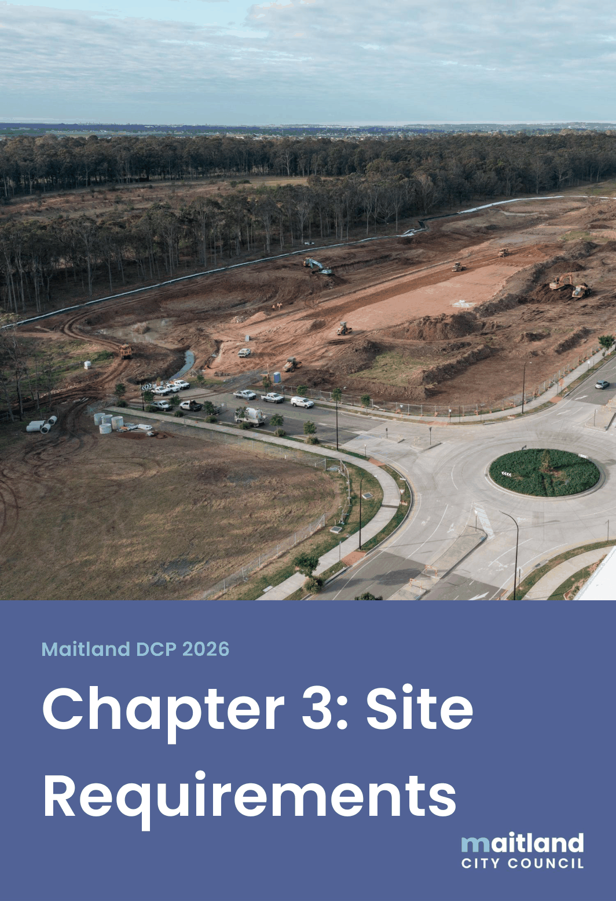

# Maitland Development Control Plan 2026 - Chapter 3 Site Requirements

> This chapter is split into 23 section file(s), one per numbered heading, in the order they appear in the PDF.

Source PDF: [MDCP 2026 - Chapter 3 Site Requirements.pdf](MDCP%202026%20-%20Chapter%203%20Site%20Requirements.pdf)

> [Picture on page 1: a picture, saved as a picture (images/ch-03-00-site-requirements-page-1-1.gif, 150 dpi).]

### Maitland DCP 2026

## Chapter 3: Site Requirements

### Table of Contents – Chapter 3: Site Requirements

3.1. Introduction ....................................................................................................................................................3 3.1.1. Application .................................................................................................................................................................. 3 3.1.2. Relationship to other Chapters ............................................................................................................................ 3 3.1.3. How to use this Chapter ......................................................................................................................................... 3 3.1.4. Intent of this Chapter ............................................................................................................................................. 3 3.2. Earthworks and Retaining Walls .......................................................................................................... 4 3.3. Stormwater Management ....................................................................................................................... 7 3.3.1. Stormwater and Drainage ......................................................................................................................................7 3.3.2. Stormwater Management within the Woodberry Swamp Catchment .................................................... 9 3.3.3. Erosion and Sediment Control ........................................................................................................................... 12 3.4. Parking and Vehicle Access ................................................................................................................. 13 3.4.1. Traffic Impacts ........................................................................................................................................................ 13 3.4.2. Vehicle Access .......................................................................................................................................................... 13 3.4.3. Parking, Circulation and Design ....................................................................................................................... 14 3.4.4. Parking Provision ................................................................................................................................................... 16 3.4.5. Loading/Unloading & Servicing Facilities ..................................................................................................... 25 3.4.6. Public Transport Access ....................................................................................................................................... 25 3.4.7. Electric Vehicle Parking ....................................................................................................................................... 26 3.5. Waste Management ................................................................................................................................ 27 3.5.1. Construction Waste Management .................................................................................................................... 27 3.5.2. Operational Waste Management...................................................................................................................... 27 3.5.3. Hazardous Goods Storage .................................................................................................................................. 30 3.6. Sustainability .............................................................................................................................................. 31 3.6.1. Liveable and resilient communities ................................................................................................................... 31 3.6.2. Circular Economy .................................................................................................................................................... 31 3.7. Crime Prevention Through Environmental Design .................................................................... 32 3.8. Social Impact Assessment .................................................................................................................... 33

<!-- sections -->
## Sections

1. [3.1.1 Application](01-3-1-1-application.md)
2. [3.1.2 Relationship to other Chapters](02-3-1-2-relationship-to-other-chapters.md)
3. [3.1.3 How to use this Chapter](03-3-1-3-how-to-use-this-chapter.md)
4. [3.1.4 Intent of this Chapter](04-3-1-4-intent-of-this-chapter.md)
5. [3.2 Earthworks and Retaining Walls](05-3-2-earthworks-and-retaining-walls.md)
6. [3.3 Stormwater Management](06-3-3-stormwater-management.md)
7. [3.3.1 Stormwater and Drainage](07-3-3-1-stormwater-and-drainage.md)
8. [3.3.2 Stormwater Management within the Woodberry Swamp Catchment](08-3-3-2-stormwater-management-within-the.md)
9. [3.3.3 Erosion and Sediment Control](09-3-3-3-erosion-and-sediment-control.md)
10. [3.4.1 Traffic Impacts](10-3-4-1-traffic-impacts.md)
11. [3.4.2 Vehicle Access](11-3-4-2-vehicle-access.md)
12. [3.4.3 Parking, Circulation and Design](12-3-4-3-parking-circulation-and-design.md)
13. [3.4.4 Parking Provision](13-3-4-4-parking-provision.md)
14. [3.4.5 Loading/Unloading & Servicing Facilities](14-3-4-5-loading-unloading-and-servicing.md)
15. [3.4.6 Public Transport Access](15-3-4-6-public-transport-access.md)
16. [3.4.7 Electric Vehicle Parking](16-3-4-7-electric-vehicle-parking.md)
17. [3.5.1 Construction Waste Management](17-3-5-1-construction-waste-management.md)
18. [3.5.2 Operational Waste Management](18-3-5-2-operational-waste-management.md)
19. [3.5.3 Hazardous Goods Storage](19-3-5-3-hazardous-goods-storage.md)
20. [3.6.1 Liveable and resilient communities](20-3-6-1-liveable-and-resilient-communities.md)
21. [3.6.2 Circular Economy](21-3-6-2-circular-economy.md)
22. [3.7 Crime Prevention Through Environmental Design](22-3-7-crime-prevention-through-environmental.md)
23. [3.8 Social Impact Assessment](23-3-8-social-impact-assessment.md)
