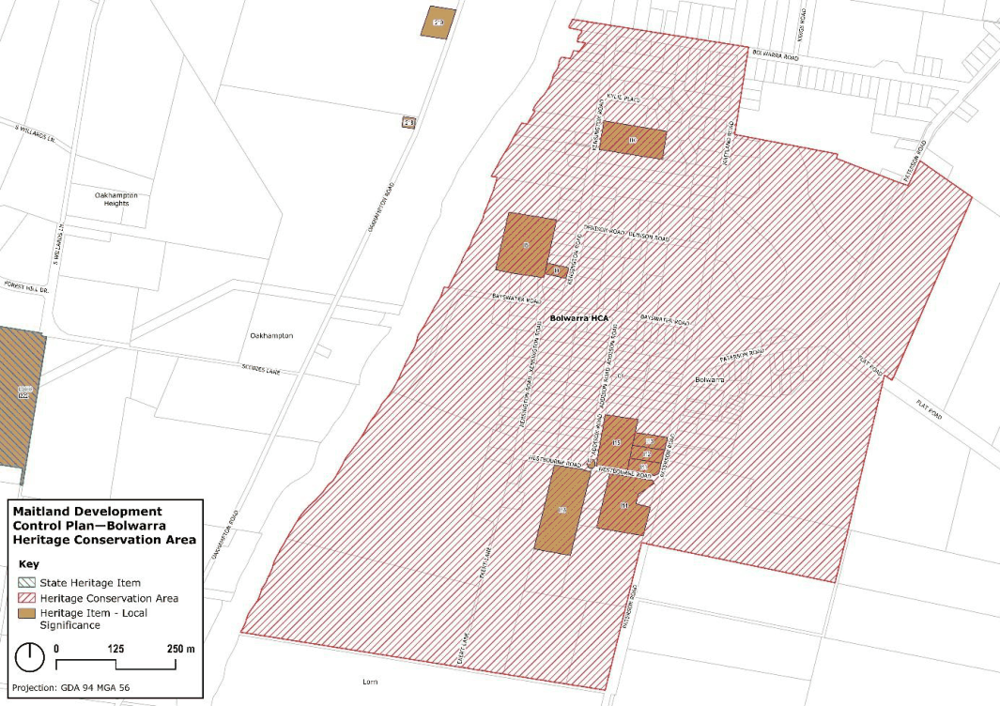

### 4.7. Bolwarra Heritage Conservation Area

| In addition to the general controls for heritage conservation areas, which also apply to the |
|---|
| Bolwarra HCA, the following specific controls are be applied to this area. Where the specific |
| controls for the Bolwarra HCA differ from the general controls for HCAs, the specific controls in |
| this section prevail. |

Figure 4-7 provides a heritage map of the Bolwarra HCA applied within MLEP 2011.

> [Picture on page 43: a picture, saved as a picture (images/ch-04-00-heritage-page-43-4.gif, 150 dpi).]

#### Figure 4-7: Bolwarra HCA Land Application Map
