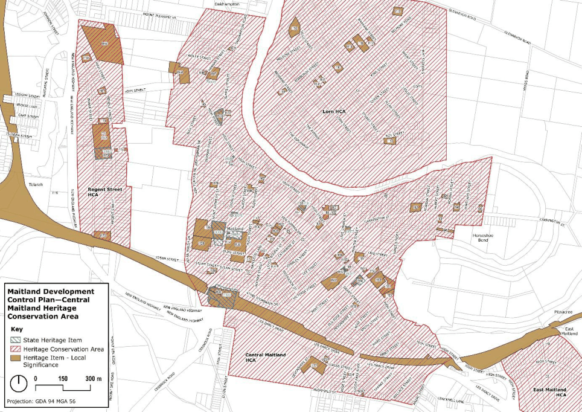

### 4.8. Central Maitland Heritage Conservation Area

| In addition to the general controls for heritage conservation areas, which also apply to the Central |
|---|
| Maitland Heritage Conservation Area (HCA), the following specific controls are to be applied to |
| this area. Where the specific controls for the Central Maitland HCA differ from the general controls |
| for HCAs, the specific controls in this section prevail. |

Figure 4-8 provides a land application map for the Central Maitland HCA.

> [Picture on page 47: a picture, saved as a picture (images/ch-04-00-heritage-page-47-4.gif, 150 dpi).]

#### Figure 4-8: Central Maitland HCA Land Application Map
