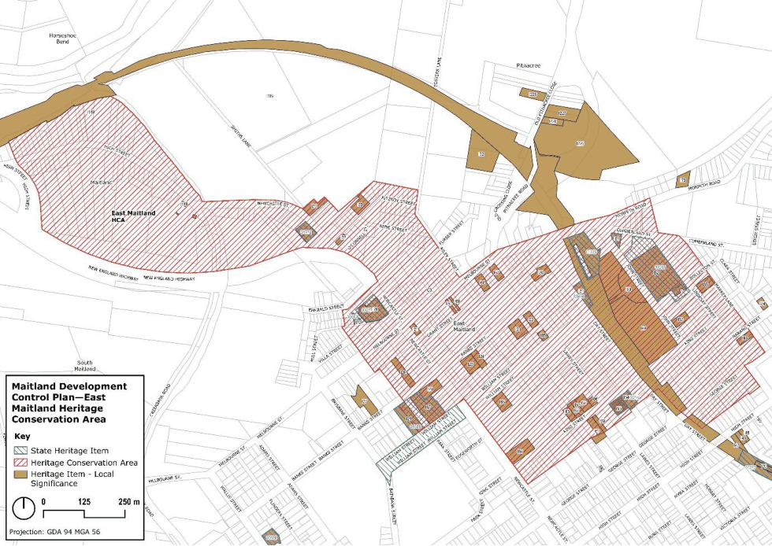

### 4.9. East Maitland Heritage Conservation Area

| In addition to the general controls for heritage conservation areas, which also apply to the East |
|---|
| Maitland Heritage Conservation Area (HCA), the following specific controls are to be applied to |
| this area. Where the specific controls for the East Maitland HCA differ from the general controls for |
| HCAs, the specific controls in this section prevail to the extent of the inconsistency. |

Figure 4-10 provides a heritage map of East Maitland HCA.

> [Picture on page 51: a picture, saved as a picture (images/ch-04-00-heritage-page-51-4.gif, 150 dpi).]

#### Figure 4-10: East Maitland HCA Land Application Map
