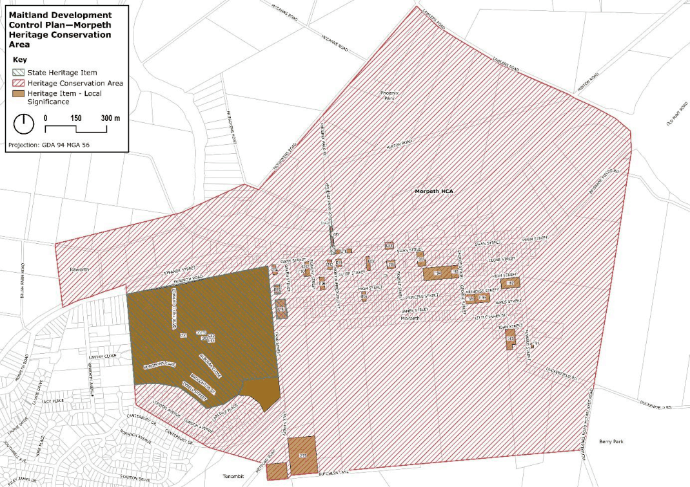
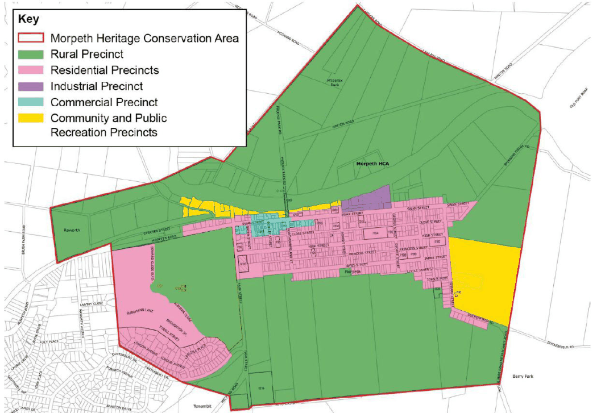

### 4.12. Morpeth Heritage Conservation Area

| In addition to the general controls for heritage conservation areas, which also apply to the |
|---|
| Morpeth Heritage Conservation Area (HCA), the following specific controls are to be applied to this |
| area. Where the specific controls for the Morpeth HCA differ from the general controls for heritage |
| conservation areas, the specific controls in this section prevail. |

Figure 4-13 provides a land application map of the Morpeth HCA.

> [Picture on page 61: a picture, saved as a picture (images/ch-04-00-heritage-page-61-4.gif, 150 dpi).]

#### Figure 4-13 Morpeth HCA Land Application Map

#### Precincts

There are five precincts in the Morpeth HCA, each with a unique character and different land use.

#### Rural Precinct

The township of Morpeth is surrounded by a rural landscape to the north, east and south. The rural lands define the edge of the HCA and is predominantly flood prone land. The specific characteristics of this precinct can be summarised by the following:

• Rural surrounds which feature barns and farmhouses and evidence of floods

• Open farming plains that provide clear views to the township of Morpeth from surrounding areas

• Incorporates the floodplains and meandering Hunter River

• Rural approaches to the Morpeth township with landmark transition Avenue plantings at Morpeth Road (Fig Tree Hill) and Duckenfield Road.

• Closebourne House and Morpeth House

#### Residential Precinct

There are two residential precincts in the Morpeth HCA. The original township is situated between Tank Street and Edward Street, directly south of the Hunter River to James Street, except for the commercial and industrial precincts. The specific character of this residential precinct includes a small number of attached dwellings mostly from mid-nineteenth century, semi-detached dwellings (or pairs), which are single-storey and sited close to the front boundary. There are also two storey buildings that are modest in scale. Some large historic residences remain (e.g. Kiora and Marlborough) and retain their expansive garden settings. Residential allotment sizes vary through the township. Those established around Swan Street consist of small allotments compared to the wider frontage allotments created on the edges of the township along James Street. Morpeth did not have any style distinctive from those in other towns in the locality, but the circumstances of the town have kept an outstanding number of pre-1870 buildings. The most predominant type is a dwelling that has a four-room core, with a different layout for the verandah, kitchen, and bathroom. This layout is seen in the earliest buildings and buildings constructed up to the 1920s. Some diversity in building typology exists in the form of churches, cinema, former joinery, and community buildings that are located within this precinct. These buildings maintain surrounding yards and gardens associated with their community use as gathering spaces and provide a spacious amenity to this residential precinct. The specific characteristics of this precinct can be summarised by the following:

• Single storey, small, detached dwellings located relatively close to the street

• Wide streets and wide allotments with narrow rear lanes

• Domestic outbuildings, such as sheds and carports, that are located in rear corners of the yard separate from the dwelling and typically as freestanding buildings. The second residential precinct is located south on Morpeth Road, towards the western entry of the town and constructed around Morpeth House and Closebourne House. This precinct includes senior housing and large contemporary dwelling houses, which are considered non-contributory in the HCA.

#### Industrial Precinct

The Industrial Precinct is contained within the eastern section of Swan Street, on the northern side predominantly between Robert Street and George Street. This area largely represents the zoned industrial land within the town. The specific character of this precinct is defined by the large industrial buildings of a variety of building forms located along the edge of the Hunter River associated with the town as a river port and the Morpeth railway line. Located within this precinct is a single block of buildings on the northern side of Swan Street which define this eastern end of the township with a strong built edge along the street boundary. Throughout the town, there are also many large sheds, including stables, built for light industrial or rural purposes within the predominantly residential area. Like the large industrial buildings on Swan Street, these add to the visual appeal and historic authenticity of Morpeth. The industrial precinct provides a tangible record of the manufacturing industries associated with the river port of Morpeth. The specific physical characteristics of this precinct can be summarised by the following:

• Limited vegetation within the precinct, including along the riverbank

• Large scale, single pitched roof buildings of consistent building materials such as iron and timber with minimal window or door openings

• Location along the riverbank with frontage to the river rather than Swan Street

• Landmark fig tree plantings fronting Swan Street.

#### Commercial Precinct

The commercial precinct is contained within the western section of Swan Street predominately between Tank Street and Northumberland Street. Apart from a couple of former isolated shops,, the remainder of shops are located on Swan Street. The specific character of this precinct is defined by the established row of shops and dwellings along the southern side of Swan Street of two and three storey (attic style) buildings. Together, these shops -particularly Campbell’s Store and the three storey shops and dwellings - are the most significant group of retail buildings pre-1880 in the Hunter Region. Individual buildings of the same period exist in other towns, but there are no comparable groups that make such a major contribution to the streetscape. Most of these buildings were built as shops and dwellings but are now used only as shops. Two nineteenth century hotels remain in the HCA. They are two storeys, with post supported verandahs and have been adapted by various additions and modifications to suit present needs. The southern side of Swan Street also has a fine collection of civic buildings constructed in the nineteenth century and designed by government architects. These include the former Courthouse, the former CBC Bank, and the former Post Office. The northern side of Swan Street by comparison is characterised by predominantly freestanding one and two storey buildings, including the former Bond Store group. This northern side of Swan Street, due to the placement of freestanding buildings maintains defined view corridors to the Hunter River and the rural plains beyond. Four types of shops are found in Morpeth:

• shops with dwellings above (mainly two and three storeys)

• shops with a dwelling at side or rear (usually single storey)

• a dwelling and shop with a projecting bay window at the front

• the large store or emporium known as ‘Campbell’s Store’ (c.1850).

#### Community and Public Recreation Precincts

There are two community and public recreation precincts in Morpeth. The first includes Morpeth Common and Morpeth Oval on the eastern side of Edward Street. The second includes the Queens Wharf precinct and the connecting riverside linear reserves, stretching to Steamer St east of the former Morpeth Railway Station. Surviving community buildings in Morpeth include the grandstand located in Morpeth Oval and the Morpeth School of Arts building.

> [Picture on page 64: a picture, saved as a picture (images/ch-04-00-heritage-page-64-1.gif, 150 dpi).]

#### Figure 4-14: Precincts within the Morpeth HCA
