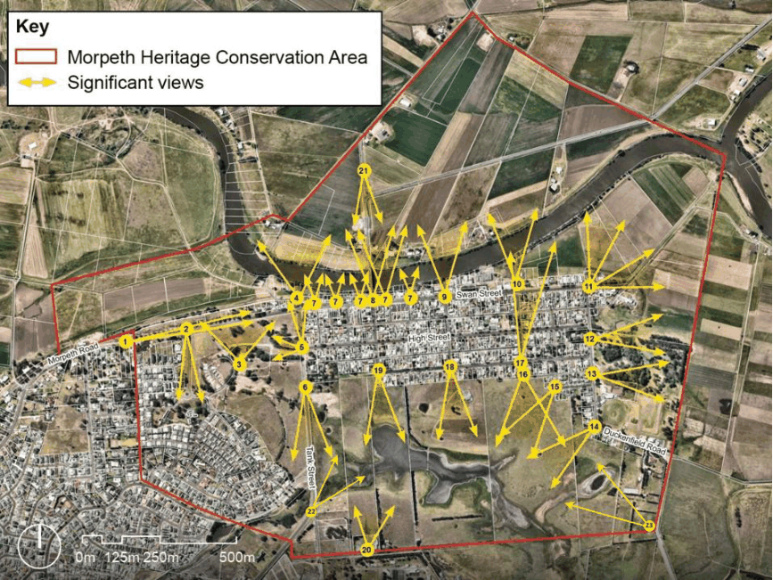

#### 4.12.1. Statement of Significance

The Statement of Significance for the Morpeth HCA is as follows:

#### Morpeth is of State Significance:

• For its role in the pattern of NSW’s cultural history: As the major river port town in the European settlement and development of the Hunter region in the 19th Century, and as an end point of a spur off the Great North Road.

• For demonstrating a high degree of creative or technical achievement in NSW: As a privately founded town whose layout is a skilful adaptation of the standards for government towns to the circumstances of the site, and the requirements of its founder, who lived alongside and whose family continued to own much land in the town and its surrounding area until 1920.

• For its uncommon and endangered aspects of NSW’s cultural history: As a town with a large collection of buildings and works from the 19th Century, many pre-1868, compared with other similar sized and aged towns; and which provides comprehensive evidence or architectural standards and building techniques, which are now relatively rare in the state. As a town with extensive archaeological evidence with potential to yield information that will contribute to an understanding of NSW’s cultural history; in particular of the river port and associated works and structures currently in an endangered condition; and

• As a private town where the founder lived alongside and whose family continued to have an impact on the town and its development for almost 90 years after its founding.

#### Morpeth is of Regional Significance:

• For its uncommon evidence of the impacts of European settlement on the natural character of the landscape: activities of early settlement (such as tree clearing) where a factor in floods that made major changes to the course of the Hunter River at Morpeth, leaving large off cuts and lagoons.

• For demonstrating the range and variety of dwelling types occurring in towns from 1830s to the present, with intact dwellings, mostly detached and single storey, from every period of its development.

• As an uncommon example of a town whose road layout and extent has changed little since the mid- 19th century and has developed and maintained a clear edge and distinctive form as an historic village in its rural setting.

#### Morpeth is of Local Significance:

• For its strong and special association with its local community which has shown its appreciation of Morpeth’s history, heritage and character, including its scenic qualities of the relationship between a riverside town and the surrounding rural area.

• As a town that demonstrates its history through tangible evidence in its current built form.

• As a major tourist destination, creating greater public awareness of the heritage significance of the

Maitland area generally.

#### Characteristic Elements:

• Early settlement on the Hunter River, established in the 1820s.

• Intact Georgian period grid land subdivision and street pattern, comprising three main streets with lanes between, and five minor cross streets. The township maintains a clear edge and distinctive village form in its rural landscape setting.

• Continuous relationship to the Hunter River.

• Large industrial buildings along the Hunter River, evidence of the early settlement and industry on the river.

• Queens Wharf.

• Morpeth Bridge.

• Landmark civic buildings designed by Government architects.

• Commercial streetscape character containing one, two and three storey examples of shops on Swan Street.

• Morpeth House and Closebourne House.

• A variety of dwelling types constructed from the 1830s to the present.

• Predominant single storey detached residential character.

• Eclectic fencing types and garden layouts in residential development.

• Old and prominent cultural plantings, including Araucaria pines and large Figs, located at the entries to the town on Morpeth Road, the northern side of Swan Street, within and around Morpeth Common and Morpeth Oval, in the town’s former colonial mansions and within several churchyards and historic homes.

• A line of mature lopped Brushbox on High Street.

• Morpeth Common and Morpeth Oval.

• Sandstone gutters, kerbing, and swale drain system.

• Expansive views over the Hunter River floodplain are available from numerous vantage points in Morpeth.

#### Significant Views

The significant views to and from the Morpeth HCA include:

1\. View from Morpeth Road to Morpeth HCA on entry to the town.

2\. View from Morpeth Road to Morpeth House.

3\. View from Closebourne House towards Hunter River and northern rural landscape.

4\. View from Queens Wharf Road to Hunter River.

5\. Views from the western end of High Street towards Closebourne House, its grounds, the river and northern rural landscape.

6\. View to the cemetery from Tank Street.

7\. Views between buildings on Swan Street to the Hunter River.

8\. View from the Morpeth Bridge to the northern rural landscape.

9\. View from the intersection of Robert and Swan streets to the northern rural landscape.

10\. View from the intersection of George and Swan streets to the northern rural landscape.

11\. Views from the intersection of Swan and Edward streets to the rural landscape.

12\. View from Edward Street to Morpeth Common and the eastern rural landscape.

13\. View from Edward Street to Morpeth Oval and the eastern rural landscape.

14\. View from Duckenfield Road to the southern rural landscape and lagoon.

15\. View from the corner of John Street and Duke streets to the southern rural landscape and lagoon.

16\. View from Little James Street to the southern rural landscape.

17\. View from the intersection of George and James streets looking north.

18\. View from the intersection of James and Robert streets to the southern rural landscape.

19\. View from the intersection of James and Northumberland streets to the southern rural landscape.

20\. View from Butchers Lane to the north across the southern rural landscape, including the southern extent of the township and the lagoon.

21\. View from the floodplain to Morpeth Bridge and the township.

22\. View from Metford Road north-east towards the lagoon and the southern extent of the township.

23\. View from Mcfarlanes Road north-west towards the lagoon and the southern extent of the township.

> [Picture on page 66: a picture, saved as a picture (images/ch-04-00-heritage-page-66-29.gif, 150 dpi).]

#### Figure 4-15: Significant views within the Morpeth HCA
