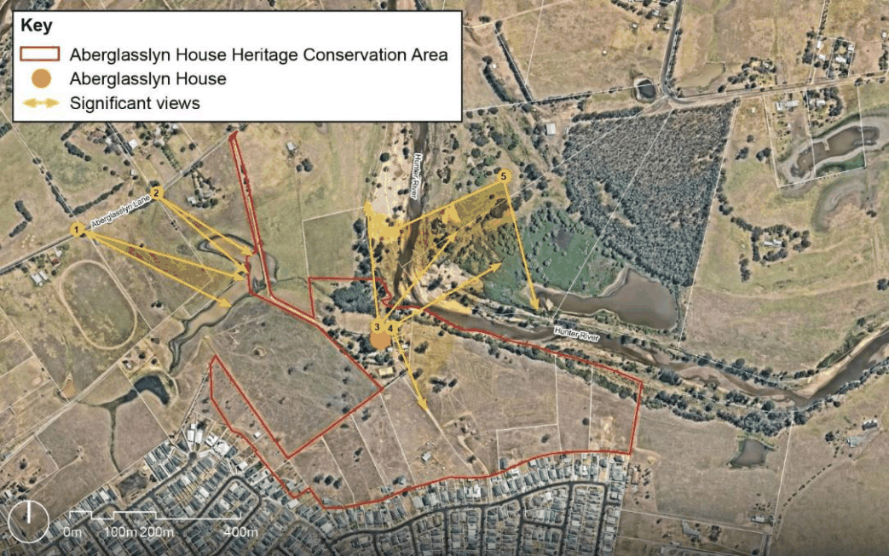

#### 4.13.1. Statement of significance

The Statement of Significance for Aberglasslyn House has been taken from the State Heritage Inventory, and is as follows: It is arguably the finest extant Greek Revival style villa (in the 18th century sense of the word) in Australia. The configuration of its fabric, largely in its c1860 form, is patent physical evidence of the high expectations of colonial settlers of the 1830s and early 1840s and the severity of the economic crash of the 1840s. It is the earliest known surviving example in Australia of a house design generated in part by considerations of an integrated sanitary plumbing system. The building is one of a group of surviving pre- 1850 in the vicinity of Maitland. The house and setting is physical evidence of the pattern of land settlement and leasehold farming in the Maitland area. It contains elements of high individual and often unique quality, including a domed stairwell and geometric stair of unique quality and design in Australia. The place is perceived by many knowledgeable people to be one of the major

sites of cultural significance in Australia. On a regional basis the building is an historic landmark (monument). It is an exemplary example of the 19th century builder's art embodied in the quality of the stonework, brickwork, timber selection, carpentry and joinery, plasterwork, hardware etc.

#### Characteristic Elements

• Aberglasslyn House, its principal garden and grounds.

• The pastoral landscape setting surrounding Aberglasslyn House, which is partially included in the boundary of the HCA.

• The historic relationship to the Hunter River.

• The natural landform to the south of the HCA.

• Views to and from Aberglaslyn House and the HCA from the Aberglasslyn Lane and the northern side of the Hunter River.

> [Picture on page 74: a picture, saved as a picture (images/ch-04-00-heritage-page-74-12.gif, 150 dpi).]

#### Figure 4-18: Significant views within the Aberglasslyn House HCA
