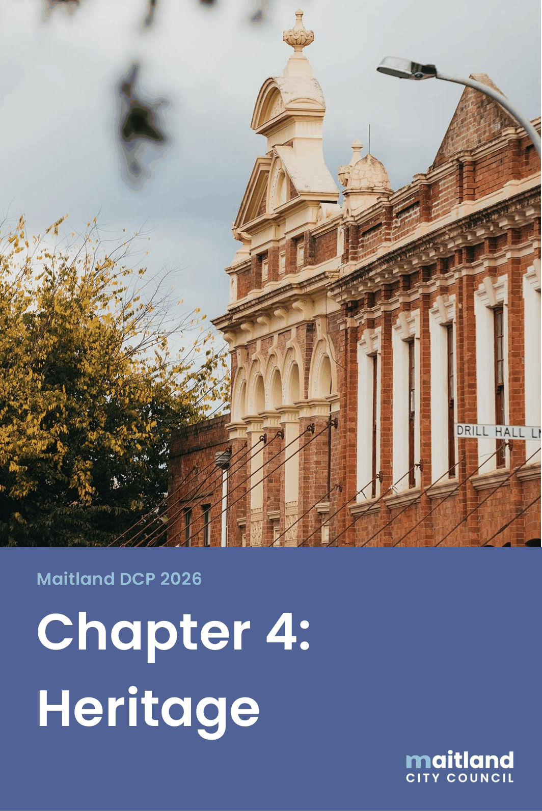

# Maitland Development Control Plan 2026 - Chapter 4 Heritage

> This chapter is split into 57 section file(s), one per numbered heading, in the order they appear in the PDF.

Source PDF: [MDCP 2026 - Chapter 4 Heritage.pdf](https://planfortomorrow.sharepoint.com/sites/Planfortomorrow/Shared%20Documents/00%20NSW-Planning-Resources/dcp/maitland-development-control-plan-2026/ch-04-00-heritage/MDCP%202026%20-%20Chapter%204%20Heritage.pdf)

> [Picture on page 1: a picture, saved as a picture (images/ch-04-00-heritage-page-1-1.gif, 150 dpi).]

### Maitland DCP 2026

## Chapter 4: Heritage Requirements

### Table of Contents – Chapter 4: Heritage

4.1. Introduction .................................................................................................................................................. 4 4.1.1. Application................................................................................................................................................. 4 4.1.2. Relationship to other Chapters .......................................................................................................... 4 4.1.3. How to use this Chapter ....................................................................................................................... 5 4.1.4. Intent of this Chapter ............................................................................................................................ 5 4.2. Aboriginal Cultural Heritage ................................................................................................................. 6 4.3. State Listed Heritage Items .................................................................................................................. 7 4.4. Locally Listed Heritage Items .............................................................................................................. 8 4.4.1. Demolition ................................................................................................................................................. 8 4.4.2. Change of Use ......................................................................................................................................... 9 4.4.3. Subdivision ............................................................................................................................................. 10 4.4.4. Setting/Expanded Curtilage ............................................................................................................ 10 4.4.5. Landscapes ............................................................................................................................................. 11 4.4.6. Conservation of Significant Fabric ................................................................................................ 12 4.4.7. Excavation .............................................................................................................................................. 14 4.4.8. Alterations and additions to residential heritage items ......................................................... 15 4.4.9. Alterations and additions to non-residential Heritage items ................................................ 22 4.5. Development in the vicinity of Heritage Items/Heritage Conservation Areas .......... 24 4.6. Heritage Conservation Areas .............................................................................................................. 25 4.6.1. Demolition ............................................................................................................................................... 25 4.6.2. Subdivision and boundary adjustment ......................................................................................... 26 4.6.3. Views and vistas ................................................................................................................................... 27 4.6.4. Streetscape character ........................................................................................................................ 27 4.6.5. Landscapes ............................................................................................................................................ 28 4.6.6. Alterations and additions to residential buildings .................................................................... 29 4.6.7. Alterations and additions to non-residential buildings............................................................ 37 4.6.8. Infill development ................................................................................................................................ 38 4.6.9. Historic streetscape elements .......................................................................................................... 39 4.6.10. Civil infrastructure ..............................................................................................................................40 4.6.11. Signage .................................................................................................................................................. 41 4.7. Bolwarra Heritage Conservation Area ........................................................................................... 43 4.7.1. Statement of Significance ................................................................................................................ 44 4.7.2. Desired Future Character .................................................................................................................. 44

4.7.3. Objectives and controls for Bolwarra HCA .................................................................................. 45 4.8. Central Maitland Heritage Conservation Area ........................................................................... 47 4.8.1. Statement of Significance ................................................................................................................. 47 4.8.2. Desired Future Character .................................................................................................................. 48 4.8.3. Objectives and controls for Central Maitland HCA ................................................................... 49 4.9. East Maitland Heritage Conservation Area ................................................................................. 51 4.9.1. Statement of Significance ................................................................................................................. 51 4.9.2. Desired Future Character .................................................................................................................. 52 4.9.3. Objectives and controls for the East Maitland HCA ................................................................. 53 4.10. Lorn Heritage Conservation Area .................................................................................................. 54 4.10.1. Statement of Significance ............................................................................................................... 54 4.10.2. Desired Future Character ................................................................................................................ 55 4.10.3. Objectives and controls for Lorn HCA ......................................................................................... 56 4.11. Regent Street Heritage Conservation Area ............................................................................... 58 4.11.1. Statement of Significance ................................................................................................................ 58 4.11.2. Desired Future Character ................................................................................................................. 59 4.11.3. Objectives and controls for Regent Street HCA ....................................................................... 60 4.12. Morpeth Heritage Conservation Area ........................................................................................... 61 4.12.1. Statement of Significance ............................................................................................................... 64 4.12.2. Desired Future Character ................................................................................................................. 67 4.12.3. Objectives and Controls for the Morpeth HCA .......................................................................... 67 4.13. Aberglasslyn House Heritage Conservation Area ................................................................... 73 4.13.1. Statement of significance ................................................................................................................ 73 4.13.2. Desired Future Character ................................................................................................................. 74 4.13.3. Objectives and Controls of the Aberglasslyn House HCA ..................................................... 75

<!-- sections -->
## Sections

1. [4.1.1 Application](01-4-1-1-application.md)
2. [4.1.2 Relationship to other Chapters](02-4-1-2-relationship-to-other-chapters.md)
3. [4.1.3 How to use this Chapter](03-4-1-3-how-to-use-this-chapter.md)
4. [4.1.4 Intent of this Chapter](04-4-1-4-intent-of-this-chapter.md)
5. [4.2 Aboriginal Cultural Heritage](05-4-2-aboriginal-cultural-heritage.md)
6. [4.3 State Listed Heritage Items](06-4-3-state-listed-heritage-items.md)
7. [4.4 Locally Listed Heritage Items](07-4-4-locally-listed-heritage-items.md)
8. [4.4.1 Demolition](08-4-4-1-demolition.md)
9. [4.4.2 Change of Use](09-4-4-2-change-of-use.md)
10. [4.4.3 Subdivision](10-4-4-3-subdivision.md)
11. [4.4.4 Setting/Expanded Curtilage](11-4-4-4-setting-expanded-curtilage.md)
12. [4.4.5 Landscapes](12-4-4-5-landscapes.md)
13. [4.4.6 Conservation of Significant Fabric](13-4-4-6-conservation-of-significant-fabric.md)
14. [4.4.7 Excavation](14-4-4-7-excavation.md)
15. [4.4.8 Alterations and additions to residential heritage items](15-4-4-8-alterations-and-additions-to-residential.md)
16. [4.4.9 Alterations and additions to non-residential Heritage items](16-4-4-9-alterations-and-additions-to-non.md)
17. [4.5 Development in the vicinity of Heritage Items/Heritage Conservation Areas](17-4-5-development-in-the-vicinity-of-heritage.md)
18. [4.6 Heritage Conservation Areas](18-4-6-heritage-conservation-areas.md)
19. [4.6.1 Demolition](19-4-6-1-demolition.md)
20. [4.6.2 Subdivision and boundary adjustment](20-4-6-2-subdivision-and-boundary-adjustment.md)
21. [4.6.3 Views and vistas](21-4-6-3-views-and-vistas.md)
22. [4.6.4 Streetscape character](22-4-6-4-streetscape-character.md)
23. [4.6.5 Landscapes](23-4-6-5-landscapes.md)
24. [4.6.6 Alterations and additions to residential buildings](24-4-6-6-alterations-and-additions-to-residential.md)
25. [4.6.7 Alterations and additions to non-residential buildings](25-4-6-7-alterations-and-additions-to-non.md)
26. [4.6.8 Infill development](26-4-6-8-infill-development.md)
27. [4.6.9 Historic streetscape elements](27-4-6-9-historic-streetscape-elements.md)
28. [4.6.10 Civil infrastructure](28-4-6-10-civil-infrastructure.md)
29. [4.6.11 Signage](29-4-6-11-signage.md)
30. [4.7 Bolwarra Heritage Conservation Area](30-4-7-bolwarra-heritage-conservation-area.md)
31. [4.7.1 Statement of Significance](31-4-7-1-statement-of-significance.md)
32. [4.7.2 Desired Future Character](32-4-7-2-desired-future-character.md)
33. [4.7.3 Objectives and controls for Bolwarra HCA](33-4-7-3-objectives-and-controls-for-bolwarra-hca.md)
34. [4.8 Central Maitland Heritage Conservation Area](34-4-8-central-maitland-heritage-conservation.md)
35. [4.8.1 Statement of Significance](35-4-8-1-statement-of-significance.md)
36. [4.8.2 Desired Future Character](36-4-8-2-desired-future-character.md)
37. [4.8.3 Objectives and controls for Central Maitland HCA](37-4-8-3-objectives-and-controls-for-central.md)
38. [4.9 East Maitland Heritage Conservation Area](38-4-9-east-maitland-heritage-conservation-area.md)
39. [4.9.1 Statement of Significance](39-4-9-1-statement-of-significance.md)
40. [4.9.2 Desired Future Character](40-4-9-2-desired-future-character.md)
41. [4.9.3 Objectives and controls for the East Maitland HCA](41-4-9-3-objectives-and-controls-for-the-east.md)
42. [4.10 Lorn Heritage Conservation Area](42-4-10-lorn-heritage-conservation-area.md)
43. [4.10.1 Statement of Significance](43-4-10-1-statement-of-significance.md)
44. [4.10.2 Desired Future Character](44-4-10-2-desired-future-character.md)
45. [4.10.3 Objectives and controls for Lorn HCA](45-4-10-3-objectives-and-controls-for-lorn-hca.md)
46. [4.11 Regent Street Heritage Conservation Area](46-4-11-regent-street-heritage-conservation-area.md)
47. [4.11.1 Statement of Significance](47-4-11-1-statement-of-significance.md)
48. [4.11.2 Desired Future Character](48-4-11-2-desired-future-character.md)
49. [4.11.3 Objectives and controls for Regent Street HCA](49-4-11-3-objectives-and-controls-for-regent.md)
50. [4.12 Morpeth Heritage Conservation Area](50-4-12-morpeth-heritage-conservation-area.md)
51. [4.12.1 Statement of Significance](51-4-12-1-statement-of-significance.md)
52. [4.12.2 Desired Future Character](52-4-12-2-desired-future-character.md)
53. [4.12.3 Objectives and Controls for the Morpeth HCA](53-4-12-3-objectives-and-controls-for-the-morpeth.md)
54. [4.13 Aberglasslyn House Heritage Conservation Area](54-4-13-aberglasslyn-house-heritage-conservation.md)
55. [4.13.1 Statement of significance](55-4-13-1-statement-of-significance.md)
56. [4.13.2 Desired Future Character](56-4-13-2-desired-future-character.md)
57. [4.13.3 Objectives and Controls of the Aberglasslyn House HCA](57-4-13-3-objectives-and-controls-of-the.md)
