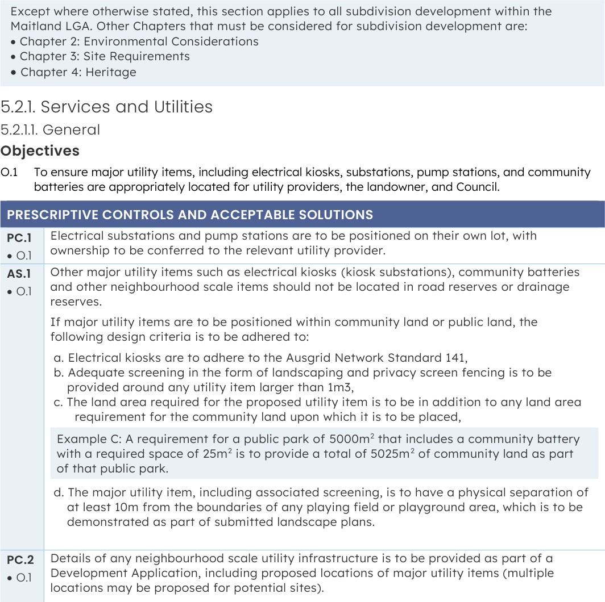
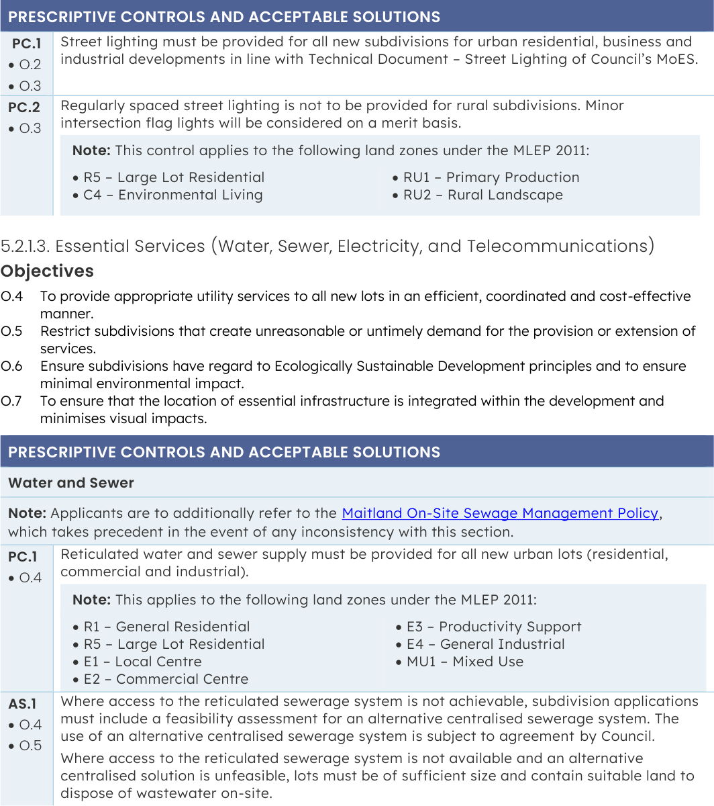
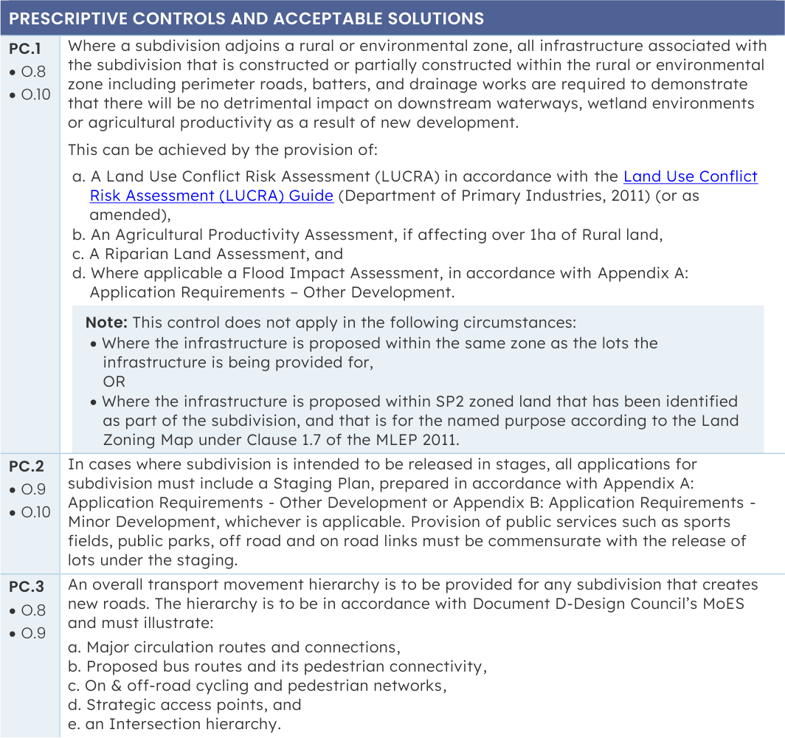
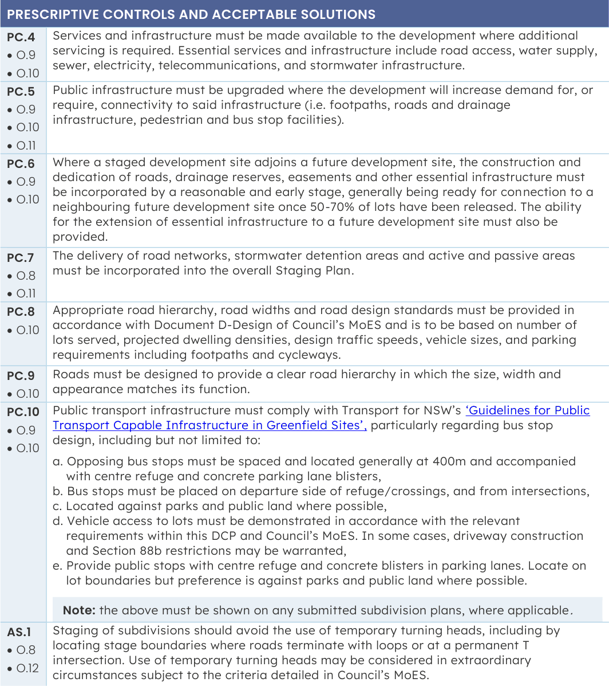
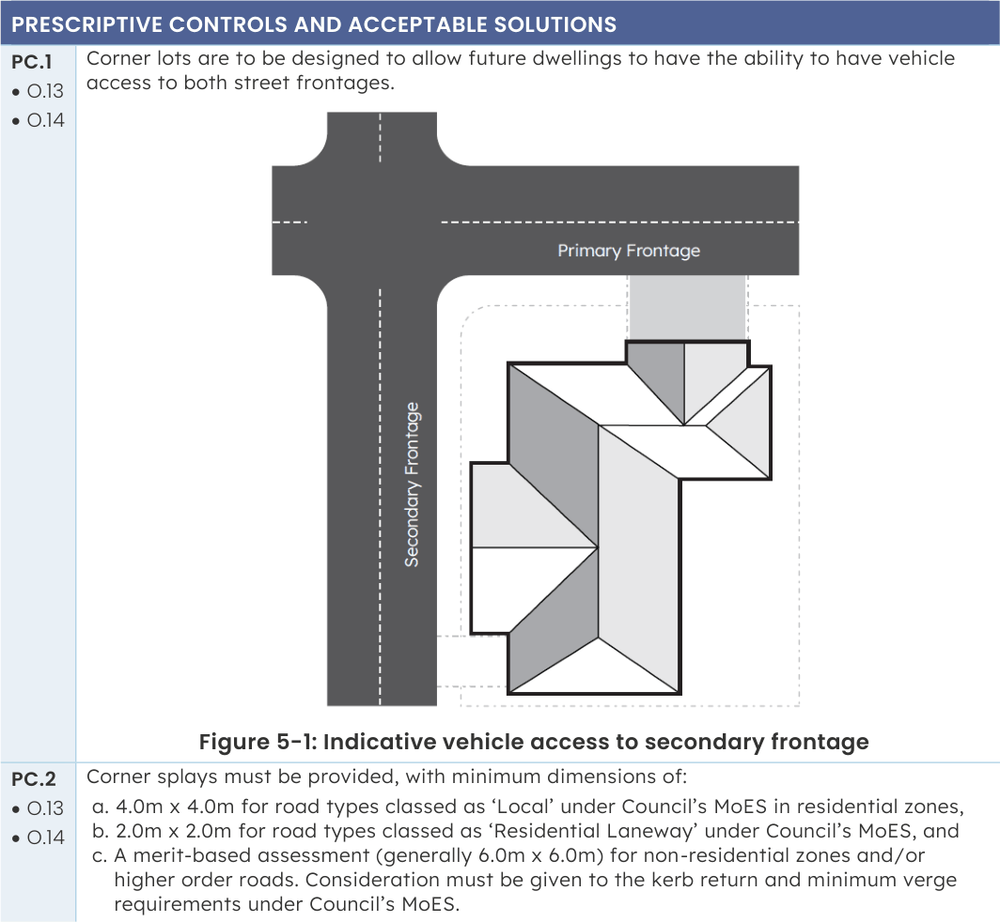
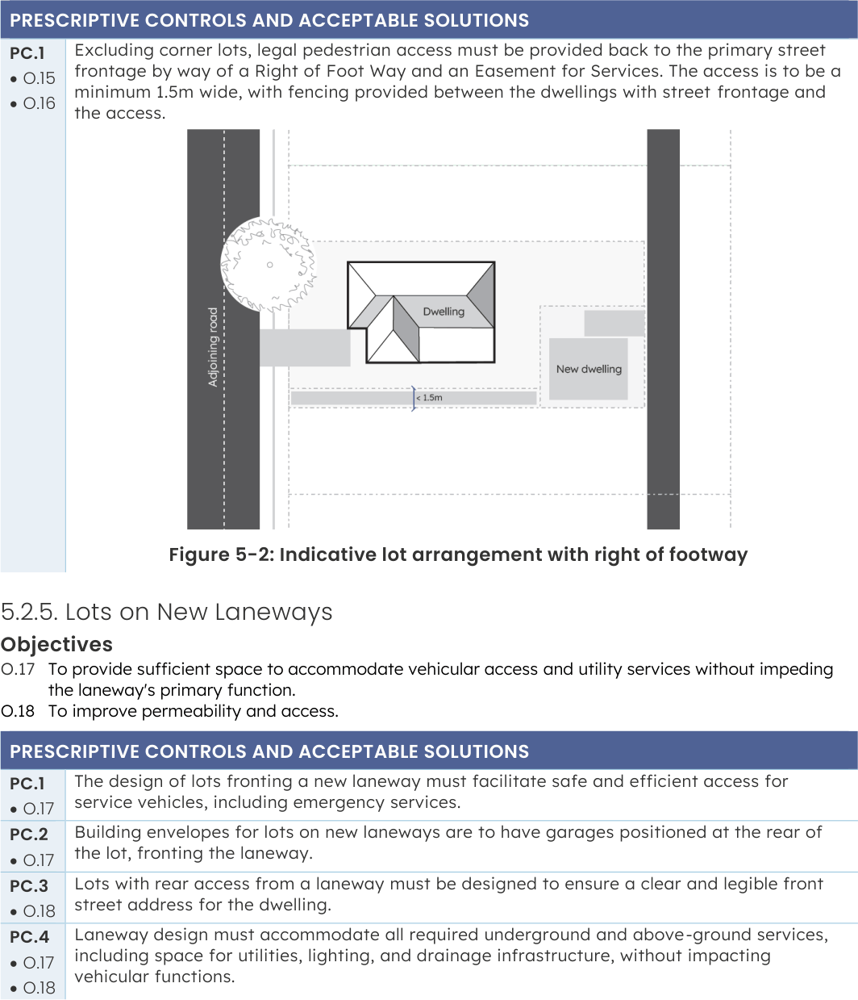
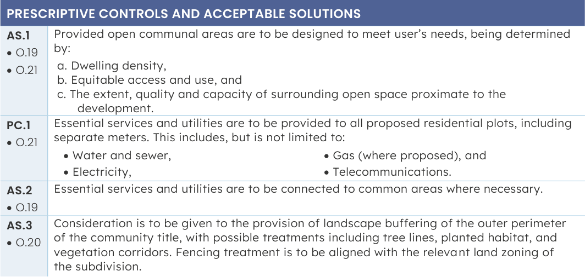
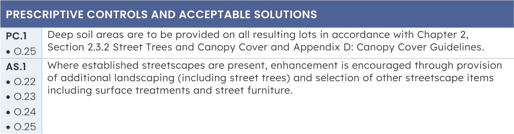
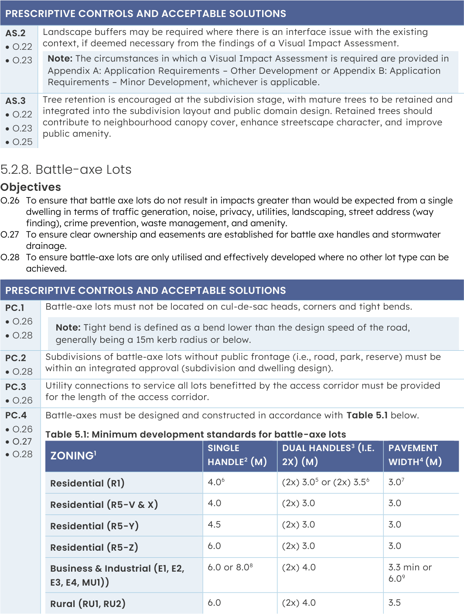
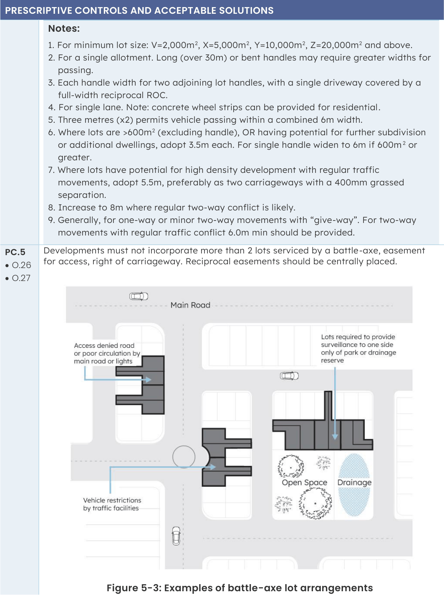

### 5.2. General Subdivision Design

> [Picture on page 5: a picture, saved as a picture (images/ch-05-00-subdivision-page-5-2.gif, 150 dpi).]
> Words printed on the picture (title and legend, copied from the PDF):
> • Chapter 4: Heritage

Except where otherwise stated, this section applies to all subdivision development within the Maitland LGA. Other Chapters that must be considered for subdivision development are:

• Chapter 2: Environmental Considerations

• Chapter 3: Site Requirements

#### 5.2.1. Services and Utilities

#### 5.2.1.1. General

#### Objectives

O.1 To ensure major utility items, including electrical kiosks, substations, pump stations, and community batteries are appropriately located for utility providers, the landowner, and Council.

#### PRESCRIPTIVE CONTROLS AND ACCEPTABLE SOLUTIONS

#### PC.1

Electrical substations and pump stations are to be positioned on their own lot, with ownership to be conferred to the relevant utility provider.

#### AS.1

Other major utility items such as electrical kiosks (kiosk substations), community batteries and other neighbourhood scale items should not be located in road reserves or drainage reserves. If major utility items are to be positioned within community land or public land, the following design criteria is to be adhered to:

a. Electrical kiosks are to adhere to the Ausgrid Network Standard 141,

b. Adequate screening in the form of landscaping and privacy screen fencing is to be provided around any utility item larger than 1m3,

c. The land area required for the proposed utility item is to be in addition to any land area requirement for the community land upon which it is to be placed, Example C: A requirement for a public park of 5000m2 that includes a community battery with a required space of 25m2 is to provide a total of 5025m2 of community land as part of that public park.

d. The major utility item, including associated screening, is to have a physical separation of at least 10m from the boundaries of any playing field or playground area, which is to be demonstrated as part of submitted landscape plans.

#### PC.2

Details of any neighbourhood scale utility infrastructure is to be provided as part of a Development Application, including proposed locations of major utility items (multiple locations may be proposed for potential sites).

#### 5.2.1.2. Street Lighting

#### Objectives

O.2 To provide lighting of public spaces for the safety of pedestrians and road users in line with Council’s MoES.

O.3 To provide street lighting where contextually and environmentally appropriate.

> [Picture on page 6: a picture, saved as a picture (images/ch-05-00-subdivision-page-6-6.gif, 150 dpi).]
> Words printed on the picture (title and legend, copied from the PDF):
> • O.2
> • O.3
> • O.3

#### PRESCRIPTIVE CONTROLS AND ACCEPTABLE SOLUTIONS

#### PC.1

Street lighting must be provided for all new subdivisions for urban residential, business and industrial developments in line with Technical Document – Street Lighting of Council’s MoES.

#### PC.2

Regularly spaced street lighting is not to be provided for rural subdivisions. Minor intersection flag lights will be considered on a merit basis. Note: This control applies to the following land zones under the MLEP 2011:

• R5 – Large Lot Residential

• C4 – Environmental Living

• RU1 – Primary Production

• RU2 – Rural Landscape

#### 5.2.1.3. Essential Services (Water, Sewer, Electricity, and Telecommunications)

#### Objectives

O.4 To provide appropriate utility services to all new lots in an efficient, coordinated and cost-effective manner.

O.5 Restrict subdivisions that create unreasonable or untimely demand for the provision or extension of services.

O.6 Ensure subdivisions have regard to Ecologically Sustainable Development principles and to ensure minimal environmental impact.

O.7 To ensure that the location of essential infrastructure is integrated within the development and minimises visual impacts.

#### PRESCRIPTIVE CONTROLS AND ACCEPTABLE SOLUTIONS

#### Water and Sewer

Note: Applicants are to additionally refer to the Maitland On-Site Sewage Management Policy, which takes precedent in the event of any inconsistency with this section.

#### PC.1

Reticulated water and sewer supply must be provided for all new urban lots (residential, commercial and industrial). Note: This applies to the following land zones under the MLEP 2011:

• E3 – Productivity Support

• E4 – General Industrial

• MU1 – Mixed Use

• R1 – General Residential

• R5 – Large Lot Residential

• E1 – Local Centre

• E2 – Commercial Centre

#### AS.1

Where access to the reticulated sewerage system is not achievable, subdivision applications must include a feasibility assessment for an alternative centralised sewerage system. The use of an alternative centralised sewerage system is subject to agreement by Council. Where access to the reticulated sewerage system is not available and an alternative centralised solution is unfeasible, lots must be of sufficient size and contain suitable land to dispose of wastewater on-site.

| PRESCRIPTIVE CONTROLS AND ACCEPTABLE SOLUTIONS |  |
|---|---|
| PC.2 | Where areas of a site are unsuitable for on-site effluent disposal, lots must be provided with a common effluent system on a suitable area under community title. |
| • O.4 |  |
| • O.5 |  |
| PC.3 • O.6 | Pump out systems must not be included within developments in the following land zones: • R1 – General Residential • E3 – Productivity Support • R5 – Large Lot Residential • E4 – General Industrial • E1 – Local Centre • MU1 – Mixed Use • E2 – Commercial Centre |
| PC.4 | Where an onsite sewer management system is required, a waste disposal area envelope is to be nominated. |
| • O.6 |  |
| • O.7 |  |
| Electricity |  |
| PC.5 • O.4 • O.5 | Underground low voltage electricity supply must occur for all new residential lots to the requirements of the electricity provider. Exceptions to this control may occur where Council and an electricity provider determine that overhead electricity supply is necessary due to flood liability of the land, or in cases where the land fronts a road supplied by existing overhead electricity distribution. Note: This control applies to the following land zonings under the MLEP 2011: • R1 – General Residential • R5 – Large Lot Residential • C4 – Environmental Living |
| PC.6 | For lots proposed for commercial and/or industrial uses, underground electricity supply must be provided to all new lots to the requirement of the electricity provider. |
| • O.4 |  |
| • O.5 |  |
| • O.7 |  |
| PC.7 • O.4 • O.5 | Low voltage electricity supply must be available to the boundary of all new rural lots. Note: This control applies to the following land zonings under the MLEP 2011: • RU1 – Primary Production • RU2 – Rural Landscape |
| PC.8 | The location, design and proposed screening of electrical kiosk substations must be shown in the development application. |
| • O.6 |  |
| • O.7 |  |
| Telecommunications |  |
| PC.9 • O.4 • O.5 | All new lots must have available connection to either: • the National Broadband Network (NBN); OR • an alternative Statutory Infrastructure Providers (SIPs) network. |

#### 5.2.2. Infrastructure and Network Delivery

#### Objectives

O.8 To ensure the staging of development and infrastructure delivery are aligned spatially and temporally.

O.9 To ensure utilities and services are planned and delivered to meet demand from development. O.10 To deliver utilities, road infrastructure, drainage and services in a manner that is safe, efficient and cost effective, and meets Council’s MoES.

O.11 To ensure design and locations of utilities infrastructure allows space for planting, water sensitive urban design and footpaths.

O.12 To ensure that where subdivision development is staged, the proposed staging allows for ongoing circulation of traffic and waste services without damaging to public land or inconveniencing road users and asset owners.

> [Picture on page 8: a picture, saved as a picture (images/ch-05-00-subdivision-page-8-13.gif, 150 dpi).]
> Words printed on the picture (title and legend, copied from the PDF):
> • O.8
> • O.10
> • O.9
> • O.10
> • O.8
> • O.9

#### PRESCRIPTIVE CONTROLS AND ACCEPTABLE SOLUTIONS

#### PC.1

Where a subdivision adjoins a rural or environmental zone, all infrastructure associated with the subdivision that is constructed or partially constructed within the rural or environmental zone including perimeter roads, batters, and drainage works are required to demonstrate that there will be no detrimental impact on downstream waterways, wetland environments or agricultural productivity as a result of new development. This can be achieved by the provision of:

a. A Land Use Conflict Risk Assessment (LUCRA) in accordance with the Land Use Conflict Risk Assessment (LUCRA) Guide (Department of Primary Industries, 2011) (or as amended),

b. An Agricultural Productivity Assessment, if affecting over 1ha of Rural land,

c. A Riparian Land Assessment, and

d. Where applicable a Flood Impact Assessment, in accordance with Appendix A: Application Requirements – Other Development. Note: This control does not apply in the following circumstances:

• Where the infrastructure is proposed within the same zone as the lots the infrastructure is being provided for, OR

• Where the infrastructure is proposed within SP2 zoned land that has been identified as part of the subdivision, and that is for the named purpose according to the Land Zoning Map under Clause 1.7 of the MLEP 2011.

#### PC.2

In cases where subdivision is intended to be released in stages, all applications for subdivision must include a Staging Plan, prepared in accordance with Appendix A: Application Requirements - Other Development or Appendix B: Application Requirements - Minor Development, whichever is applicable. Provision of public services such as sports fields, public parks, off road and on road links must be commensurate with the release of lots under the staging.

#### PC.3

An overall transport movement hierarchy is to be provided for any subdivision that creates new roads. The hierarchy is to be in accordance with Document D-Design Council’s MoES and must illustrate:

a. Major circulation routes and connections,

b. Proposed bus routes and its pedestrian connectivity,

c. On & off-road cycling and pedestrian networks,

d. Strategic access points, and

e. an Intersection hierarchy.

> [Picture on page 9: a map, saved as a picture (images/ch-05-00-subdivision-page-9-1.gif, 150 dpi); the street names and other small labels are on the picture.]

#### PC.4

Services and infrastructure must be made available to the development where additional servicing is required. Essential services and infrastructure include road access, water supply, sewer, electricity, telecommunications, and stormwater infrastructure.

#### PC.5

Public infrastructure must be upgraded where the development will increase demand for, or require, connectivity to said infrastructure (i.e. footpaths, roads and drainage infrastructure, pedestrian and bus stop facilities).

#### PC.6

Where a staged development site adjoins a future development site, the construction and dedication of roads, drainage reserves, easements and other essential infrastructure must be incorporated by a reasonable and early stage, generally being ready for connection to a neighbouring future development site once 50-70% of lots have been released. The ability for the extension of essential infrastructure to a future development site must also be provided.

#### PC.7

The delivery of road networks, stormwater detention areas and active and passive areas must be incorporated into the overall Staging Plan.

#### PC.8

Appropriate road hierarchy, road widths and road design standards must be provided in accordance with Document D-Design of Council’s MoES and is to be based on number of lots served, projected dwelling densities, design traffic speeds, vehicle sizes, and parking requirements including footpaths and cycleways.

#### PC.9

Roads must be designed to provide a clear road hierarchy in which the size, width and appearance matches its function.

#### PC.10

Public transport infrastructure must comply with Transport for NSW’s ‘Guidelines for Public Transport Capable Infrastructure in Greenfield Sites’, particularly regarding bus stop design, including but not limited to:

a. Opposing bus stops must be spaced and located generally at 400m and accompanied with centre refuge and concrete parking lane blisters,

b. Bus stops must be placed on departure side of refuge/crossings, and from intersections,

c. Located against parks and public land where possible,

d. Vehicle access to lots must be demonstrated in accordance with the relevant requirements within this DCP and Council’s MoES. In some cases, driveway construction and Section 88b restrictions may be warranted,

e. Provide public stops with centre refuge and concrete blisters in parking lanes. Locate on lot boundaries but preference is against parks and public land where possible.

Note: the above must be shown on any submitted subdivision plans, where applicable.

#### AS.1

Staging of subdivisions should avoid the use of temporary turning heads, including by locating stage boundaries where roads terminate with loops or at a permanent T intersection. Use of temporary turning heads may be considered in extraordinary circumstances subject to the criteria detailed in Council’s MoES.

#### 5.2.3. Corner Lots

#### Objectives

O.13 To ensure corner lots are of sufficient dimensions and size to contribute positively to the streetscape and residential amenity.

O.14 To ensure corner lots can accommodate minimum setback requirements from both the primary and secondary frontages.

> [Picture on page 10: a picture, saved as a picture (images/ch-05-00-subdivision-page-10-7.gif, 150 dpi).]
> Words printed on the picture (title and legend, copied from the PDF):
> • O.13
> • O.14
> • O.13
> • O.14

Figure 5-1: Indicative vehicle access to secondary frontage

#### PRESCRIPTIVE CONTROLS AND ACCEPTABLE SOLUTIONS

#### PC.1

Corner lots are to be designed to allow future dwellings to have the ability to have vehicle access to both street frontages.

Corner splays must be provided, with minimum dimensions of:

#### PC.2

a. 4.0m x 4.0m for road types classed as ‘Local’ under Council’s MoES in residential zones,

b. 2.0m x 2.0m for road types classed as ‘Residential Laneway’ under Council’s MoES, and

c. A merit-based assessment (generally 6.0m x 6.0m) for non-residential zones and/or higher order roads. Consideration must be given to the kerb return and minimum verge requirements under Council’s MoES.

#### 5.2.4. Lots on Existing Laneways

#### Objectives

O.15 To ensure infill development occurs in a coordinated manner. O.16 To ensure vehicle and pedestrian safety and residential amenity is maintained or enhanced.

> [Picture on page 11: a picture, saved as a picture (images/ch-05-00-subdivision-page-11-5.gif, 150 dpi).]
> Words printed on the picture (title and legend, copied from the PDF):
> • O.15
> • O.16

Figure 5-2: Indicative lot arrangement with right of footway

#### PRESCRIPTIVE CONTROLS AND ACCEPTABLE SOLUTIONS

#### PC.1

Excluding corner lots, legal pedestrian access must be provided back to the primary street frontage by way of a Right of Foot Way and an Easement for Services. The access is to be a minimum 1.5m wide, with fencing provided between the dwellings with street frontage and the access.

#### 5.2.5. Lots on New Laneways

#### Objectives

O.17 To provide sufficient space to accommodate vehicular access and utility services without impeding

the laneway's primary function.

O.18 To improve permeability and access.

#### PRESCRIPTIVE CONTROLS AND ACCEPTABLE SOLUTIONS

#### PC.1

The design of lots fronting a new laneway must facilitate safe and efficient access for service vehicles, including emergency services.

#### PC.2

Building envelopes for lots on new laneways are to have garages positioned at the rear of the lot, fronting the laneway.

#### PC.3

Lots with rear access from a laneway must be designed to ensure a clear and legible front street address for the dwelling.

#### PC.4

Laneway design must accommodate all required underground and above-ground services, including space for utilities, lighting, and drainage infrastructure, without impacting vehicular functions.

#### 5.2.6. Community Title Subdivision

This Section specifically applies to subdivision utilising Community Title and is to be read in conjunction with the rest of this Chapter and Clause 4.1AA of the MLEP 2011.

#### Objectives

O.19 To ensure community title subdivisions appropriately provision for proposed open space common facilities.

O.20 To assist in managing the interface between community title subdivisions and neighbouring land uses. O.21 To ensure that community title subdivisions meet the needs of future residents.

> [Picture on page 12: a picture, saved as a picture (images/ch-05-00-subdivision-page-12-9.gif, 150 dpi).]
> Words printed on the picture (title and legend, copied from the PDF):
> • O.19
> • O.21
> development.
> • O.21
> • Water and sewer,
> • Electricity,
> • O.19
> • O.20

#### PRESCRIPTIVE CONTROLS AND ACCEPTABLE SOLUTIONS

#### AS.1

Provided open communal areas are to be designed to meet user’s needs, being determined by:

a. Dwelling density,

b. Equitable access and use, and

c. The extent, quality and capacity of surrounding open space proximate to the

#### PC.1

Essential services and utilities are to be provided to all proposed residential plots, including separate meters. This includes, but is not limited to:

• Gas (where proposed), and

• Telecommunications.

Essential services and utilities are to be connected to common areas where necessary.

#### AS.2

#### AS.3

Consideration is to be given to the provision of landscape buffering of the outer perimeter of the community title, with possible treatments including tree lines, planted habitat, and vegetation corridors. Fencing treatment is to be aligned with the relevant land zoning of the subdivision.

#### 5.2.7. Subdivision Landscaping

#### Objectives

O.22 To maintain and enhance the existing character, landscape and scenic qualities of the Maitland LGA. O.23 To create, maintain and enhance streetscape and minimise visual impact of subdivision development. O.24 To ensure that new and existing streets have street trees and sufficient canopy cover to reduce the urban heat island effect.

O.25 To assist in achieving the objectives of the Maitland Environmental Sustainability Strategy 2030 in relation to improving canopy cover and reinforcing the blue-green grid.

> [Picture on page 12: a picture, saved as a picture (images/ch-05-00-subdivision-page-12-37.gif, 150 dpi).]
> Words printed on the picture (title and legend, copied from the PDF):
> • O.25
> • O.22
> • O.23
> • O.24
> • O.25

#### PRESCRIPTIVE CONTROLS AND ACCEPTABLE SOLUTIONS

#### PC.1

Deep soil areas are to be provided on all resulting lots in accordance with Chapter 2, Section 2.3.2 Street Trees and Canopy Cover and Appendix D: Canopy Cover Guidelines.

#### AS.1

Where established streetscapes are present, enhancement is encouraged through provision of additional landscaping (including street trees) and selection of other streetscape items including surface treatments and street furniture.

> [Picture on page 13: a picture, saved as a picture (images/ch-05-00-subdivision-page-13-1.gif, 150 dpi).]
> Words printed on the picture (title and legend, copied from the PDF):
> • O.22
> • O.23 Note: The circumstances in which a Visual Impact Assessment is required are provided in
> • O.22
> • O.23
> • O.25

#### AS.2

Landscape buffers may be required where there is an interface issue with the existing context, if deemed necessary from the findings of a Visual Impact Assessment.

Appendix A: Application Requirements – Other Development or Appendix B: Application Requirements – Minor Development, whichever is applicable.

#### AS.3

Tree retention is encouraged at the subdivision stage, with mature trees to be retained and integrated into the subdivision layout and public domain design. Retained trees should contribute to neighbourhood canopy cover, enhance streetscape character, and improve public amenity.

#### 5.2.8. Battle-axe Lots

#### Objectives

O.26 To ensure that battle axe lots do not result in impacts greater than would be expected from a single dwelling in terms of traffic generation, noise, privacy, utilities, landscaping, street address (way finding), crime prevention, waste management, and amenity.

O.27 To ensure clear ownership and easements are established for battle axe handles and stormwater drainage.

O.28 To ensure battle-axe lots are only utilised and effectively developed where no other lot type can be achieved.

> Words printed on the picture (title and legend, copied from the PDF):
> PC.4 Battle-axes must be designed and constructed in accordance with Table 5.1 below.

Table 5.1: Minimum development standards for battle-axe lots

#### PRESCRIPTIVE CONTROLS AND ACCEPTABLE SOLUTIONS

Battle-axe lots must not be located on cul-de-sac heads, corners and tight bends.

#### PC.1

Note: Tight bend is defined as a bend lower than the design speed of the road, generally being a 15m kerb radius or below.

#### PC.2

Subdivisions of battle-axe lots without public frontage (i.e., road, park, reserve) must be within an integrated approval (subdivision and dwelling design).

#### PC.3

Utility connections to service all lots benefitted by the access corridor must be provided for the length of the access corridor.

| O.27 • O.28 | ZONING1 Residential (R1) Residential (R5-V & X) Residential (R5-Y) Residential (R5-Z) Business & Industrial (E1, E2, E3, E4, MU1)) Rural (RU1, RU2) | SINGLE HANDLE2 (M) 4.06 4.0 4.5 6.0 6.0 or 8.08 6.0 | DUAL HANDLES3 (I.E. 2X) (M) (2x) 3.05 or (2x) 3.56 (2x) 3.0 (2x) 3.0 (2x) 3.0 (2x) 4.0 (2x) 4.0 | PAVEMENT WIDTH4 (M) 3.07 3.0 3.0 3.0 3.3 min or 6.09 3.5 |
|---|---|---|---|---|

> [Picture on page 14: a picture, saved as a picture (images/ch-05-00-subdivision-page-14-1.gif, 150 dpi).]
> Words printed on the picture (title and legend, copied from the PDF):
> passing.
> full-width reciprocal ROC.
> • O.26
> • O.27

Figure 5-3: Examples of battle-axe lot arrangements

#### Notes:

1\. For minimum lot size: V=2,000m2, X=5,000m2, Y=10,000m2, Z=20,000m2 and above.

2\. For a single allotment. Long (over 30m) or bent handles may require greater widths for

3\. Each handle width for two adjoining lot handles, with a single driveway covered by a

4\. For single lane. Note: concrete wheel strips can be provided for residential.

5\. Three metres (x2) permits vehicle passing within a combined 6m width.

6\. Where lots are >600m2 (excluding handle), OR having potential for further subdivision or additional dwellings, adopt 3.5m each. For single handle widen to 6m if 600m 2 or greater.

7\. Where lots have potential for high density development with regular traffic movements, adopt 5.5m, preferably as two carriageways with a 400mm grassed separation.

8\. Increase to 8m where regular two-way conflict is likely.

9\. Generally, for one-way or minor two-way movements with “give-way”. For two-way movements with regular traffic conflict 6.0m min should be provided.

#### PC.5

Developments must not incorporate more than 2 lots serviced by a battle-axe, easement for access, right of carriageway. Reciprocal easements should be centrally placed.
