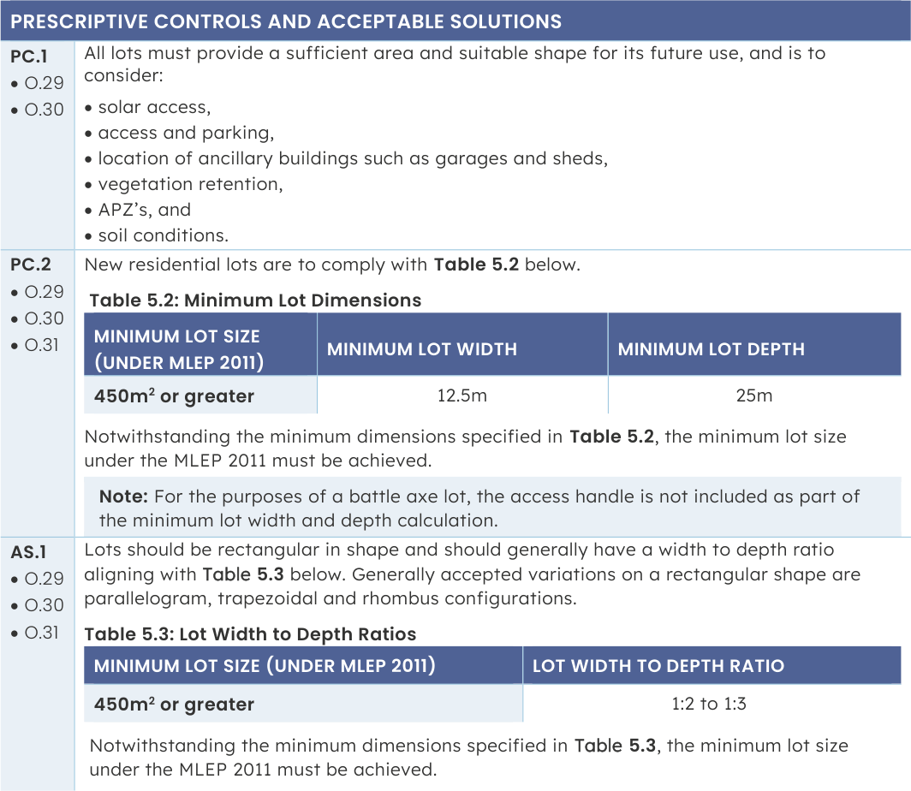
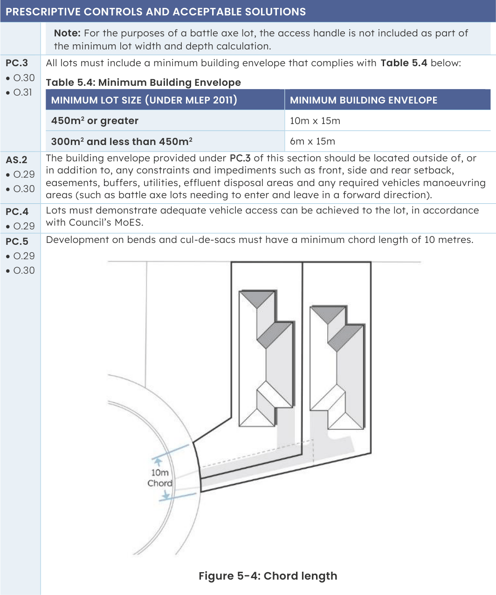
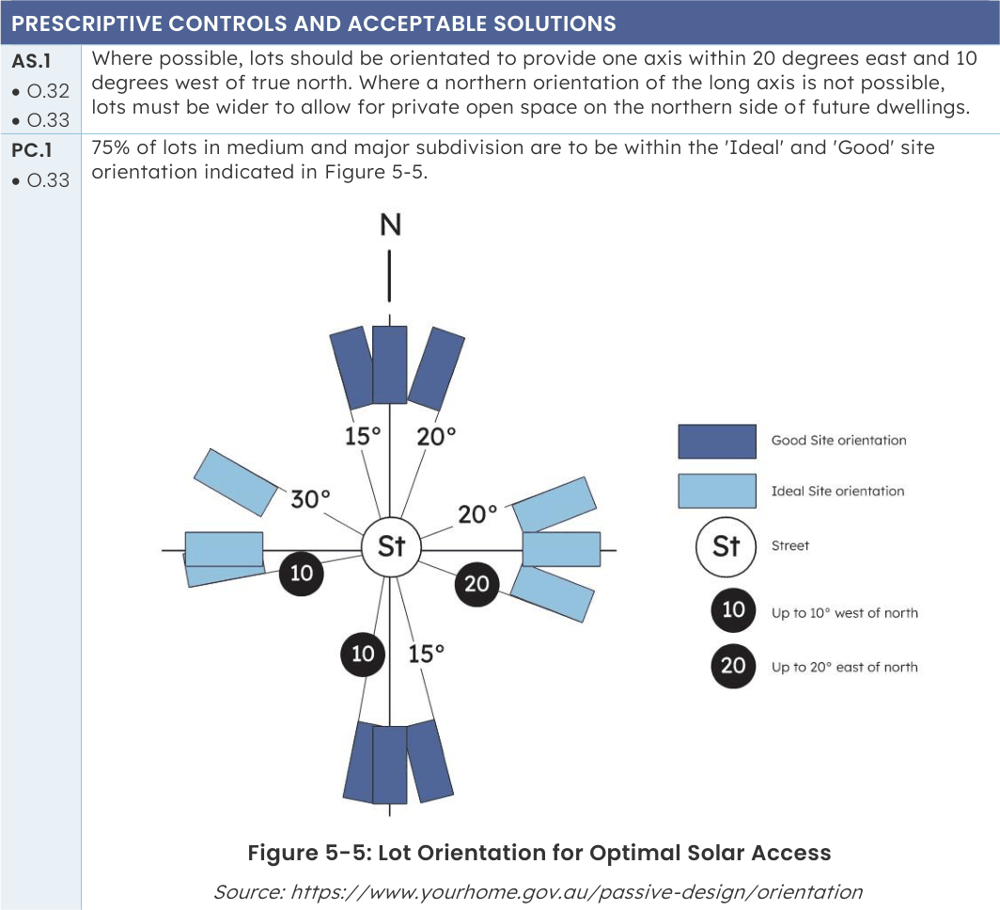
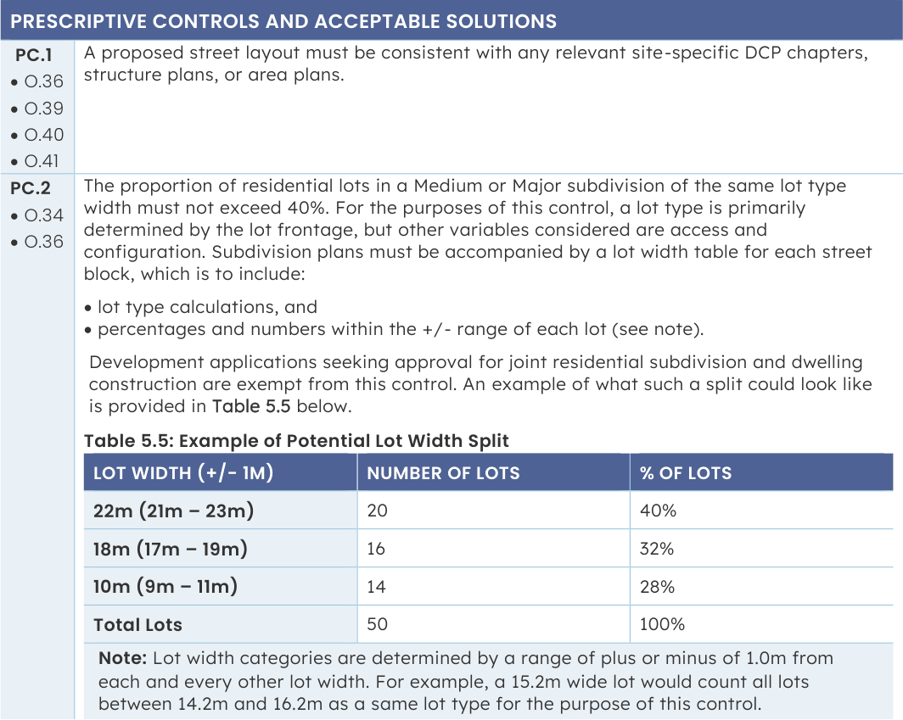
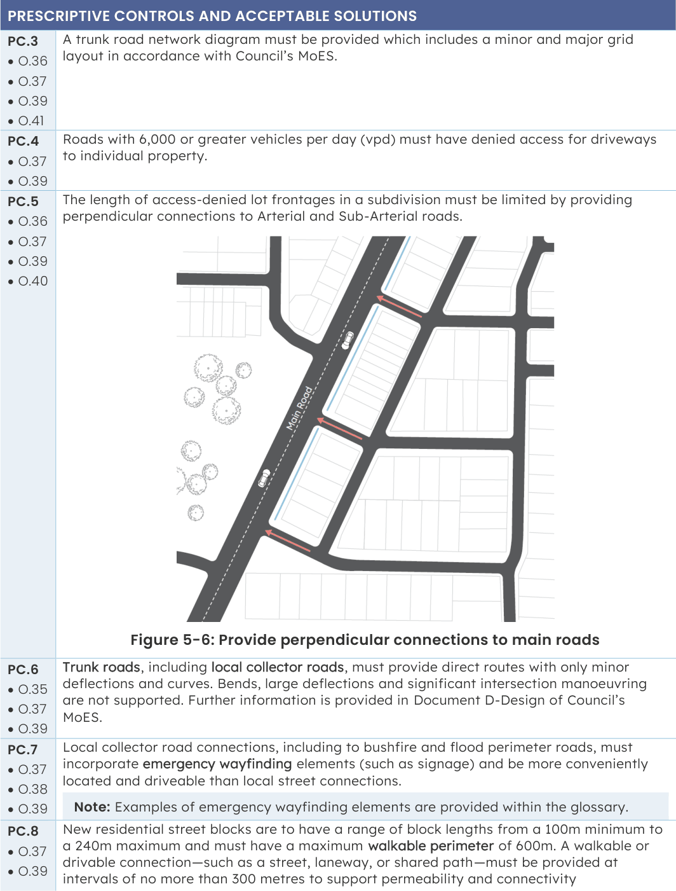
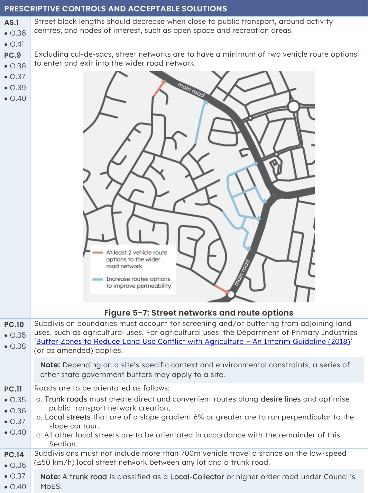
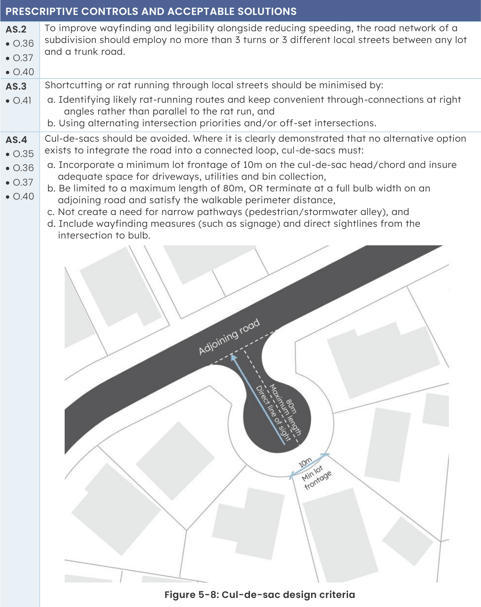
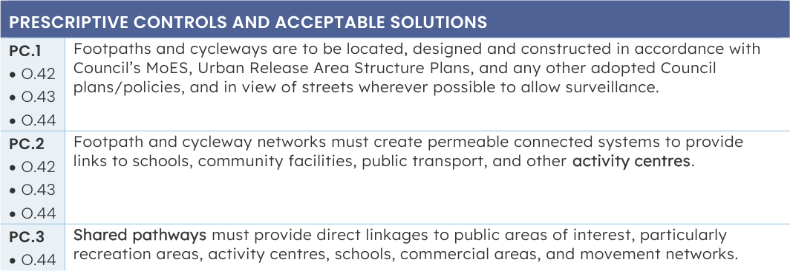

### 5.3. Residential Subdivision

Except where otherwise stated, this section applies to the following land zonings under the MLEP 2011:

• R1 – General Residential

• R5 – Large Lot Residential

#### 5.3.1. Lot Size and Dimensions

#### Objectives

O.29 To ensure all new lots have a size and shape appropriate to their proposed use, and to allow for the provision of necessary services and other requirements.

O.30 To ensure that lot shape, orientation and dimensions provide for adequate separation between adjoining residential developments for privacy and to maximise solar access for future dwellings.

O.31 To encourage a variety of lot sizes, types and design to promote housing choice, create compact settlements, attractive streetscapes, enhanced walkability and distinctive character.

> [Picture on page 15: a map, saved as a picture (images/ch-05-00-subdivision-page-15-14.gif, 150 dpi); the street names and other small labels are on the picture.]
> Words printed on the picture (title and legend, copied from the PDF):
> • O.30 • solar access,
> PC.2 New residential lots are to comply with Table 5.2 below.
> • O.31 Table 5.3: Lot Width to Depth Ratios
> 1:2 to 1:3

Table 5.2: Minimum Lot Dimensions

#### PRESCRIPTIVE CONTROLS AND ACCEPTABLE SOLUTIONS

#### PC.1

All lots must provide a sufficient area and suitable shape for its future use, and is to consider:

• access and parking,

• location of ancillary buildings such as garages and sheds,

• vegetation retention,

• APZ’s, and

• soil conditions.

#### MINIMUM LOT SIZE (UNDER MLEP 2011)

#### MINIMUM LOT WIDTH

#### MINIMUM LOT DEPTH

#### 450m2 or greater

Notwithstanding the minimum dimensions specified in Table 5.2, the minimum lot size under the MLEP 2011 must be achieved. Note: For the purposes of a battle axe lot, the access handle is not included as part of the minimum lot width and depth calculation.

#### AS.1

Lots should be rectangular in shape and should generally have a width to depth ratio aligning with Table 5.3 below. Generally accepted variations on a rectangular shape are parallelogram, trapezoidal and rhombus configurations.

#### MINIMUM LOT SIZE (UNDER MLEP 2011)

#### LOT WIDTH TO DEPTH RATIO

#### 450m2 or greater

Notwithstanding the minimum dimensions specified in Table 5.3, the minimum lot size under the MLEP 2011 must be achieved.

> [Picture on page 16: a picture, saved as a picture (images/ch-05-00-subdivision-page-16-1.gif, 150 dpi).]
> Words printed on the picture (title and legend, copied from the PDF):
> PC.3 All lots must include a minimum building envelope that complies with Table 5.4 below:
> • O.30
> • O.31
> • O.29
> • O.30
> • O.29
> • O.29
> • O.30

Table 5.4: Minimum Building Envelope

Figure 5-4: Chord length

Note: For the purposes of a battle axe lot, the access handle is not included as part of the minimum lot width and depth calculation.

| MINIMUM LOT SIZE (UNDER MLEP 2011) | MINIMUM BUILDING ENVELOPE 10m x 15m 15m |
|---|---|
| 450m2 or greater |  |
| 300m2 and less than 450m2 | 6m x |

#### AS.2

The building envelope provided under PC.3 of this section should be located outside of, or in addition to, any constraints and impediments such as front, side and rear setback, easements, buffers, utilities, effluent disposal areas and any required vehicles manoeuvring areas (such as battle axe lots needing to enter and leave in a forward direction).

#### PC.4

Lots must demonstrate adequate vehicle access can be achieved to the lot, in accordance with Council’s MoES. Development on bends and cul-de-sacs must have a minimum chord length of 10 metres.

#### PC.5

#### 5.3.2. Solar Access and Energy Efficiency

#### Objectives

O.32 To encourage the design of residential subdivisions which maximise solar access, allow flexibility in the siting of future buildings to take advantage of a northern orientation.

O.33 To enable lot shape and orientation which facilitates the design and construction of development that is energy efficient, attractive and functional, and environmentally sustainable.

> [Picture on page 17: a picture, saved as a picture (images/ch-05-00-subdivision-page-17-7.gif, 150 dpi).]
> Words printed on the picture (title and legend, copied from the PDF):
> • O.32
> • O.33
> • O.33
> Source: https://www.yourhome.gov.au/passive-design/orientation

Figure 5-5: Lot Orientation for Optimal Solar Access

#### PRESCRIPTIVE CONTROLS AND ACCEPTABLE SOLUTIONS

#### AS.1

Where possible, lots should be orientated to provide one axis within 20 degrees east and 10 degrees west of true north. Where a northern orientation of the long axis is not possible, lots must be wider to allow for private open space on the northern side of future dwellings.

#### PC.1

75% of lots in medium and major subdivision are to be within the 'Ideal' and 'Good' site orientation indicated in Figure 5-5.

#### 5.3.3. Street Layout and Block Length

This section only applies to subdivision that affects road locations, road layout, or street block lengths.

#### Objectives

O.34 To provide diversity of allotments within the streetscape of each street block by dispersing different lot widths to achieve variety and avoid large concentrations of similar housing types in any one area.

O.35 To ensure the design of any proposed residential subdivision considers natural landform features, including outlook and slopes.

O.36 To align street layouts to provide optimised access to public and community facilities, parks and public transport.

O.37 To ensure public infrastructure meets the adopted technical requirements as set out in MoES and other adopted Council policies/plans etc.

O.38 To retain and expand areas of natural habitat, and direct development away from environmentally sensitive areas.

O.39 To provide a simple and safe movement system for private vehicles, public transport, pedestrians and on-road and off-road cyclists.

O.40 To ensure adequate arrangements have been made for suitable vehicular access. O.41 To improve residential amenity and safety for active transport users, where neighbourhood streets do not operate as through traffic routes for external traffic.

> [Picture on page 18: a picture, saved as a picture (images/ch-05-00-subdivision-page-18-20.gif, 150 dpi).]
> Words printed on the picture (title and legend, copied from the PDF):
> • O.36
> • O.39
> • O.40
> • O.41
> • O.34
> • O.36

Table 5.5: Example of Potential Lot Width Split

#### PRESCRIPTIVE CONTROLS AND ACCEPTABLE SOLUTIONS

#### PC.1

A proposed street layout must be consistent with any relevant site-specific DCP chapters, structure plans, or area plans.

#### PC.2

The proportion of residential lots in a Medium or Major subdivision of the same lot type width must not exceed 40%. For the purposes of this control, a lot type is primarily determined by the lot frontage, but other variables considered are access and configuration. Subdivision plans must be accompanied by a lot width table for each street block, which is to include:

• lot type calculations, and

• percentages and numbers within the +/- range of each lot (see note). Development applications seeking approval for joint residential subdivision and dwelling construction are exempt from this control. An example of what such a split could look like is provided in Table 5.5 below.

| LOT WIDTH (+/- 1M) | NUMBER OF LOTS | % OF LOTS |
|---|---|---|
| 22m (21m – 23m) | 20 | 40% |
| 18m (17m – 19m) | 16 | 32% |
| 10m (9m – 11m) | 14 | 28% |
| Total Lots | 50 | 100% |

Note: Lot width categories are determined by a range of plus or minus of 1.0m from each and every other lot width. For example, a 15.2m wide lot would count all lots between 14.2m and 16.2m as a same lot type for the purpose of this control.

> [Picture on page 19: a map, saved as a picture (images/ch-05-00-subdivision-page-19-1.gif, 150 dpi); the street names and other small labels are on the picture.]

Figure 5-6: Provide perpendicular connections to main roads

#### PC.3

A trunk road network diagram must be provided which includes a minor and major grid layout in accordance with Council’s MoES.

#### PC.4

Roads with 6,000 or greater vehicles per day (vpd) must have denied access for driveways to individual property.

#### PC.5

The length of access-denied lot frontages in a subdivision must be limited by providing perpendicular connections to Arterial and Sub-Arterial roads.

#### PC.6

Trunk roads, including local collector roads, must provide direct routes with only minor deflections and curves. Bends, large deflections and significant intersection manoeuvring are not supported. Further information is provided in Document D-Design of Council’s MoES.

#### PC.7

Local collector road connections, including to bushfire and flood perimeter roads, must incorporate emergency wayfinding elements (such as signage) and be more conveniently located and driveable than local street connections. Note: Examples of emergency wayfinding elements are provided within the glossary.

#### PC.8

New residential street blocks are to have a range of block lengths from a 100m minimum to a 240m maximum and must have a maximum walkable perimeter of 600m. A walkable or drivable connection—such as a street, laneway, or shared path—must be provided at intervals of no more than 300 metres to support permeability and connectivity

> [Picture on page 20: a map, saved as a picture (images/ch-05-00-subdivision-page-20-1.gif, 150 dpi); the street names and other small labels are on the picture.]
> Words printed on the picture (title and legend, copied from the PDF):
> public transport network creation,
> • O.37 Note: A trunk road is classified as a Local-Collector or higher order road under Council’s

Figure 5-7: Street networks and route options

#### AS.1

Street block lengths should decrease when close to public transport, around activity centres, and nodes of interest, such as open space and recreation areas.

#### PC.9

Excluding cul-de-sacs, street networks are to have a minimum of two vehicle route options to enter and exit into the wider road network.

#### PC.10

Subdivision boundaries must account for screening and/or buffering from adjoining land uses, such as agricultural uses. For agricultural uses, the Department of Primary Industries ‘Buffer Zones to Reduce Land Use Conflict with Agriculture – An Interim Guideline (2018)’ (or as amended) applies. Note: Depending on a site’s specific context and environmental constraints, a series of other state government buffers may apply to a site. Roads are to be orientated as follows:

#### PC.11

a. Trunk roads must create direct and convenient routes along desire lines and optimise

b. Local streets that are of a slope gradient 6% or greater are to run perpendicular to the

c. All other local streets are to be orientated in accordance with the remainder of this

#### PC.14

Subdivisions must not include more than 700m vehicle travel distance on the low-speed (≤50 km/h) local street network between any lot and a trunk road.

> [Picture on page 21: a picture, saved as a picture (images/ch-05-00-subdivision-page-21-1.gif, 150 dpi).]
> Words printed on the picture (title and legend, copied from the PDF):
> • O.36
> • O.37
> • O.40
> • O.41
> • O.35
> • O.36
> • O.37
> • O.40
> intersection to bulb.

Figure 5-8: Cul-de-sac design criteria

#### AS.2

To improve wayfinding and legibility alongside reducing speeding, the road network of a subdivision should employ no more than 3 turns or 3 different local streets between any lot and a trunk road.

Shortcutting or rat running through local streets should be minimised by:

#### AS.3

a. Identifying likely rat-running routes and keep convenient through-connections at right angles rather than parallel to the rat run, and

b. Using alternating intersection priorities and/or off-set intersections.

#### AS.4

Cul-de-sacs should be avoided. Where it is clearly demonstrated that no alternative option exists to integrate the road into a connected loop, cul-de-sacs must:

a. Incorporate a minimum lot frontage of 10m on the cul-de-sac head/chord and insure adequate space for driveways, utilities and bin collection,

b. Be limited to a maximum length of 80m, OR terminate at a full bulb width on an adjoining road and satisfy the walkable perimeter distance,

c. Not create a need for narrow pathways (pedestrian/stormwater alley), and

d. Include wayfinding measures (such as signage) and direct sightlines from the

#### 5.3.4. Active Transport Networks

Except where otherwise stated, this section only applies to Medium and Major Subdivision, as defined in Section 5.1.3.

#### Objectives

O.42 To provide acceptable levels of access, safety and convenience for all active transport, such as pedestrians and cyclists.

O.43 To ensure local streets are well-connected to an active transport network. O.44 To ensure residential street and path design creates safe pedestrian and cyclist routes that connect to adjoining streets, schools, open spaces and activity centres in accordance with MoES.

> [Picture on page 22: a picture, saved as a picture (images/ch-05-00-subdivision-page-22-10.gif, 150 dpi).]
> Words printed on the picture (title and legend, copied from the PDF):
> • O.42
> • O.43
> • O.44
> • O.42
> • O.43
> • O.44
> • O.44

#### PRESCRIPTIVE CONTROLS AND ACCEPTABLE SOLUTIONS

#### PC.1

Footpaths and cycleways are to be located, designed and constructed in accordance with Council’s MoES, Urban Release Area Structure Plans, and any other adopted Council plans/policies, and in view of streets wherever possible to allow surveillance.

#### PC.2

Footpath and cycleway networks must create permeable connected systems to provide links to schools, community facilities, public transport, and other activity centres.

#### PC.3

Shared pathways must provide direct linkages to public areas of interest, particularly recreation areas, activity centres, schools, commercial areas, and movement networks.

#### 5.3.5. Open Space and Recreation

Unless otherwise stated (PC.2 and PC.4), the controls under this section only apply to subdivision that proposes the creation of open space, local parks, drainage reserves, and recreation facilities.

#### Objectives

O.45 To provide sufficient local open space that is primarily for the active and passive recreational needs of residents.

O.46 To enhance the appearance and amenity of urban development through integrated open space. O.47 To encourage the use of drought resilient practices in open space maintenance, such as recycled water networks.

O.48 To ensure that public open space of appropriate quantity and quality is provided in order to meet the recreational and social needs of the community.

| PRESCRIPTIVE CONTROLS AND ACCEPTABLE SOLUTIONS |  |
|---|---|
| PC.1 • O.45 • O.48 | The number, size and location of open space, local parks and recreation facilities must be consistent with Council’s requirements, Council’s Community Infrastructure Strategy and the relevant Section 7.11 Contributions Plan. Note: Sites which are developed outside of an applicable s7.11 Contributions Plan that does not provides size, location, and costing for recreational open space shall be assessed on a case-by-case basis. |
| AS.1 | Public open space within a subdivision should form part of a pedestrian/cycleway network that connects residential areas and other facilities. |
| • O.46 |  |
| AS.2 | Public open space areas should be functional, well-located and distributed appropriately throughout the subdivision to maximise accessibility and provide for passive and active |
| • O.45 |  |

| PRESCRIPTIVE CONTROLS AND ACCEPTABLE SOLUTIONS |  |
|---|---|
| • O.47 | recreational opportunities. Generally, at least 80% of residential lots should be within 400m of the nearest public open space area. |
| • O.48 |  |
| PC.2 • O.47 | Residential subdivision within 3km of a Water Treatment Plant are to connect open space and recreation facilities to recycled water networks to improve drought resilience and limit the use of drinking water for care and maintenance purposes. |
| AS.3 | All open space should be edged with a public street or public footpath with dwellings addressing the space. |
| • O.46 |  |
| PC.3 • O.46 | Public open space must be designed with consideration given to Crime Prevention Through Environmental Design (CPTED) principles. Note: Controls for CPTED consideration are provided under Section 3.7 of Chapter 3: Site Requirements. |
| PC.4 • O.46 | Fencing must be provided for residential lots where the lot adjoins public reserves or infrastructure. Council may require that the fencing be of open style/pool style depending on the topography and landscape character of the adjoining reserve. Where open style fencing is provided, the landscape design will need to demonstrate that the location of plantings is adequate to ensure a suitable level of privacy for the adjoining residential lots, reduce the visual impact of the fencing and improve the landscape quality of the reserve. |

#### 5.3.6. Entry Features

Excepting PC.1 in this section, the following controls only apply to Major residential subdivisions, as defined in Section 5.1.3.

#### Objectives

O.49 To consider the potential cumulative visual impacts of entry features. O.50 To regulate entry feature locations, sizes, and life spans.

| PRESCRIPTIVE CONTROLS AND ACCEPTABLE SOLUTIONS |  |
|---|---|
| PC.1 | Entry features must only be provided in conjunction with Major residential subdivisions i.e. 50 lots or more. |
| • O.50 |  |
| PC.2 | Entry feature locations must be identified within the Development Application for a subdivision. |
| • O.50 |  |
| AS.1 • O.49 • O.50 | Entry features without additional assessment are limited to a size of 20m 2, with a maximum height of 4m. If the proposed entry feature is in exceedance of these dimensions, a Visual Impact Assessment must be prepared which includes a view analysis and assessment of the entry feature. |
| PC.3 | Entry features must only be located on private land. |
| • O.50 |  |
| PC.4 | Entry features must not impede on vehicle sight lines. |
| • O.49 |  |
| • O.50 |  |
