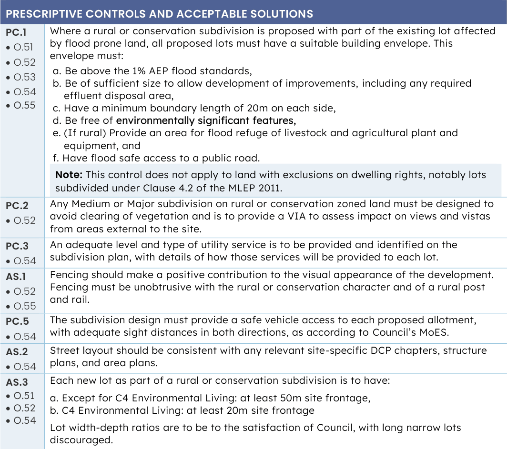

### 5.4. Rural and Conservation Subdivision

This section specifically applies to the following land zonings under the MLEP 2011:

• RU1 – Primary Production

• RU2 – Rural Landscape

• C3 – Environmental Management

• C4 – Environmental Living

#### Objectives

O.51 To protect productive agricultural land and avoid fragmentation of rural land. O.52 To ensure subdivisions are designed to maintain and enhance the rural or conservation character and scenic landscape of the Maitland LGA, particularly along ridgelines, low lying areas, and valleys which may be viewed from above.

O.53 To ensure that the extent and intensity of rural subdivision within hazardous flood areas, including floodways, is flood-sensitive and provides habitable areas above the floodplain.

O.54 To ensure rural and conservation allotments are of sufficient size, shape, and servicing to cater for a range of rural or conservation land uses.

O.55 To minimise potential land use conflicts within rural / non-urban zones or other adjoining zones.

> [Picture on page 24: a map, saved as a picture (images/ch-05-00-subdivision-page-24-17.gif, 150 dpi); the street names and other small labels are on the picture.]
> Words printed on the picture (title and legend, copied from the PDF):
> effluent disposal area,

#### PRESCRIPTIVE CONTROLS AND ACCEPTABLE SOLUTIONS

#### PC.1

Where a rural or conservation subdivision is proposed with part of the existing lot affected by flood prone land, all proposed lots must have a suitable building envelope. This envelope must:

a. Be above the 1% AEP flood standards,

b. Be of sufficient size to allow development of improvements, including any required

c. Have a minimum boundary length of 20m on each side,

d. Be free of environmentally significant features,

e. (If rural) Provide an area for flood refuge of livestock and agricultural plant and

f. Have flood safe access to a public road. Note: This control does not apply to land with exclusions on dwelling rights, notably lots subdivided under Clause 4.2 of the MLEP 2011.

#### PC.2

Any Medium or Major subdivision on rural or conservation zoned land must be designed to avoid clearing of vegetation and is to provide a VIA to assess impact on views and vistas from areas external to the site.

#### PC.3

An adequate level and type of utility service is to be provided and identified on the subdivision plan, with details of how those services will be provided to each lot.

#### AS.1

Fencing should make a positive contribution to the visual appearance of the development. Fencing must be unobtrusive with the rural or conservation character and of a rural post and rail.

#### PC.5

The subdivision design must provide a safe vehicle access to each proposed allotment, with adequate sight distances in both directions, as according to Council’s MoES.

#### AS.2

Street layout should be consistent with any relevant site-specific DCP chapters, structure plans, and area plans. Each new lot as part of a rural or conservation subdivision is to have:

a. Except for C4 Environmental Living: at least 50m site frontage,

b. C4 Environmental Living: at least 20m site frontage

#### AS.3

Lot width-depth ratios are to be to the satisfaction of Council, with long narrow lots discouraged.
