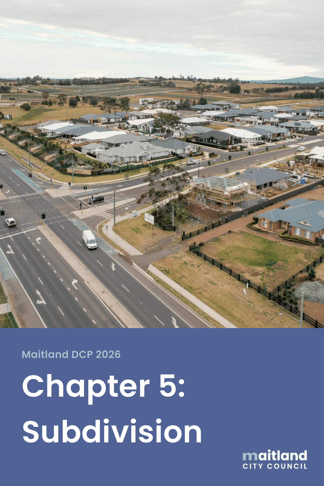

# Maitland Development Control Plan 2026 - Chapter 5 Subdivision

> This chapter is split into 5 section file(s), one per numbered heading, in the order they appear in the PDF.

Source PDF: [MDCP 2026 - Chapter 5 Subdivision.pdf](MDCP%202026%20-%20Chapter%205%20Subdivision.pdf)

> [Picture on page 1: a picture, saved as a picture (images/ch-05-00-subdivision-page-1-1.gif, 150 dpi).]

### Maitland DCP 2026

## Chapter 5: Subdivision

### Table of Contents – Chapter 5: Subdivision

5.1. Introduction ....................................................................................................................................................3 5.1.1. Application .................................................................................................................................................... 3 5.1.2. Relationship to other Chapters .............................................................................................................. 3 5.1.3. Scale of Subdivisions ................................................................................................................................. 4 5.1.4. Intent of this Chapter ............................................................................................................................... 4 5.2. General Subdivision Design ................................................................................................................... 5 5.2.1. Services and Utilities ................................................................................................................................. 5 5.2.1.1. General ......................................................................................................................................................... 5 5.2.1.2. Street Lighting ........................................................................................................................................... 6 5.2.1.3. Essential Services (Water, Sewer, Electricity, and Telecommunications) ......................... 6 5.2.2. Infrastructure and Network Delivery ................................................................................................... 8 5.2.3. Corner Lots ................................................................................................................................................. 10 5.2.4. Lots on Existing Laneways ..................................................................................................................... 11 5.2.5. Lots on New Laneways ............................................................................................................................ 11 5.2.6. Community Title Subdivision ................................................................................................................ 12 5.2.7. Subdivision Landscaping ....................................................................................................................... 12 5.2.8. Battle-axe Lots .......................................................................................................................................... 13 5.3. Residential Subdivision .......................................................................................................................... 15 5.3.1. Lot Size and Dimensions ........................................................................................................................ 15 5.3.2. Solar Access and Energy Efficiency .................................................................................................... 17 5.3.3. Street Layout and Block Length .......................................................................................................... 18 5.3.4. Active Transport Networks.................................................................................................................... 22 5.3.5. Open Space and Recreation ................................................................................................................. 22 5.3.6. Entry Features ........................................................................................................................................... 23 5.4. Rural Subdivision ...................................................................................................................................... 24 5.5. Industrial and Commercial Subdivision ......................................................................................... 25

<!-- sections -->
## Sections

1. [5.1 Introduction](01-5-1-introduction.md)
2. [5.2 General Subdivision Design](02-5-2-general-subdivision-design.md)
3. [5.3 Residential Subdivision](03-5-3-residential-subdivision.md)
4. [5.4 Rural and Conservation Subdivision](04-5-4-rural-and-conservation-subdivision.md)
5. [5.5 Industrial and Commercial Subdivision](05-5-5-industrial-and-commercial-subdivision.md)
