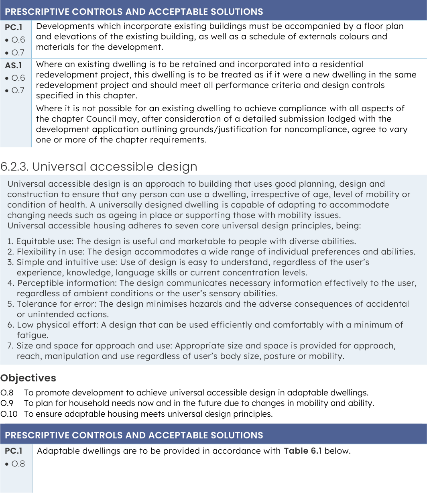

#### 6.2.2. Development incorporating existing dwellings

#### Objectives

O.6 To ensure that the streetscape character is retained and incorporated into new development where possible.

O.7 To ensure that new and existing dwelling(s) are complementary and provide a high standard of amenity and privacy.

> [Picture on page 5: a picture, saved as a picture (images/ch-06-00-residential-uses-page-5-7.gif, 150 dpi).]
> Words printed on the picture (title and legend, copied from the PDF):
> • O.6
> • O.7
> • O.6
> • O.7

#### PRESCRIPTIVE CONTROLS AND ACCEPTABLE SOLUTIONS

#### PC.1

Developments which incorporate existing buildings must be accompanied by a floor plan and elevations of the existing building, as well as a schedule of externals colours and materials for the development.

#### AS.1

Where an existing dwelling is to be retained and incorporated into a residential redevelopment project, this dwelling is to be treated as if it were a new dwelling in the same redevelopment project and should meet all performance criteria and design controls specified in this chapter. Where it is not possible for an existing dwelling to achieve compliance with all aspects of the chapter Council may, after consideration of a detailed submission lodged with the development application outlining grounds/justification for noncompliance, agree to vary one or more of the chapter requirements.
