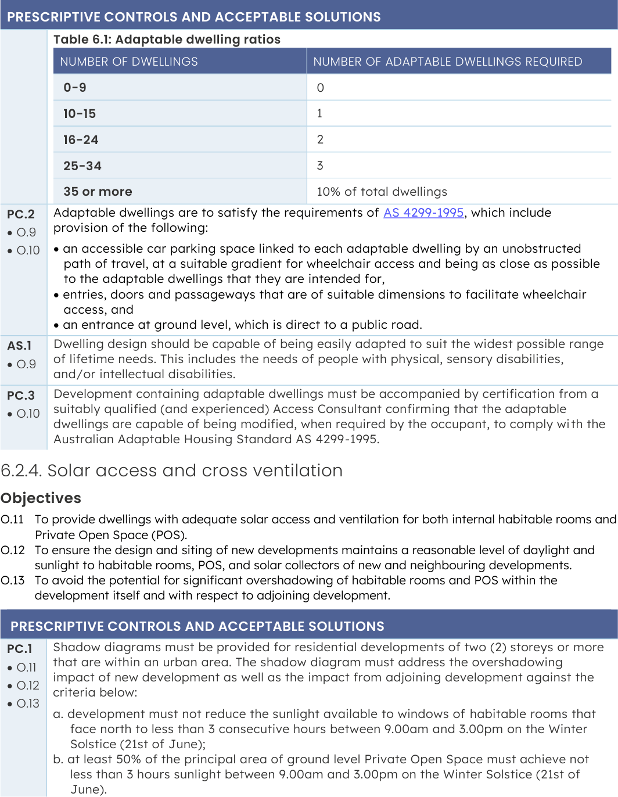

#### 6.2.3. Universal accessible design

> Words printed on the picture (title and legend, copied from the PDF):
> or unintended actions.

Universal accessible design is an approach to building that uses good planning, design and construction to ensure that any person can use a dwelling, irrespective of age, level of mobility or condition of health. A universally designed dwelling is capable of adapting to accommodate changing needs such as ageing in place or supporting those with mobility issues. Universal accessible housing adheres to seven core universal design principles, being:

1\. Equitable use: The design is useful and marketable to people with diverse abilities.

2\. Flexibility in use: The design accommodates a wide range of individual preferences and abilities.

3\. Simple and intuitive use: Use of design is easy to understand, regardless of the user’s experience, knowledge, language skills or current concentration levels.

4\. Perceptible information: The design communicates necessary information effectively to the user, regardless of ambient conditions or the user’s sensory abilities.

5\. Tolerance for error: The design minimises hazards and the adverse consequences of accidental

6\. Low physical effort: A design that can be used efficiently and comfortably with a minimum of

7\. Size and space for approach and use: Appropriate size and space is provided for approach,

reach, manipulation and use regardless of user’s body size, posture or mobility.

#### Objectives

O.8 To promote development to achieve universal accessible design in adaptable dwellings. O.9 To plan for household needs now and in the future due to changes in mobility and ability. O.10 To ensure adaptable housing meets universal design principles.

> Words printed on the picture (title and legend, copied from the PDF):
> PC.1 Adaptable dwellings are to be provided in accordance with Table 6.1 below.

#### PRESCRIPTIVE CONTROLS AND ACCEPTABLE SOLUTIONS

> [Picture on page 6: a map, saved as a picture (images/ch-06-00-residential-uses-page-6-1.gif, 150 dpi); the street names and other small labels are on the picture.]
> Words printed on the picture (title and legend, copied from the PDF):
> NUMBER OF DWELLINGS
> NUMBER OF ADAPTABLE DWELLINGS REQUIRED
> 10% of total dwellings
> • O.10 • an accessible car parking space linked to each adaptable dwelling by an unobstructed

Table 6.1: Adaptable dwelling ratios

#### 10-15 16-24 25-34
