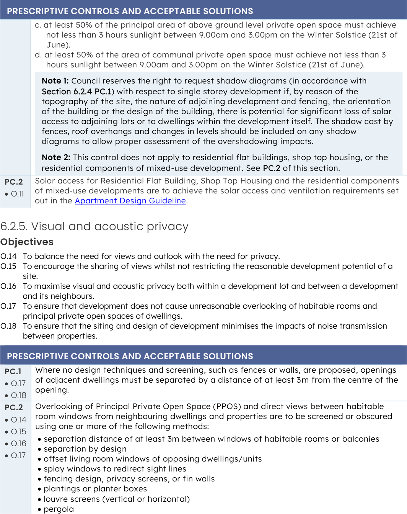

#### 6.2.4. Solar access and cross ventilation

#### Objectives

O.11 To provide dwellings with adequate solar access and ventilation for both internal habitable rooms and Private Open Space (POS).

O.12 To ensure the design and siting of new developments maintains a reasonable level of daylight and sunlight to habitable rooms, POS, and solar collectors of new and neighbouring developments.

O.13 To avoid the potential for significant overshadowing of habitable rooms and POS within the development itself and with respect to adjoining development.

#### PRESCRIPTIVE CONTROLS AND ACCEPTABLE SOLUTIONS

#### PC.1

Shadow diagrams must be provided for residential developments of two (2) storeys or more that are within an urban area. The shadow diagram must address the overshadowing impact of new development as well as the impact from adjoining development against the criteria below:

a. development must not reduce the sunlight available to windows of habitable rooms that face north to less than 3 consecutive hours between 9.00am and 3.00pm on the Winter Solstice (21st of June);

b. at least 50% of the principal area of ground level Private Open Space must achieve not less than 3 hours sunlight between 9.00am and 3.00pm on the Winter Solstice (21st of June).

> [Picture on page 7: a picture, saved as a picture (images/ch-06-00-residential-uses-page-7-1.gif, 150 dpi).]
> Words printed on the picture (title and legend, copied from the PDF):
> • O.11

c. at least 50% of the principal area of above ground level private open space must achieve not less than 3 hours sunlight between 9.00am and 3.00pm on the Winter Solstice (21st of June).

d. at least 50% of the area of communal private open space must achieve not less than 3 hours sunlight between 9.00am and 3.00pm on the Winter Solstice (21st of June). Note 1: Council reserves the right to request shadow diagrams (in accordance with Section 6.2.4 PC.1) with respect to single storey development if, by reason of the topography of the site, the nature of adjoining development and fencing, the orientation of the building or the design of the building, there is potential for significant loss of solar access to adjoining lots or to dwellings within the development itself. The shadow cast by fences, roof overhangs and changes in levels should be included on any shadow diagrams to allow proper assessment of the overshadowing impacts. Note 2: This control does not apply to residential flat buildings, shop top housing, or the residential components of mixed-use development. See PC.2 of this section.

#### PC.2

Solar access for Residential Flat Building, Shop Top Housing and the residential components of mixed-use developments are to achieve the solar access and ventilation requirements set out in the Apartment Design Guideline.
