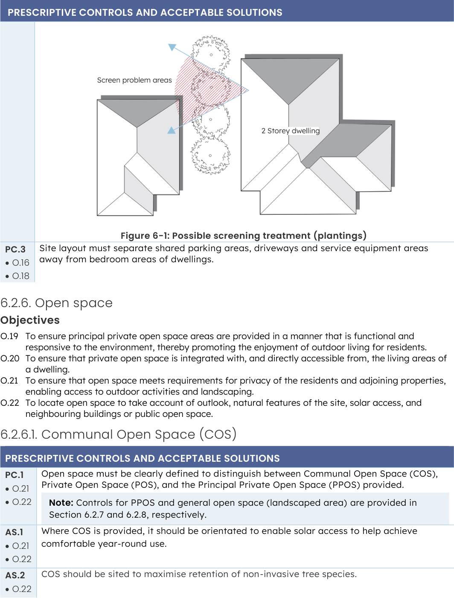

#### 6.2.5. Visual and acoustic privacy

#### Objectives

O.14 To balance the need for views and outlook with the need for privacy. O.15 To encourage the sharing of views whilst not restricting the reasonable development potential of a site.

O.16 To maximise visual and acoustic privacy both within a development lot and between a development and its neighbours.

O.17 To ensure that development does not cause unreasonable overlooking of habitable rooms and principal private open spaces of dwellings.

O.18 To ensure that the siting and design of development minimises the impacts of noise transmission between properties.

#### PRESCRIPTIVE CONTROLS AND ACCEPTABLE SOLUTIONS

#### PC.1

Where no design techniques and screening, such as fences or walls, are proposed, openings of adjacent dwellings must be separated by a distance of at least 3m from the centre of the opening.

#### PC.2

Overlooking of Principal Private Open Space (PPOS) and direct views between habitable room windows from neighbouring dwellings and properties are to be screened or obscured using one or more of the following methods:

• separation distance of at least 3m between windows of habitable rooms or balconies

• separation by design

• offset living room windows of opposing dwellings/units

• splay windows to redirect sight lines

• fencing design, privacy screens, or fin walls

• plantings or planter boxes

• louvre screens (vertical or horizontal)

• pergola

> [Picture on page 8: a picture, saved as a picture (images/ch-06-00-residential-uses-page-8-1.gif, 150 dpi).]
> Words printed on the picture (title and legend, copied from the PDF):
> • O.16
> • O.18

Figure 6-1: Possible screening treatment (plantings)

#### PC.3

Site layout must separate shared parking areas, driveways and service equipment areas away from bedroom areas of dwellings.
