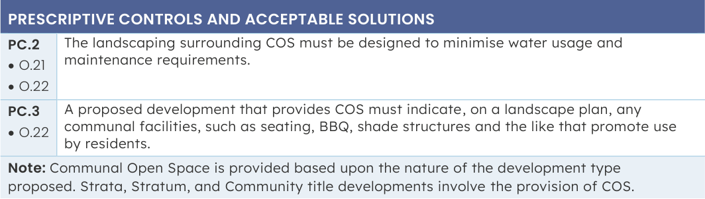

#### 6.2.6.1. Communal Open Space (COS)

> Words printed on the picture (title and legend, copied from the PDF):
> • O.22 Note: Controls for PPOS and general open space (landscaped area) are provided in

#### PRESCRIPTIVE CONTROLS AND ACCEPTABLE SOLUTIONS

#### PC.1

Open space must be clearly defined to distinguish between Communal Open Space (COS), Private Open Space (POS), and the Principal Private Open Space (PPOS) provided.

Section 6.2.7 and 6.2.8, respectively.

#### AS.1

Where COS is provided, it should be orientated to enable solar access to help achieve comfortable year-round use.

COS should be sited to maximise retention of non-invasive tree species.

#### AS.2

> [Picture on page 9: a picture, saved as a picture (images/ch-06-00-residential-uses-page-9-1.gif, 150 dpi).]
> Words printed on the picture (title and legend, copied from the PDF):
> • O.21
> • O.22
> • O.22

#### PC.2

The landscaping surrounding COS must be designed to minimise water usage and maintenance requirements.

#### PC.3

A proposed development that provides COS must indicate, on a landscape plan, any communal facilities, such as seating, BBQ, shade structures and the like that promote use by residents.

Note: Communal Open Space is provided based upon the nature of the development type proposed. Strata, Stratum, and Community title developments involve the provision of COS.
