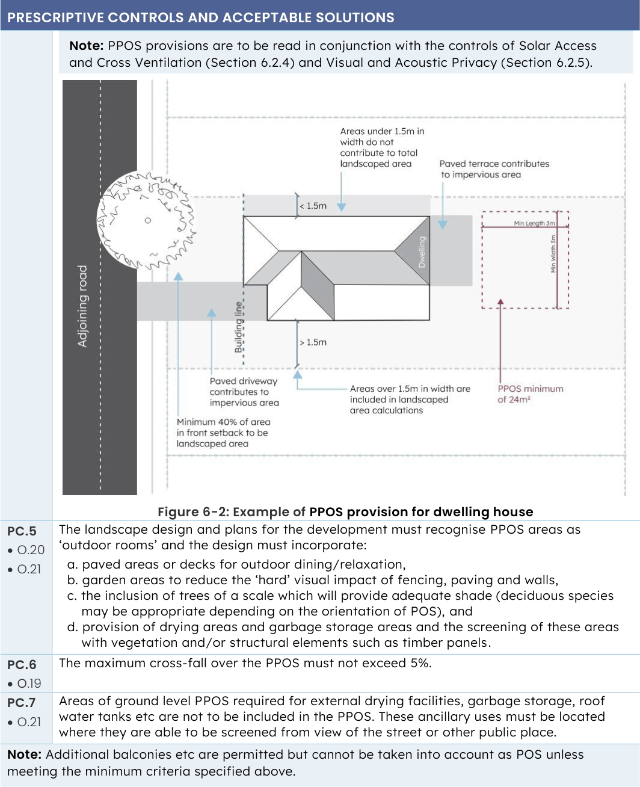

#### 6.2.7. Principal Private Open Space (PPOS)

| PRESCRIPTIVE CONTROLS AND ACCEPTABLE SOLUTIONS |  |
|---|---|
| PC.4 • O.19 | PPOS is to be provided in accordance with Table 6.2. Table 6.2: Minimum Principal Private Open Space DWELLING TYPE MINIMUM PPOS Dwelling house 24m2 and at least 3m wide and 3m long. Dwelling houses in rural 24m2 and at least 3m wide and 3m long. or environmental zones 24m2 and at least 3m wide and 3m long (each). Dual occupancies and OR Semi-detached dwellings 16m2 at least 3m wide and 3m long, and an additional balcony with a minimum width of 2.5m. Secondary dwellings 24m2 and at least 3m wide and 3m long. 24m2 and at least 3m wide and 3m long, Attached dwellings OR 16m2 at least 3m wide and 3m long, and an additional balcony with a minimum width of 2.5m. 1 – 2 bedrooms: 16m2 and at least 3m wide and 3m long. 3+ bedrooms: 24m2 and at least 3m wide and 3m long. Multi-dwelling housing OR 16m2 at least 3m wide and 3m long, and an additional balcony with a minimum width of 2.5m. Boarding houses and Co- 24m2 and at least 3m wide and 3m long. living housing Group homes 24m2 and at least 3m wide and 3m long. Residential flat buildings Refer to Apartment Design Guide (or equivalent). Shop top housing Refer to Apartment Design Guide (or equivalent). Seniors housing Refer to Apartment Design Guide (or equivalent). |

> [Picture on page 10: a picture, saved as a picture (images/ch-06-00-residential-uses-page-10-1.gif, 150 dpi).]
> Words printed on the picture (title and legend, copied from the PDF):
> • O.20
> • O.21
> • O.19
> • O.21

Figure 6-2: Example of PPOS provision for dwelling house

Note: PPOS provisions are to be read in conjunction with the controls of Solar Access and Cross Ventilation (Section 6.2.4) and Visual and Acoustic Privacy (Section 6.2.5).

#### PC.5

The landscape design and plans for the development must recognise PPOS areas as ‘outdoor rooms’ and the design must incorporate:

a. paved areas or decks for outdoor dining/relaxation,

b. garden areas to reduce the ‘hard’ visual impact of fencing, paving and walls,

c. the inclusion of trees of a scale which will provide adequate shade (deciduous species may be appropriate depending on the orientation of POS), and

d. provision of drying areas and garbage storage areas and the screening of these areas with vegetation and/or structural elements such as timber panels. The maximum cross-fall over the PPOS must not exceed 5%.

#### PC.6

#### PC.7

Areas of ground level PPOS required for external drying facilities, garbage storage, roof water tanks etc are not to be included in the PPOS. These ancillary uses must be located where they are able to be screened from view of the street or other public place.

Note: Additional balconies etc are permitted but cannot be taken into account as POS unless meeting the minimum criteria specified above.
