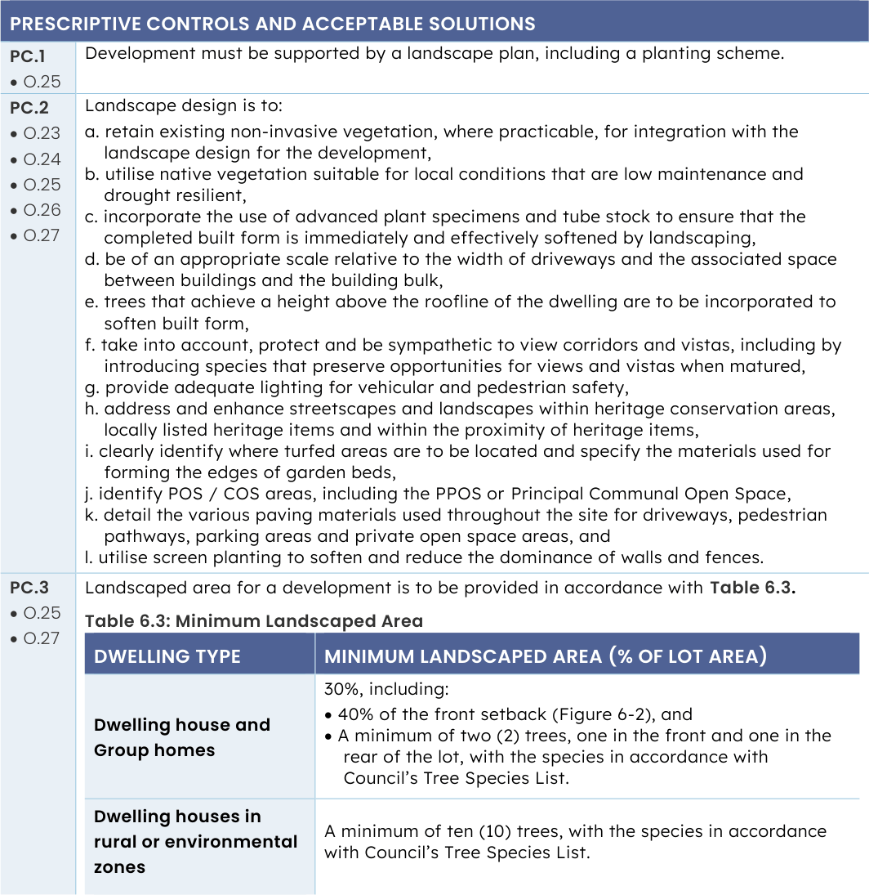

#### 6.2.8. Landscaping and landscaped area

#### Objectives

O.23 To enhance the appearance and amenity of new development for the benefit of users and the community in general.

O.24 To encourage the use of water efficient landscape systems embracing the principles of Water Sensitive Urban Design (WSUD).

O.25 To integrate building and landscape elements. O.26 To protect existing landscape features including natural landforms, watercourses and native vegetation and integrate them, where possible, with new development.

O.27 To blend new development into an established streetscape and neighbourhood character.

> [Picture on page 11: a picture, saved as a picture (images/ch-06-00-residential-uses-page-11-11.gif, 150 dpi).]
> Words printed on the picture (title and legend, copied from the PDF):
> • O.25
> • O.23
> • O.24
> • O.25
> • O.26
> drought resilient,
> • O.27 completed built form is immediately and effectively softened by landscaping,
> soften built form,

#### PRESCRIPTIVE CONTROLS AND ACCEPTABLE SOLUTIONS

Development must be supported by a landscape plan, including a planting scheme.

#### PC.1

Landscape design is to:

#### PC.2

a. retain existing non-invasive vegetation, where practicable, for integration with the landscape design for the development,

b. utilise native vegetation suitable for local conditions that are low maintenance and

c. incorporate the use of advanced plant specimens and tube stock to ensure that the

d. be of an appropriate scale relative to the width of driveways and the associated space between buildings and the building bulk,

e. trees that achieve a height above the roofline of the dwelling are to be incorporated to

f. take into account, protect and be sympathetic to view corridors and vistas, including by introducing species that preserve opportunities for views and vistas when matured,

g. provide adequate lighting for vehicular and pedestrian safety,

h. address and enhance streetscapes and landscapes within heritage conservation areas, locally listed heritage items and within the proximity of heritage items,

i. clearly identify where turfed areas are to be located and specify the materials used for forming the edges of garden beds,

|  | j. identify POS / COS areas, including the PPOS or Principal Communal Open Space, |
|---|---|
|  | k. detail the various paving materials used throughout the site for driveways, pedestrian |
|  | pathways, parking areas and private open space areas, and |
|  | l. utilise screen planting to soften and reduce the dominance of walls and fences. |
| PC.3 | Landscaped area for a development is to be provided in accordance with Table 6.3. |
| • O.25 | Table 6.3: Minimum Landscaped Area |
| • O.27 | DWELLING TYPE MINIMUM LANDSCAPED AREA (% OF LOT AREA) 30%, including: Dwelling house and • 40% of the front setback (Figure 6-2), and • A minimum of two (2) trees, one in the front and one in the Group homes rear of the lot, with the species in accordance with Council’s Tree Species List. Dwelling houses in rural or environmental A minimum of ten (10) trees, with the species in accordance with Council’s Tree Species List. zones |

|  | DWELLING TYPE MINIMUM LANDSCAPED AREA (% OF LOT AREA) 50% minus 100m2, including: Dual occupancies and • 25% of the front setback, and Semi-detached • A minimum of two (2) trees, one in the front and one in the dwellings rear of the lot, with the species in accordance with Council’s Tree Species List. Secondary dwellings 10%, including a minimum of 50% behind the building line. 10%, including a minimum of one (1) tree along each building Attached dwellings frontage, with the species in accordance with Council’s Tree Species List. Multi-dwelling 15%, including a minimum of one (1) tree per five (5) dwellings, with the species in accordance with Council’s Tree housing Species List. Boarding houses and 20% Co-living housing Residential flat 20%, including: • A minimum of one (1) tree per five (5) dwellings, with the buildings species in accordance with Council’s Tree Species List. Shop top housing Refer to Apartment Design Guide (or equivalent). Seniors housing Refer to Apartment Design Guide (or equivalent). Note 1: The minimum landscaped area is in addition to the PPOS requirements under Section 6.2.7. Additionally, the minimum landscaped area contributes to the minimum unbuilt area requirements stipulated in Section 6.2.9. Note 2: Areas less than 1.5m in width are not included in the landscaped area calculation. |
|---|---|
| AS.1 • O.24 | Except for dwelling houses, the landscape design for a development should integrate with the stormwater management scheme, having regard to relevant WSUD principles. |
