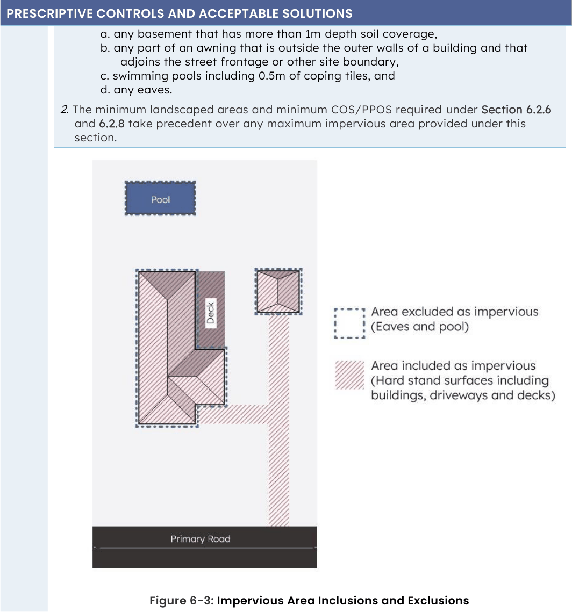

#### 6.2.9. Impervious area

This section is to be read in conjunction with Section 6.2.6 Open Space and Section 6.2.8 Landscaping & Landscaped Area. The minimum landscaped areas and minimum COS/PPOS required under Section 6.2.6 and 6.2.8 take precedent over any maximum impervious area provided under this section.

#### Objectives

O.28 To ensure the density of new residential development is sympathetic to the locality. O.29 To ensure that development minimises impervious surfaces and maintains a balance of amenity, solar access and privacy between ‘built’ and ‘unbuilt’ areas.

O.30 To ensure dwellings can meet requirements relating to landscaped area, privacy, solar access, internal site circulation, and open space.

#### PRESCRIPTIVE CONTROLS AND ACCEPTABLE SOLUTIONS

#### PC.1

• O.28

• O.29

Impervious area must satisfy the requirements detailed in Table 6.4. All development application site plans for residential development are to provide a detailed ‘percentage impervious area’ calculation, including having regard to the requirements of Sections 6.2.6 and 6.2.8.

• O.30

#### Table 6.4: Maximum Impervious Area

| DWELLING TYPE AND LOT AREA RANGE | MAXIMUM IMPERVIOUS AREA (NOTE 2) 75% |
|---|---|
| Dwelling house <700m2 |  |
| Dwelling house 700m2 – <1500m2 | 60% |
| Dwelling house 1500m2 – <2500m2 | 50% |
| Dwelling house 2500m2 - <4000m2 | 1,000m2 |
| Dwelling houses Over 4,000m2 | 1,250m2 |
| Dual occupancies and Semi-detached | 75% |
| dwellings |  |
| Attached dwellings | 80% |
| Multi-dwelling housing | 75% |
| Boarding houses and Co-living housing | 80% |
| Group homes | 80% |
| Residential flat buildings | 80% |
| Shop top housing | 100% |
| Where Seniors housing SEPP, |  |
| applicable refer to Housing multi-dwelling housing or residential flat buildings. Notes |  |
| 1. Maximum impervious area means the proportion of a site area covered by surfaces |  |
| that water is unable to penetrate. This includes, but is not limited to, buildings, |  |
| driveways, sheds, and garages. However, the following are not included for the |  |
| purpose of calculating maximum impervious area: |  |

> [Picture on page 14: a picture, saved as a picture (images/ch-06-00-residential-uses-page-14-1.gif, 150 dpi).]

Figure 6-3: Impervious Area Inclusions and Exclusions

a. any basement that has more than 1m depth soil coverage,

b. any part of an awning that is outside the outer walls of a building and that adjoins the street frontage or other site boundary,

c. swimming pools including 0.5m of coping tiles, and

d. any eaves.

2\. The minimum landscaped areas and minimum COS/PPOS required under Section 6.2.6 and 6.2.8 take precedent over any maximum impervious area provided under this section.
