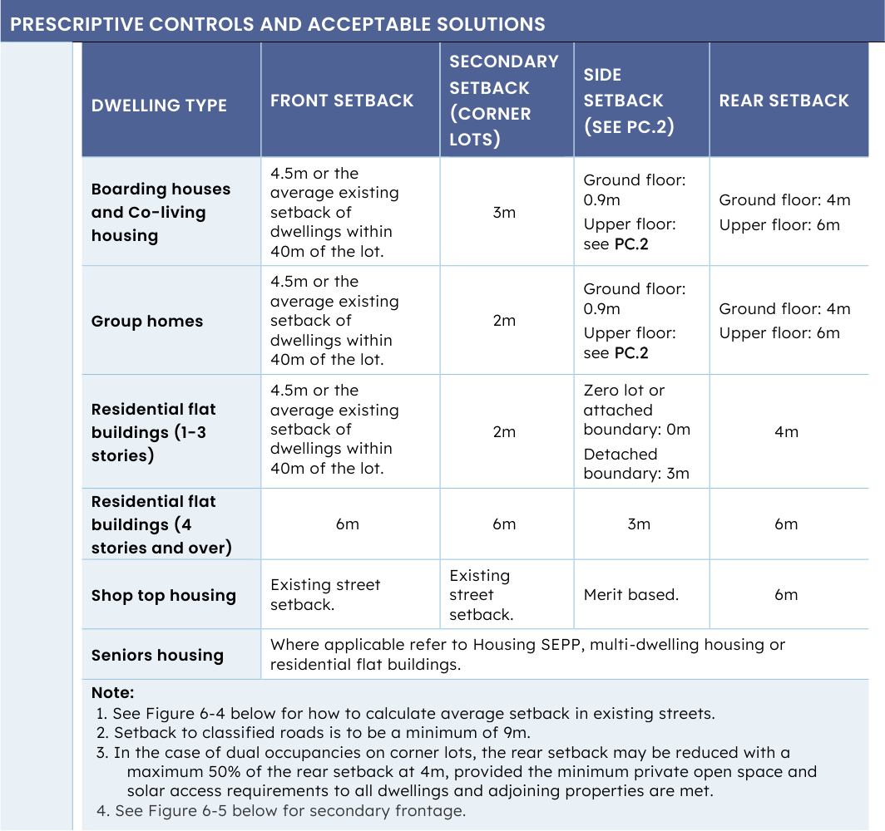
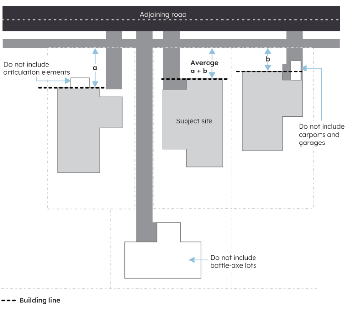
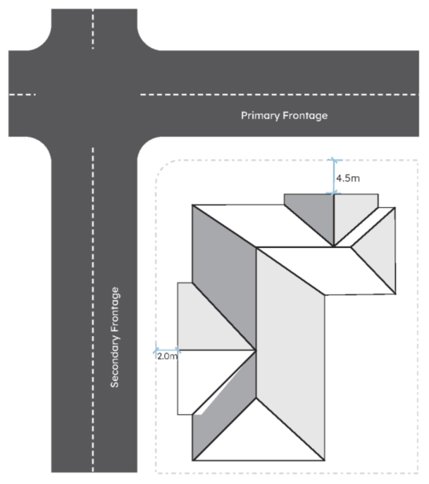
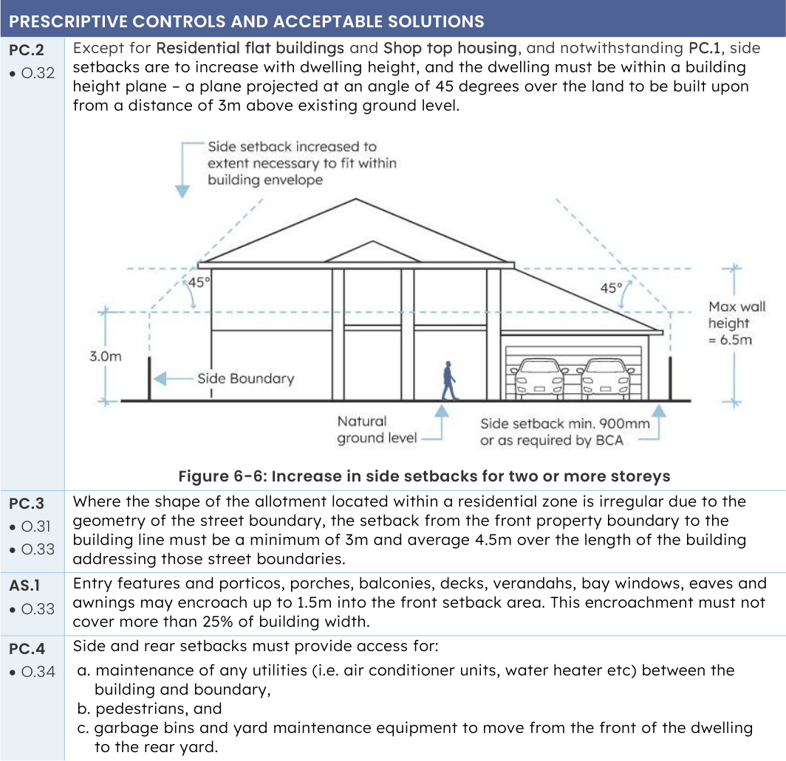

#### 6.2.10. Housing setbacks

#### Objectives

O.31 To ensure that housing provides a consistent presentation to the road among similar typologies. O.32 To reduce overall bulk and scale of development. O.33 To facilitate the opportunity for variability in design in areas of residential density. O.34 To improve site impermeability and circulation.

| PRESCRIPTIVE CONTROLS AND ACCEPTABLE SOLUTIONS |  |
|---|---|
| PC.1 • O.31 | Setbacks for a development are to be provided in accordance with Table 6.5. Table 6.5: Housing setbacks (minimum) SECONDARY SIDE SETBACK DWELLING TYPE FRONT SETBACK SETBACK REAR SETBACK (CORNER (SEE PC.2) LOTS) 4.5m or the Ground floor: average existing 0.9m Ground floor: 4m Dwelling house setback of 2mNote 4 dwellings within Upper floor: Upper floor: 6m 40m of the lot. Note 1 see PC.2 Dwelling house on <5,000m2: 10m <5,000m2: 6m <5,000m2:4m <5,000m2: 4m R5 Large Lot >5,000m2: 20m >5,000m2:10m >5,000m2: 6m >5,000m2: 6m Residential Dwelling houses in 20m 15m 10m 10m rural zones Dwelling houses in environmental 20m 10m 6m 6m zones 4.5m or the Ground floor: Ground floor: 4m Dual occupancies, average existing 0.9m Upper floor: 6m Semi-detached setback of 2m Upper floor: Corner Lots: see dwellings dwellings within see PC.2 40m of the lot. Note 3 <900m2: 3m Secondary Equal to or behind the front building line of the 900m2 - <1500m2: dwellings primary dwelling. 5m >1500m2: 10m 4.5m or the Zero lot or On rear lane: 1m average existing attached Attached setback of boundary: 0m All other cases: dwellings within 2m Ensure PPOS and dwellings Detached landscaped area 40m of the lot. boundary: is met. 0.9m 4.5m or the Ground floor: average existing Multi-dwelling setback of 0.9m Ground floor: 4m 2m housing dwellings within Upper floor: Upper floor: 6m 40m of the lot. see PC.2 |

> [Picture on page 16: a map, saved as a picture (images/ch-06-00-residential-uses-page-16-1.gif, 150 dpi); the street names and other small labels are on the picture.]
> Words printed on the picture (title and legend, copied from the PDF):
> Ground floor: 4m
> Upper floor: 6m
> 4.5m or the
> 40m of the lot.
> Ground floor: 4m
> Upper floor: 6m
> 4.5m or the
> 40m of the lot.
> Zero lot or
> 4.5m or the
> 40m of the lot.
> stories and over)
> Shop top housing
> Where applicable refer to Housing SEPP, multi-dwelling housing or
> residential flat buildings.
> 1\. See Figure 6-4 below for how to calculate average setback in existing streets.
> 2\. Setback to classified roads is to be a minimum of 9m.
> 3\. In the case of dual occupancies on corner lots, the rear setback may be reduced with a
> maximum 50% of the rear setback at 4m, provided the minimum private open space and
> solar access requirements to all dwellings and adjoining properties are met.
> 4\. See Figure 6-5 below for secondary frontage.

#### SECONDARY

#### SIDE

#### SETBACK

#### SETBACK REAR SETBACK

#### DWELLING TYPE

#### FRONT SETBACK

(CORNER

(SEE PC.2)

#### LOTS)

> [Picture on page 17: a picture, saved as a picture (images/ch-06-00-residential-uses-page-17-1.gif, 150 dpi).]

#### Figure 6-4: Housing Setbacks average of existing lots

> [Picture on page 17: a picture, saved as a picture (images/ch-06-00-residential-uses-page-17-3.gif, 150 dpi).]

#### Figure 6-5: Secondary setback for corner lots

> [Picture on page 18: a picture, saved as a picture (images/ch-06-00-residential-uses-page-18-1.gif, 150 dpi).]
> Words printed on the picture (title and legend, copied from the PDF):
> • O.32
> • O.31
> • O.33
> • O.33
> • O.34
> building and boundary,
> to the rear yard.

Figure 6-6: Increase in side setbacks for two or more storeys

#### PC.2

Except for Residential flat buildings and Shop top housing, and notwithstanding PC.1, side setbacks are to increase with dwelling height, and the dwelling must be within a building height plane – a plane projected at an angle of 45 degrees over the land to be built upon from a distance of 3m above existing ground level.

#### PC.3

Where the shape of the allotment located within a residential zone is irregular due to the geometry of the street boundary, the setback from the front property boundary to the building line must be a minimum of 3m and average 4.5m over the length of the building addressing those street boundaries.

#### AS.1

Entry features and porticos, porches, balconies, decks, verandahs, bay windows, eaves and awnings may encroach up to 1.5m into the front setback area. This encroachment must not cover more than 25% of building width. Side and rear setbacks must provide access for:

#### PC.4

a. maintenance of any utilities (i.e. air conditioner units, water heater etc) between the

b. pedestrians, and

c. garbage bins and yard maintenance equipment to move from the front of the dwelling
