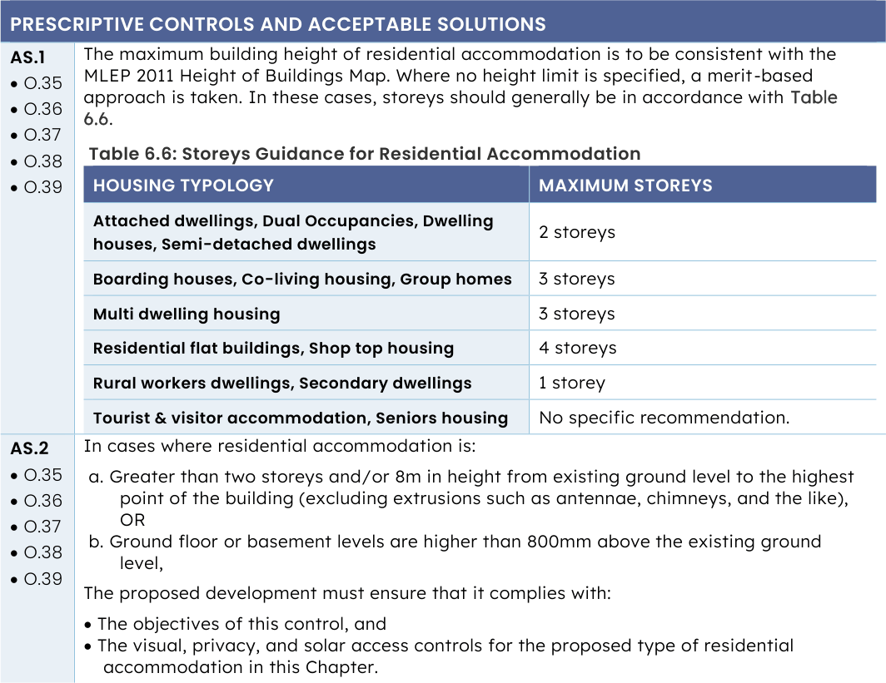

#### 6.2.11. Residential building height

#### Objectives

O.35 To provide guidance for where no building heights apply under the MLEP 2011. O.36 To ensure that the height of new development is not excessive and relates well to topography, the current local character and any future desired local character.

O.37 To respond to site topography and slope by stepping building heights/floor levels to minimise cut and/or fill and not result in excessive scale or bulk.

O.38 To minimise impact on key view-lines or appreciation of significant natural features or heritage items. O.39 To minimise overshadowing and impacts on views and privacy of adjacent dwellings and their private open space.

> [Picture on page 19: a map, saved as a picture (images/ch-06-00-residential-uses-page-19-11.gif, 150 dpi); the street names and other small labels are on the picture.]
> Words printed on the picture (title and legend, copied from the PDF):
> accommodation in this Chapter.

Table 6.6: Storeys Guidance for Residential Accommodation

#### PRESCRIPTIVE CONTROLS AND ACCEPTABLE SOLUTIONS

#### AS.1

The maximum building height of residential accommodation is to be consistent with the MLEP 2011 Height of Buildings Map. Where no height limit is specified, a merit-based approach is taken. In these cases, storeys should generally be in accordance with Table 6.6.

| HOUSING TYPOLOGY | MAXIMUM STOREYS storeys |
|---|---|
| Attached dwellings, Dual Occupancies, Dwelling | 2 |
| houses, Semi-detached dwellings |  |
| Boarding houses, Co-living housing, Group homes | 3 storeys |
| Multi dwelling housing | 3 storeys |
| Residential flat buildings, Shop top housing | 4 storeys |
| Rural workers dwellings, Secondary dwellings | 1 storey |
| Tourist & visitor accommodation, Seniors housing | No specific recommendation. |

In cases where residential accommodation is:

#### AS.2

a. Greater than two storeys and/or 8m in height from existing ground level to the highest point of the building (excluding extrusions such as antennae, chimneys, and the like), OR

b. Ground floor or basement levels are higher than 800mm above the existing ground

The proposed development must ensure that it complies with:

• The objectives of this control, and

• The visual, privacy, and solar access controls for the proposed type of residential
