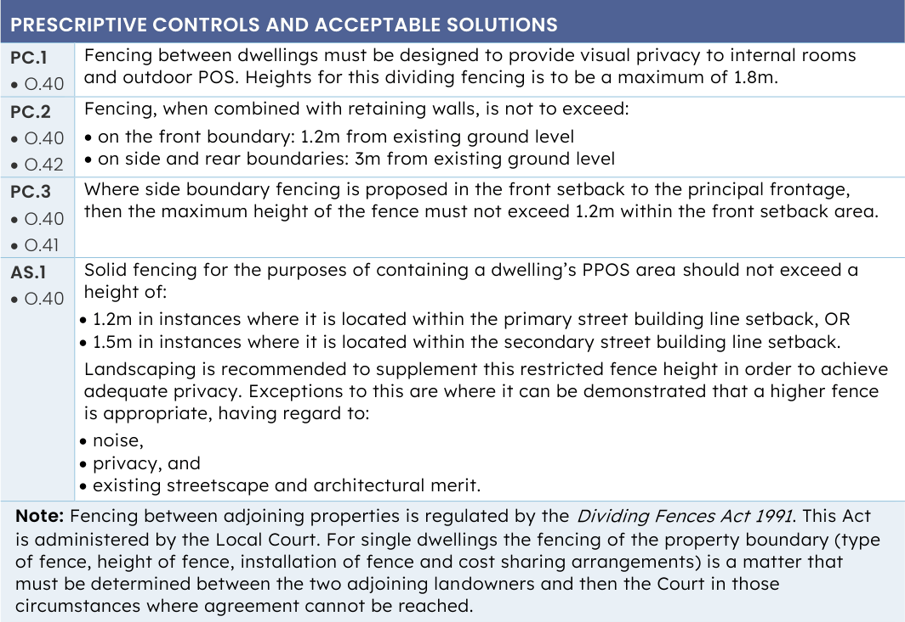

#### 6.2.12. Fencing and walls

#### Objectives

O.40 To ensure that all fences and walls provide privacy, security and noise attenuation while balancing impacts upon the streetscape, passive surveillance, adjacent buildings, and the use of open spaces areas within the development or on adjoining land.

O.41 To ensure that fences and walls positively contribute to the character of the streetscape through careful consideration of materials, height, form, and transparency.

O.42 To maintain clear, legible, and inviting pedestrian entry points from the street, ensuring that fencing and walls do not obstruct access or diminish the welcoming nature of the home’s entrance.

> [Picture on page 20: a picture, saved as a picture (images/ch-06-00-residential-uses-page-20-10.gif, 150 dpi).]
> Words printed on the picture (title and legend, copied from the PDF):
> • O.40
> • O.40 • on the front boundary: 1.2m from existing ground level
> • O.42
> • O.40
> • O.41
> • O.40

#### PRESCRIPTIVE CONTROLS AND ACCEPTABLE SOLUTIONS

#### PC.1

Fencing between dwellings must be designed to provide visual privacy to internal rooms and outdoor POS. Heights for this dividing fencing is to be a maximum of 1.8m. Fencing, when combined with retaining walls, is not to exceed:

#### PC.2

• on side and rear boundaries: 3m from existing ground level

#### PC.3

Where side boundary fencing is proposed in the front setback to the principal frontage, then the maximum height of the fence must not exceed 1.2m within the front setback area.

#### AS.1

Solid fencing for the purposes of containing a dwelling’s PPOS area should not exceed a height of:

• 1.2m in instances where it is located within the primary street building line setback, OR

• 1.5m in instances where it is located within the secondary street building line setback. Landscaping is recommended to supplement this restricted fence height in order to achieve adequate privacy. Exceptions to this are where it can be demonstrated that a higher fence is appropriate, having regard to:

• noise,

• privacy, and

• existing streetscape and architectural merit.

Note: Fencing between adjoining properties is regulated by the Dividing Fences Act 1991. This Act is administered by the Local Court. For single dwellings the fencing of the property boundary (type of fence, height of fence, installation of fence and cost sharing arrangements) is a matter that must be determined between the two adjoining landowners and then the Court in those circumstances where agreement cannot be reached.
