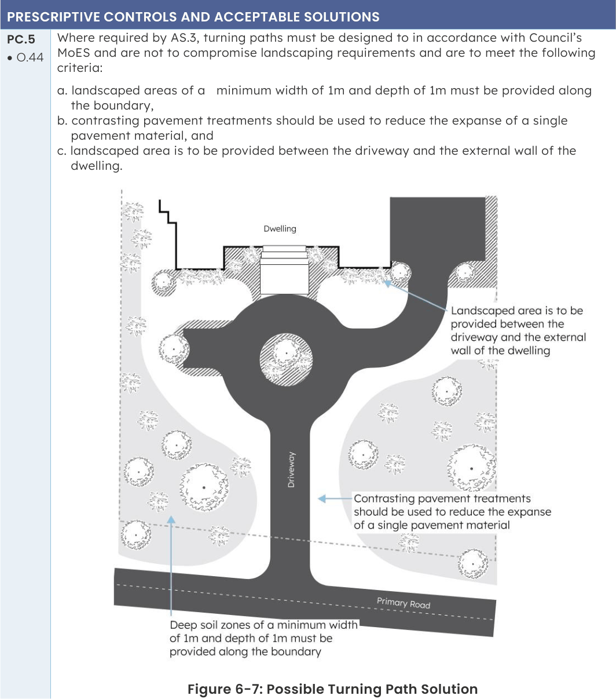

#### 6.2.13.1. Driveways

| PRESCRIPTIVE CONTROLS AND ACCEPTABLE SOLUTIONS |  |
|---|---|
| AS.1 | Driveways within the site must be a minimum of 3m wide and should not conflict with existing infrastructure, including street trees. |
| • O.43 |  |
| PC.1 • O.43 | The driveway width across the footway must be as follows: a. 3m wide for single car garages, OR b. 4.5m for double garages (side by side spaces). |
| AS.2 • O.44 | Landscaping should be incorporated into the design of driveway and manoeuvring areas to minimise the expanse of hard surfaces, volume and rate of stormwater runoff, and adverse visual impacts on the streetscape. |
| PC.2 | Driveways must be located to maximise on-street parking. The distance between driveway crossings must be less than 1.5m or greater than 7m to maximise on-street parking and to provide sufficient length for whole car parks between access points. |
| • O.43 |  |
| • O.4 |  |
| 6 |  |
| PC.3 • O.4 6 | Driveways must demonstrate suitable vehicle access can be achieved and are to avoid any applicable denied driveway areas, such as at intersections, roundabouts, in-road street tree pits and other infrastructure and regulated locations. Exact requirements relating to this control are to comply with Council’s MoES. |
| AS.3 • O.43 • O.44 | Driveways may be required to incorporate a dedicated turning area in instances where: a. there is poor sight distance from the driveway to pedestrian or vehicular traffic, OR b. the accessway fronts a main road or highly pedestrianised area, OR c. in cases where the driveway services three or more dwellings, OR d. where vehicles would otherwise have to reverse more than 30m. |
| PC.4 | Pedestrian entries and paths are to be clearly distinguished from vehicle driveways. |
| • O.43 |  |
| • O.44 |  |
| AS.4 • O.43 • O.44 • O.47 | Aside from dwelling houses, driveways are to be located in areas that avoid street tree plantings wherever possible. Where avoidance is not possible, development must ensure that suitable arrangements have been made to replant any removed street trees at a 1:1 ratio. Note: Controls for street tree replacement for dwelling houses are provided in Section 6.3 of this Chapter. |

> [Picture on page 22: a picture, saved as a picture (images/ch-06-00-residential-uses-page-22-1.gif, 150 dpi).]
> Words printed on the picture (title and legend, copied from the PDF):
> • O.44
> the boundary,
> pavement material, and
> dwelling.

Figure 6-7: Possible Turning Path Solution

#### PC.5

Where required by AS.3, turning paths must be designed to in accordance with Council’s MoES and are not to compromise landscaping requirements and are to meet the following criteria:

a. landscaped areas of a   minimum width of 1m and depth of 1m must be provided along

b. contrasting pavement treatments should be used to reduce the expanse of a single

c. landscaped area is to be provided between the driveway and the external wall of the
