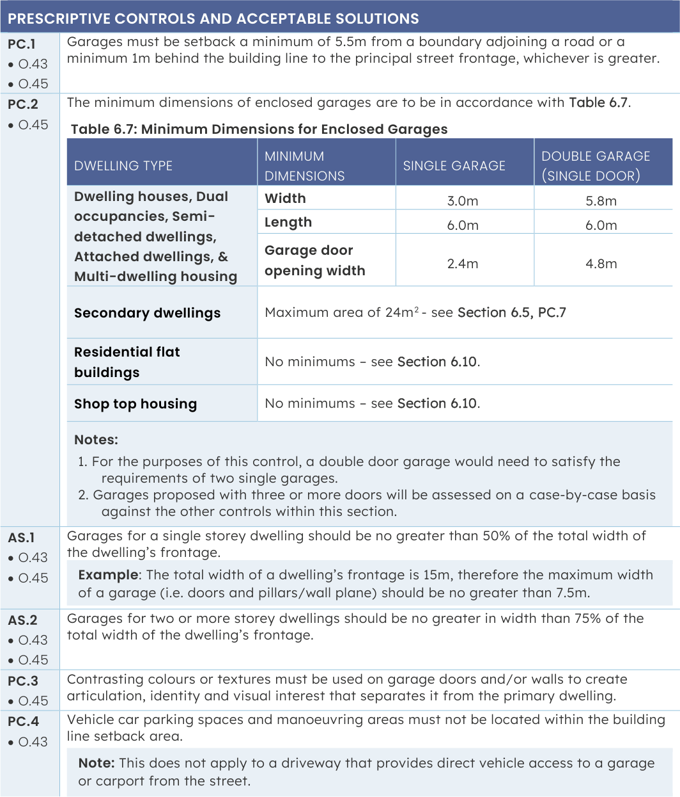
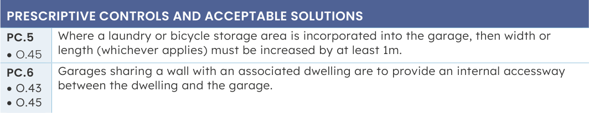

#### 6.2.13.2. Carparking and garages

Refer to Section 6.2.14 Sites having a boundary to a laneway of this Chapter for specific carparking and garage controls relating to development on laneways.

> [Picture on page 23: a picture, saved as a picture (images/ch-06-00-residential-uses-page-23-4.gif, 150 dpi).]
> Words printed on the picture (title and legend, copied from the PDF):
> • O.43
> • O.45
> • O.45
> • O.43
> • O.45 Example: The total width of a dwelling’s frontage is 15m, therefore the maximum width
> • O.43
> • O.45
> • O.45
> • O.43

Table 6.7: Minimum Dimensions for Enclosed Garages

#### PRESCRIPTIVE CONTROLS AND ACCEPTABLE SOLUTIONS

#### PC.1

Garages must be setback a minimum of 5.5m from a boundary adjoining a road or a minimum 1m behind the building line to the principal street frontage, whichever is greater.

The minimum dimensions of enclosed garages are to be in accordance with Table 6.7.

| DWELLING TYPE | MINIMUM DIMENSIONS | SINGLE GARAGE | DOUBLE GARAGE (SINGLE DOOR) 5.8m 6.0m |
|---|---|---|---|
| Dwelling houses, Dual | Width | 3.0m |  |
| occupancies, Semi- | Length | 6.0m |  |
| detached dwellings, |  |  |  |
|  | Garage door opening width Maximum area of | 2.4m 4.8m 24m2 - see Section 6.5, PC.7 |  |
| Attached dwellings, & |  |  |  |
| Multi-dwelling housing |  |  |  |
| Secondary dwellings |  |  |  |
| Residential flat | No |  |  |
| buildings |  |  |  |
| Shop top housing No |  |  |  |
| minimums – see Section 6.10. minimums – see Section 6.10. Notes: 1. For the purposes of this control, a double door garage would need to satisfy the requirements of two single garages. 2. Garages proposed with three or more doors will be assessed on a case-by-case basis against the other controls within this section. |  |  |  |

#### PC.2

#### AS.1

Garages for a single storey dwelling should be no greater than 50% of the total width of the dwelling’s frontage.

of a garage (i.e. doors and pillars/wall plane) should be no greater than 7.5m.

#### AS.2

Garages for two or more storey dwellings should be no greater in width than 75% of the total width of the dwelling’s frontage.

#### PC.3

Contrasting colours or textures must be used on garage doors and/or walls to create articulation, identity and visual interest that separates it from the primary dwelling.

#### PC.4

Vehicle car parking spaces and manoeuvring areas must not be located within the building line setback area. Note: This does not apply to a driveway that provides direct vehicle access to a garage or carport from the street.

> [Picture on page 24: a picture, saved as a picture (images/ch-06-00-residential-uses-page-24-1.gif, 150 dpi).]
> Words printed on the picture (title and legend, copied from the PDF):
> • O.45
> • O.43
> • O.45

#### PC.5

Where a laundry or bicycle storage area is incorporated into the garage, then width or length (whichever applies) must be increased by at least 1m. Garages sharing a wall with an associated dwelling are to provide an internal accessway between the dwelling and the garage.

#### PC.6
