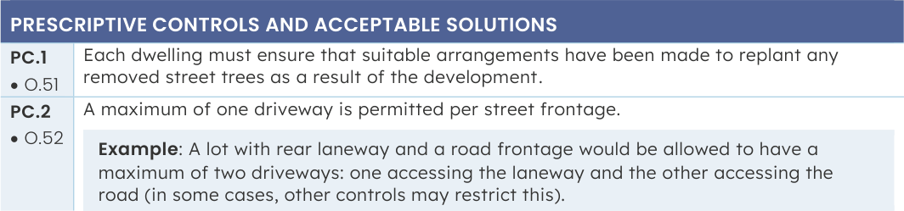

### 6.3. Dwelling house

This Section of the Chapter applies to detached dwelling houses within the R1 General Residential and R5 Large Lot Residential zones of MLEP 2011. Relevant ‘General Housing Controls’ are found in Section 6.2 and this section. In the event of any inconsistency between Section 6.2 and this section, this section prevails.

#### Objectives

O.51 To ensure street trees are protected through replacement and embellishment. O.52 To limit the overall impact of driveway accesses along each street frontage.

> [Picture on page 25: a picture, saved as a picture (images/ch-06-00-residential-uses-page-25-9.gif, 150 dpi).]
> Words printed on the picture (title and legend, copied from the PDF):
> • O.51
> • O.52

#### PRESCRIPTIVE CONTROLS AND ACCEPTABLE SOLUTIONS

#### PC.1

Each dwelling must ensure that suitable arrangements have been made to replant any removed street trees as a result of the development. A maximum of one driveway is permitted per street frontage.

#### PC.2

Example: A lot with rear laneway and a road frontage would be allowed to have a maximum of two driveways: one accessing the laneway and the other accessing the road (in some cases, other controls may restrict this).
