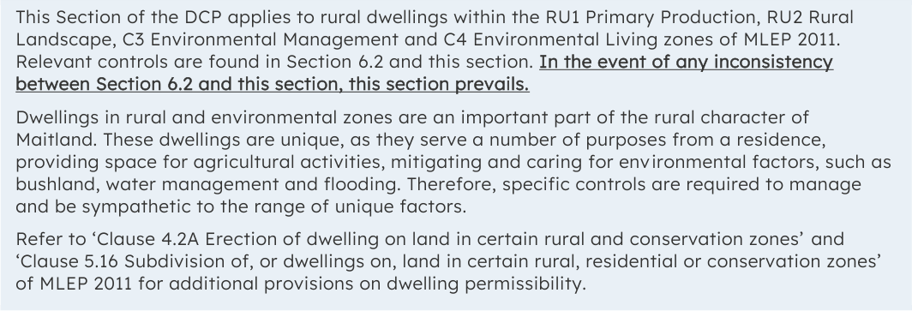
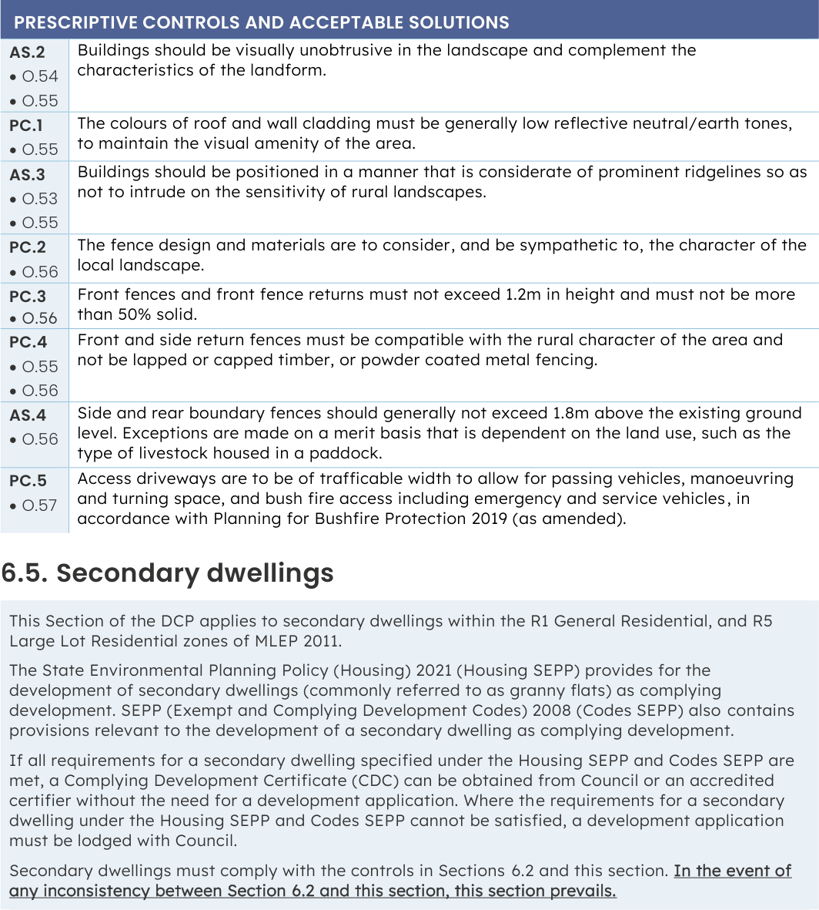

### 6.4. Dwellings in rural and environmental zones

> [Picture on page 25: a picture, saved as a picture (images/ch-06-00-residential-uses-page-25-20.gif, 150 dpi).]

This Section of the DCP applies to rural dwellings within the RU1 Primary Production, RU2 Rural Landscape, C3 Environmental Management and C4 Environmental Living zones of MLEP 2011. Relevant controls are found in Section 6.2 and this section. In the event of any inconsistency between Section 6.2 and this section, this section prevails. Dwellings in rural and environmental zones are an important part of the rural character of Maitland. These dwellings are unique, as they serve a number of purposes from a residence, providing space for agricultural activities, mitigating and caring for environmental factors, such as bushland, water management and flooding. Therefore, specific controls are required to manage and be sympathetic to the range of unique factors. Refer to ‘Clause 4.2A Erection of dwelling on land in certain rural and conservation zones’ and ‘Clause 5.16 Subdivision of, or dwellings on, land in certain rural, residential or conservation zones’

of MLEP 2011 for additional provisions on dwelling permissibility.

#### Objectives

O.53 To conserve and enhance native vegetation, vegetation corridors, topographical features, and fauna habitat.

O.54 To limit impact on scenic corridors by maintaining and/or enhancing them, as identified within the Maitland Local Strategic Planning Statement.

O.55 To ensure that external finishes used have minimal detrimental impact on the visual amenity of an area.

O.56 To ensure that fencing and retaining walls are compatible with the existing landscape character and are not a risk to fauna.

O.57 To enable suitable driveway widths for all vehicle users. O.58 To support in the reduction of land use conflict.

#### PRESCRIPTIVE CONTROLS AND ACCEPTABLE SOLUTIONS

#### AS.1

Development should, through sensitive design, retain the majority of significant natural features on the site, including mature trees, rocky outcrops, and major vegetation.

• O.53

> [Picture on page 26: a picture, saved as a picture (images/ch-06-00-residential-uses-page-26-1.gif, 150 dpi).]
> Words printed on the picture (title and legend, copied from the PDF):
> • O.54
> • O.55
> • O.55
> • O.53
> • O.55
> • O.56
> • O.56
> • O.55
> • O.56
> • O.56
> • O.57

#### AS.2

Buildings should be visually unobtrusive in the landscape and complement the characteristics of the landform.

#### PC.1

The colours of roof and wall cladding must be generally low reflective neutral/earth tones, to maintain the visual amenity of the area.

#### AS.3

Buildings should be positioned in a manner that is considerate of prominent ridgelines so as not to intrude on the sensitivity of rural landscapes.

#### PC.2

The fence design and materials are to consider, and be sympathetic to, the character of the local landscape. Front fences and front fence returns must not exceed 1.2m in height and must not be more than 50% solid.

#### PC.3

#### PC.4

Front and side return fences must be compatible with the rural character of the area and not be lapped or capped timber, or powder coated metal fencing.

#### AS.4

Side and rear boundary fences should generally not exceed 1.8m above the existing ground level. Exceptions are made on a merit basis that is dependent on the land use, such as the type of livestock housed in a paddock.

#### PC.5

Access driveways are to be of trafficable width to allow for passing vehicles, manoeuvring and turning space, and bush fire access including emergency and service vehicles, in accordance with Planning for Bushfire Protection 2019 (as amended).
