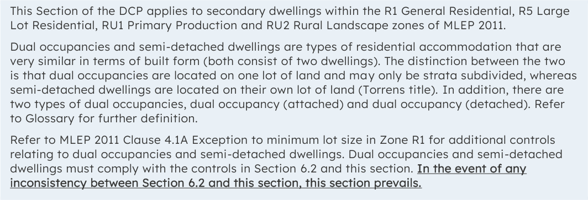

### 6.6. Dual occupancies and semi-detached dwellings

> [Picture on page 28: a picture, saved as a picture (images/ch-06-00-residential-uses-page-28-2.gif, 150 dpi).]

This Section of the DCP applies to secondary dwellings within the R1 General Residential, R5 Large Lot Residential, RU1 Primary Production and RU2 Rural Landscape zones of MLEP 2011. Dual occupancies and semi-detached dwellings are types of residential accommodation that are very similar in terms of built form (both consist of two dwellings). The distinction between the two is that dual occupancies are located on one lot of land and may only be strata subdivided, whereas semi-detached dwellings are located on their own lot of land (Torrens title). In addition, there are two types of dual occupancies, dual occupancy (attached) and dual occupancy (detached). Refer to Glossary for further definition. Refer to MLEP 2011 Clause 4.1A Exception to minimum lot size in Zone R1 for additional controls relating to dual occupancies and semi-detached dwellings. Dual occupancies and semi-detached dwellings must comply with the controls in Section 6.2 and this section. In the event of any

inconsistency between Section 6.2 and this section, this section prevails.

#### Objectives

O.64 To ensure orderly and planned residential density. O.65 To ensure dual occupancies and semi-detached dwellings are compatible with existing housing and do not adversely affect the local environment or the amenity of adjacent residents.

O.66 To limit the overall impact of driveway accesses along each street frontage.

| PRESCRIPTIVE CONTROLS AND ACCEPTABLE SOLUTIONS |  |
|---|---|
| AS.1 | Dual occupancy and semi-detached development on corner lots should be designed to address both street frontages while having one front entry and one garage fronting each street. |
| • O.64 |  |
| • O.66 |  |
| AS.2 | Detached dual occupancies within residential zones should have a minimum of 2m separation between the dwellings. |
| • O.65 |  |
| AS.3 | Detached dual occupancies within rural zones should have a maximum of 20m separation between the dwellings. |
| • O.65 |  |
| PC.2 | Buildings must not be of mirror-reversed or replicated built form. Differentiation in building form and architectural treatment between dwellings must be provided. |
| • O.66 |  |
| AS.4 | Each dwelling should have a separate driveway. If a combined driveway is provided, each dwelling must ensure that suitable arrangements have been made to replant any affected street trees at a 2:1 ratio. |
| • O.65 |  |
| • O.66 |  |
| PC.3 | A minimum of a 1m wide landscaped area must be provided between a driveway and a boundary fence. The landscape area should be free of retaining walls and extend for the full length of the driveway. |
| • O.65 |  |
| • O.66 |  |
| PC.4 | A driveway along the side of a dwelling must be offset a minimum of 0.9m from the side wall of the dwelling. |
| • O.66 |  |
| AS.5 | For sites with a rear lane, vehicle access for the rear dwelling should be from the lane, and pedestrian access should be from the primary street frontage. |
| • O.65 |  |
| • O.66 |  |
| PC.5 • O.66 | A maximum of one driveway per dwelling is permitted per street frontage. Example: A lot with rear laneway and a road frontage would be allowed to have a maximum of two driveways: one accessing the laneway and the other accessing the road (in some cases, other controls may restrict this). |
