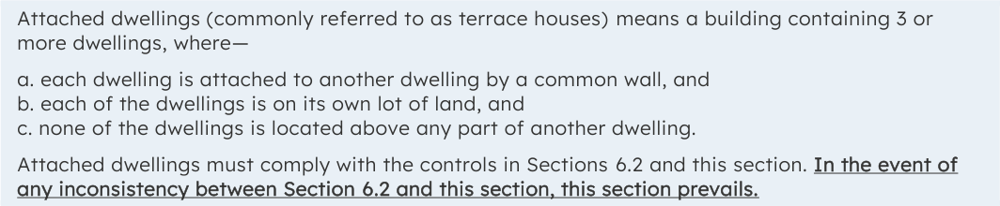

### 6.7. Attached dwellings

> [Picture on page 29: a picture, saved as a picture (images/ch-06-00-residential-uses-page-29-2.gif, 150 dpi).]

Attached dwellings (commonly referred to as terrace houses) means a building containing 3 or more dwellings, where—

a. each dwelling is attached to another dwelling by a common wall, and

b. each of the dwellings is on its own lot of land, and

c. none of the dwellings is located above any part of another dwelling. Attached dwellings must comply with the controls in Sections 6.2 and this section. In the event of

any inconsistency between Section 6.2 and this section, this section prevails.

#### Objectives

O.67 To ensure that attached dwelling developments are located on sites with sufficient size and street frontage to accommodate the required building envelope, car parking, solar access, landscaping and private open space.

O.68 To encourage high quality residential developments which feature a high standard of urban design and provide a high level of amenity for residents.

O.69 To ensure that each new dwelling provides a sufficient amount of storage for elements such as garden equipment and bicycles.

O.70 To provide a designated area for waste collection to ensure efficient waste servicing. O.71 To limit the overall impact of kerb crossings and garaging along each street frontage.

| PRESCRIPTIVE CONTROLS AND ACCEPTABLE SOLUTIONS |  |
|---|---|
| AS.1 | Each proposed dwelling should have direct frontage to a public road. |
| • O.67 |  |
| • O.68 |  |
| AS.2 • O.68 | Attached dwellings should have a unified design for the whole development, including a coordinated style and base colour palette. Individuality can be added as small details or accent colours, rather than strikingly different forms. |
| AS.3 • O.68 | Attached dwellings should create an appearance of a single dwelling or grouped dwellings that are separated by gardens and ancillary structures, with facades designed to incorporate a variety of materials and shading structures. |
| AS.4 | At least one habitable room is to be located at the front of each dwelling addressing the street and / or internal driveway. |
| • O.67 |  |
| • O.68 |  |
| PC.1 | Each dwelling must provide a minimum storage area of 8m 3. This space is to be provided exclusively for storage purposes and must be provided in addition to any garage space. |
| • O.69 |  |
| AS.5 | Indoor ducted air conditioning elements are encouraged to be located towards the centre of the site and be acoustically insulated. |
| • O.68 |  |
| PC.2 | Bins are to be presented on the kerbside for collection and are not to encroach on any driveway. This is to be demonstrated as a waste collection area on submitted site plans. |
| • O.70 |  |
| PC.3 • O.71 | A maximum of one driveway is permitted per street frontage of each dwelling. Example: A dwelling with rear laneway and a road frontage would be allowed to have a maximum of two driveways: one accessing the laneway and the other accessing the road (in some cases, other controls may restrict this). |
