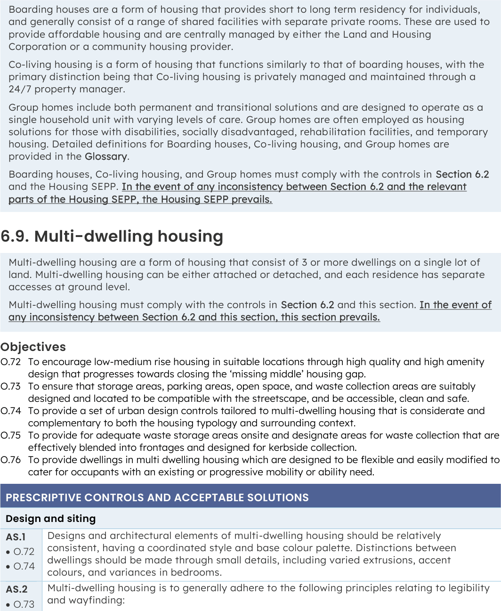

### 6.8. Boarding houses, Co-living housing, and Group homes

> [Picture on page 30: a picture, saved as a picture (images/ch-06-00-residential-uses-page-30-2.gif, 150 dpi).]

Boarding houses are a form of housing that provides short to long term residency for individuals, and generally consist of a range of shared facilities with separate private rooms. These are used to provide affordable housing and are centrally managed by either the Land and Housing Corporation or a community housing provider. Co-living housing is a form of housing that functions similarly to that of boarding houses, with the primary distinction being that Co-living housing is privately managed and maintained through a 24/7 property manager. Group homes include both permanent and transitional solutions and are designed to operate as a single household unit with varying levels of care. Group homes are often employed as housing solutions for those with disabilities, socially disadvantaged, rehabilitation facilities, and temporary housing. Detailed definitions for Boarding houses, Co-living housing, and Group homes are provided in the Glossary. Boarding houses, Co-living housing, and Group homes must comply with the controls in Section 6.2 and the Housing SEPP. In the event of any inconsistency between Section 6.2 and the relevant parts of the Housing SEPP, the Housing SEPP prevails.
