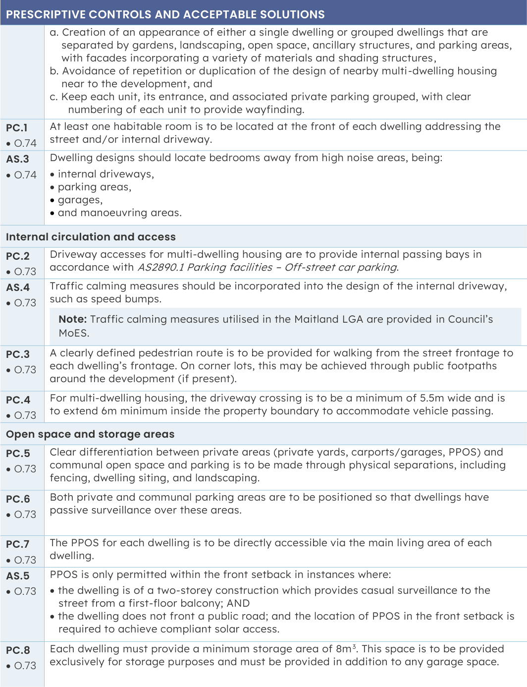
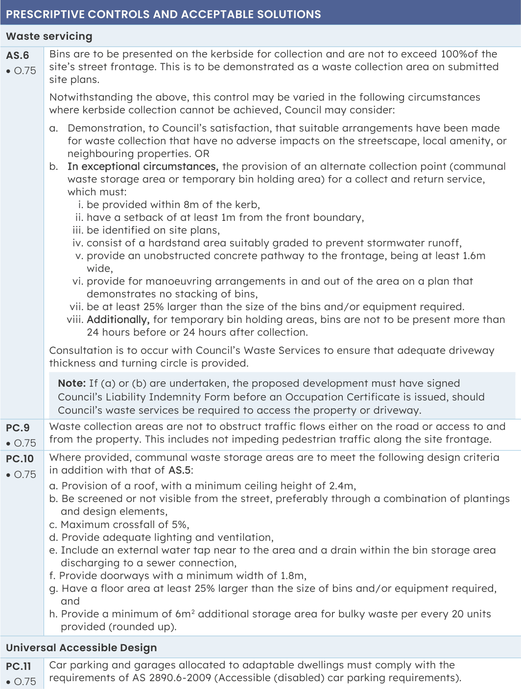
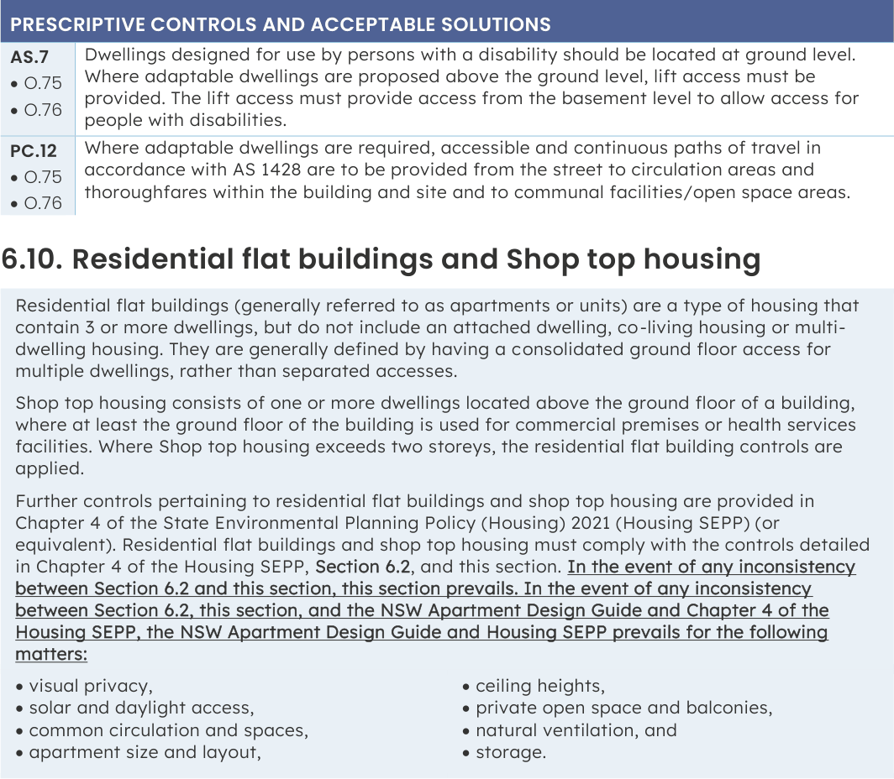

### 6.9. Multi-dwelling housing

Multi-dwelling housing are a form of housing that consist of 3 or more dwellings on a single lot of

land. Multi-dwelling housing can be either attached or detached, and each residence has separate accesses at ground level. Multi-dwelling housing must comply with the controls in Section 6.2 and this section. In the event of

any inconsistency between Section 6.2 and this section, this section prevails.

#### Objectives

O.72 To encourage low-medium rise housing in suitable locations through high quality and high amenity design that progresses towards closing the ‘missing middle’ housing gap.

O.73 To ensure that storage areas, parking areas, open space, and waste collection areas are suitably designed and located to be compatible with the streetscape, and be accessible, clean and safe.

O.74 To provide a set of urban design controls tailored to multi-dwelling housing that is considerate and complementary to both the housing typology and surrounding context.

O.75 To provide for adequate waste storage areas onsite and designate areas for waste collection that are effectively blended into frontages and designed for kerbside collection.

O.76 To provide dwellings in multi dwelling housing which are designed to be flexible and easily modified to cater for occupants with an existing or progressive mobility or ability need.

#### PRESCRIPTIVE CONTROLS AND ACCEPTABLE SOLUTIONS

#### Design and siting AS.1

Designs and architectural elements of multi-dwelling housing should be relatively consistent, having a coordinated style and base colour palette. Distinctions between dwellings should be made through small details, including varied extrusions, accent colours, and variances in bedrooms.

#### AS.2

Multi-dwelling housing is to generally adhere to the following principles relating to legibility and wayfinding:

> [Picture on page 31: a map, saved as a picture (images/ch-06-00-residential-uses-page-31-1.gif, 150 dpi); the street names and other small labels are on the picture.]
> Words printed on the picture (title and legend, copied from the PDF):
> • O.74 • internal driveways,
> • parking areas,
> • and manoeuvring areas.
> • O.73 • the dwelling is of a two-storey construction which provides casual surveillance to the

a. Creation of an appearance of either a single dwelling or grouped dwellings that are separated by gardens, landscaping, open space, ancillary structures, and parking areas, with facades incorporating a variety of materials and shading structures,

b. Avoidance of repetition or duplication of the design of nearby multi-dwelling housing near to the development, and

c. Keep each unit, its entrance, and associated private parking grouped, with clear numbering of each unit to provide wayfinding.

#### PC.1

At least one habitable room is to be located at the front of each dwelling addressing the street and/or internal driveway. Dwelling designs should locate bedrooms away from high noise areas, being:

#### AS.3

#### Internal circulation and access PC.2

Driveway accesses for multi-dwelling housing are to provide internal passing bays in accordance with AS2890.1 Parking facilities – Off-street car parking.

#### AS.4

Traffic calming measures should be incorporated into the design of the internal driveway, such as speed bumps. Note: Traffic calming measures utilised in the Maitland LGA are provided in Council’s

#### PC.3

A clearly defined pedestrian route is to be provided for walking from the street frontage to each dwelling’s frontage. On corner lots, this may be achieved through public footpaths around the development (if present).

#### PC.4

For multi-dwelling housing, the driveway crossing is to be a minimum of 5.5m wide and is to extend 6m minimum inside the property boundary to accommodate vehicle passing.

#### Open space and storage areas PC.5

Clear differentiation between private areas (private yards, carports/garages, PPOS) and communal open space and parking is to be made through physical separations, including fencing, dwelling siting, and landscaping.

#### PC.6

Both private and communal parking areas are to be positioned so that dwellings have passive surveillance over these areas.

#### PC.7

The PPOS for each dwelling is to be directly accessible via the main living area of each dwelling. PPOS is only permitted within the front setback in instances where:

#### AS.5

street from a first-floor balcony; AND

• the dwelling does not front a public road; and the location of PPOS in the front setback is required to achieve compliant solar access.

#### PC.8

Each dwelling must provide a minimum storage area of 8m 3. This space is to be provided exclusively for storage purposes and must be provided in addition to any garage space.

> [Picture on page 32: a picture, saved as a picture (images/ch-06-00-residential-uses-page-32-1.gif, 150 dpi).]
> Words printed on the picture (title and legend, copied from the PDF):
> • O.75
> wide,
> • O.75
> • O.75
> and design elements,
> and
> provided (rounded up).
> • O.75

#### Waste servicing AS.6

Bins are to be presented on the kerbside for collection and are not to exceed 100%of the site’s street frontage. This is to be demonstrated as a waste collection area on submitted site plans. Notwithstanding the above, this control may be varied in the following circumstances where kerbside collection cannot be achieved, Council may consider:

a. Demonstration, to Council’s satisfaction, that suitable arrangements have been made for waste collection that have no adverse impacts on the streetscape, local amenity, or neighbouring properties. OR

b. In exceptional circumstances, the provision of an alternate collection point (communal waste storage area or temporary bin holding area) for a collect and return service, which must:

i. be provided within 8m of the kerb,

ii. have a setback of at least 1m from the front boundary,

iii. be identified on site plans,

iv. consist of a hardstand area suitably graded to prevent stormwater runoff,

v. provide an unobstructed concrete pathway to the frontage, being at least 1.6m

vi. provide for manoeuvring arrangements in and out of the area on a plan that demonstrates no stacking of bins,

vii. be at least 25% larger than the size of the bins and/or equipment required.

viii. Additionally, for temporary bin holding areas, bins are not to be present more than 24 hours before or 24 hours after collection.

Consultation is to occur with Council’s Waste Services to ensure that adequate driveway thickness and turning circle is provided. Note: If (a) or (b) are undertaken, the proposed development must have signed Council’s Liability Indemnity Form before an Occupation Certificate is issued, should Council’s waste services be required to access the property or driveway.

#### PC.9

Waste collection areas are not to obstruct traffic flows either on the road or access to and from the property. This includes not impeding pedestrian traffic along the site frontage.

#### PC.10

Where provided, communal waste storage areas are to meet the following design criteria in addition with that of AS.5:

a. Provision of a roof, with a minimum ceiling height of 2.4m,

b. Be screened or not visible from the street, preferably through a combination of plantings

c. Maximum crossfall of 5%,

d. Provide adequate lighting and ventilation,

e. Include an external water tap near to the area and a drain within the bin storage area discharging to a sewer connection,

f. Provide doorways with a minimum width of 1.8m,

g. Have a floor area at least 25% larger than the size of bins and/or equipment required,

h. Provide a minimum of 6m2 additional storage area for bulky waste per every 20 units

#### Universal Accessible Design PC.11

Car parking and garages allocated to adaptable dwellings must comply with the requirements of AS 2890.6-2009 (Accessible (disabled) car parking requirements).

> [Picture on page 33: a picture, saved as a picture (images/ch-06-00-residential-uses-page-33-1.gif, 150 dpi).]
> Words printed on the picture (title and legend, copied from the PDF):
> • O.75
> • O.76
> • O.75
> • O.76

#### AS.7

Dwellings designed for use by persons with a disability should be located at ground level. Where adaptable dwellings are proposed above the ground level, lift access must be provided. The lift access must provide access from the basement level to allow access for people with disabilities.

#### PC.12

Where adaptable dwellings are required, accessible and continuous paths of travel in accordance with AS 1428 are to be provided from the street to circulation areas and thoroughfares within the building and site and to communal facilities/open space areas.
