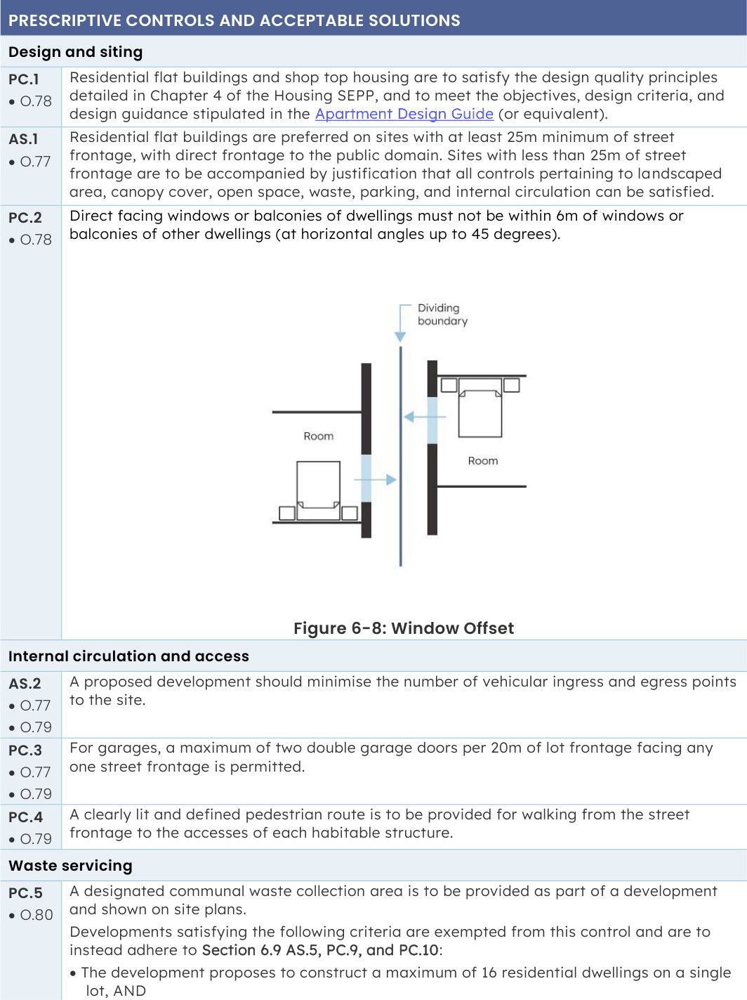
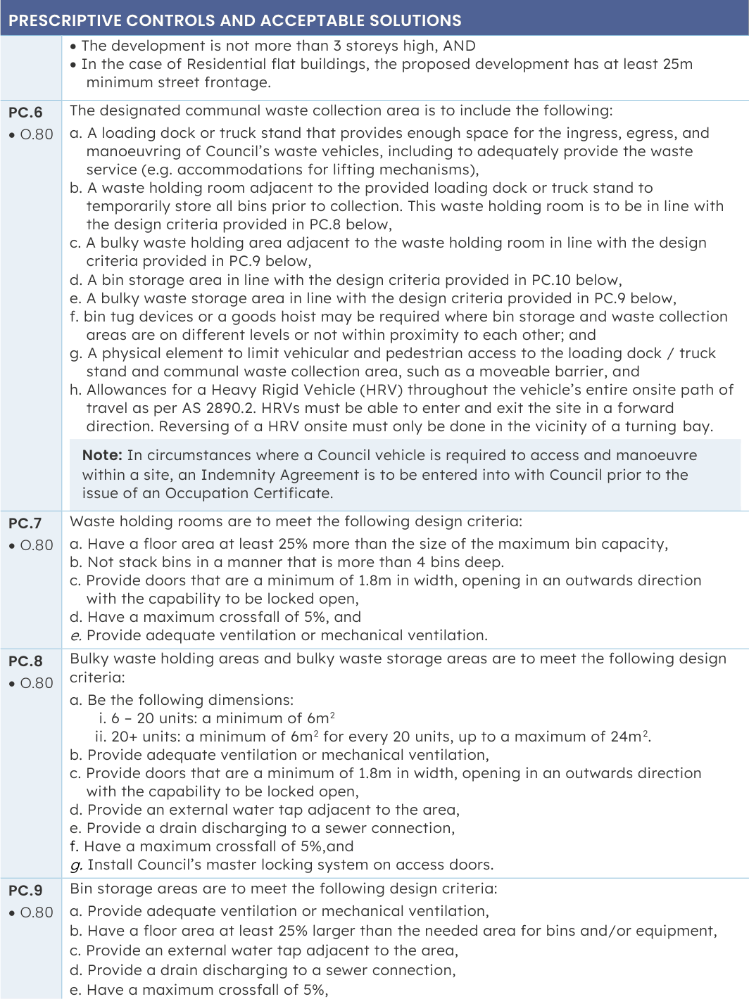
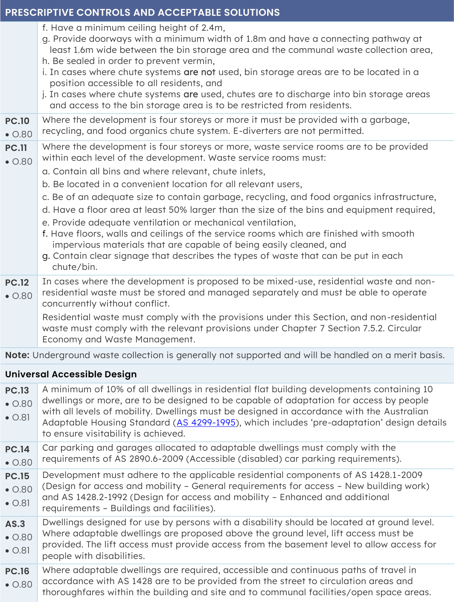

### 6.10. Residential flat buildings and Shop top housing

> Words printed on the picture (title and legend, copied from the PDF):
> • ceiling heights,

Residential flat buildings (generally referred to as apartments or units) are a type of housing that contain 3 or more dwellings, but do not include an attached dwelling, co-living housing or multi-dwelling housing. They are generally defined by having a consolidated ground floor access for multiple dwellings, rather than separated accesses. Shop top housing consists of one or more dwellings located above the ground floor of a building, where at least the ground floor of the building is used for commercial premises or health services facilities. Where Shop top housing exceeds two storeys, the residential flat building controls are applied. Further controls pertaining to residential flat buildings and shop top housing are provided in Chapter 4 of the State Environmental Planning Policy (Housing) 2021 (Housing SEPP) (or equivalent). Residential flat buildings and shop top housing must comply with the controls detailed in Chapter 4 of the Housing SEPP, Section 6.2, and this section. In the event of any inconsistency between Section 6.2 and this section, this section prevails. In the event of any inconsistency between Section 6.2, this section, and the NSW Apartment Design Guide and Chapter 4 of the Housing SEPP, the NSW Apartment Design Guide and Housing SEPP prevails for the following matters:

• visual privacy,

• solar and daylight access,

• common circulation and spaces,

• apartment size and layout,

• private open space and balconies,

• natural ventilation, and

• storage.

#### Objectives

O.77 To ensure that high-density development is situated on appropriate block types that take into account the increased level of servicing required for a comfortable level of habitation.

O.78 To establish a high-quality residential environment where all dwellings have a good level of amenity. O.79 To ensure that high-density development integrates with streetscapes. O.80 To provide for adequate waste storage areas onsite and designate areas for waste collection. These are to be suitably accessible from the street, effectively blended into frontages, and clean and safe for all users.

O.81 To provide dwellings in residential flat buildings and shop-top housing which are designed to be flexible and easily modified to cater for occupants with an existing or progressive mobility or ability need.

> [Picture on page 34: a picture, saved as a picture (images/ch-06-00-residential-uses-page-34-1.gif, 150 dpi).]
> Words printed on the picture (title and legend, copied from the PDF):
> • O.78
> • O.77
> • O.78
> • O.77
> • O.79
> • O.77
> • O.79
> • O.79
> • O.80
> lot, AND

Figure 6-8: Window Offset

#### Design and siting PC.1

Residential flat buildings and shop top housing are to satisfy the design quality principles detailed in Chapter 4 of the Housing SEPP, and to meet the objectives, design criteria, and design guidance stipulated in the Apartment Design Guide (or equivalent).

#### AS.1

Residential flat buildings are preferred on sites with at least 25m minimum of street frontage, with direct frontage to the public domain. Sites with less than 25m of street frontage are to be accompanied by justification that all controls pertaining to landscaped area, canopy cover, open space, waste, parking, and internal circulation can be satisfied.

#### PC.2

Direct facing windows or balconies of dwellings must not be within 6m of windows or balconies of other dwellings (at horizontal angles up to 45 degrees).

#### Internal circulation and access AS.2

A proposed development should minimise the number of vehicular ingress and egress points to the site.

#### PC.3

For garages, a maximum of two double garage doors per 20m of lot frontage facing any one street frontage is permitted.

#### PC.4

A clearly lit and defined pedestrian route is to be provided for walking from the street frontage to the accesses of each habitable structure.

#### Waste servicing PC.5

A designated communal waste collection area is to be provided as part of a development and shown on site plans. Developments satisfying the following criteria are exempted from this control and are to instead adhere to Section 6.9 AS.5, PC.9, and PC.10:

• The development proposes to construct a maximum of 16 residential dwellings on a single

> [Picture on page 35: a picture, saved as a picture (images/ch-06-00-residential-uses-page-35-1.gif, 150 dpi).]
> Words printed on the picture (title and legend, copied from the PDF):
> minimum street frontage.
> • O.80
> • O.80 a. Have a floor area at least 25% more than the size of the maximum bin capacity,
> • O.80
> • O.80 a. Provide adequate ventilation or mechanical ventilation,

• The development is not more than 3 storeys high, AND

• In the case of Residential flat buildings, the proposed development has at least 25m

The designated communal waste collection area is to include the following:

#### PC.6

a. A loading dock or truck stand that provides enough space for the ingress, egress, and manoeuvring of Council’s waste vehicles, including to adequately provide the waste service (e.g. accommodations for lifting mechanisms),

b. A waste holding room adjacent to the provided loading dock or truck stand to temporarily store all bins prior to collection. This waste holding room is to be in line with the design criteria provided in PC.8 below,

c. A bulky waste holding area adjacent to the waste holding room in line with the design criteria provided in PC.9 below,

d. A bin storage area in line with the design criteria provided in PC.10 below,

e. A bulky waste storage area in line with the design criteria provided in PC.9 below,

f. bin tug devices or a goods hoist may be required where bin storage and waste collection areas are on different levels or not within proximity to each other; and

g. A physical element to limit vehicular and pedestrian access to the loading dock / truck stand and communal waste collection area, such as a moveable barrier, and

h. Allowances for a Heavy Rigid Vehicle (HRV) throughout the vehicle’s entire onsite path of travel as per AS 2890.2. HRVs must be able to enter and exit the site in a forward direction. Reversing of a HRV onsite must only be done in the vicinity of a turning bay. Note: In circumstances where a Council vehicle is required to access and manoeuvre within a site, an Indemnity Agreement is to be entered into with Council prior to the issue of an Occupation Certificate. Waste holding rooms are to meet the following design criteria:

#### PC.7

b. Not stack bins in a manner that is more than 4 bins deep.

c. Provide doors that are a minimum of 1.8m in width, opening in an outwards direction with the capability to be locked open,

d. Have a maximum crossfall of 5%, and

e. Provide adequate ventilation or mechanical ventilation.

#### PC.8

Bulky waste holding areas and bulky waste storage areas are to meet the following design criteria:

a. Be the following dimensions:

i. 6 – 20 units: a minimum of 6m2

ii. 20+ units: a minimum of 6m2 for every 20 units, up to a maximum of 24m2.

b. Provide adequate ventilation or mechanical ventilation,

c. Provide doors that are a minimum of 1.8m in width, opening in an outwards direction with the capability to be locked open,

d. Provide an external water tap adjacent to the area,

e. Provide a drain discharging to a sewer connection,

f. Have a maximum crossfall of 5%,and

g. Install Council’s master locking system on access doors. Bin storage areas are to meet the following design criteria:

#### PC.9

b. Have a floor area at least 25% larger than the needed area for bins and/or equipment,

c. Provide an external water tap adjacent to the area,

d. Provide a drain discharging to a sewer connection,

e. Have a maximum crossfall of 5%,

> [Picture on page 36: a picture, saved as a picture (images/ch-06-00-residential-uses-page-36-1.gif, 150 dpi).]
> Words printed on the picture (title and legend, copied from the PDF):
> • O.80
> • O.80
> chute/bin.
> • O.80

f. Have a minimum ceiling height of 2.4m,

g. Provide doorways with a minimum width of 1.8m and have a connecting pathway at least 1.6m wide between the bin storage area and the communal waste collection area,

h. Be sealed in order to prevent vermin,

i. In cases where chute systems are not used, bin storage areas are to be located in a position accessible to all residents, and

j. In cases where chute systems are used, chutes are to discharge into bin storage areas and access to the bin storage area is to be restricted from residents.

#### PC.10

Where the development is four storeys or more it must be provided with a garbage, recycling, and food organics chute system. E-diverters are not permitted.

#### PC.11

Where the development is four storeys or more, waste service rooms are to be provided within each level of the development. Waste service rooms must:

a. Contain all bins and where relevant, chute inlets,

b. Be located in a convenient location for all relevant users,

c. Be of an adequate size to contain garbage, recycling, and food organics infrastructure,

d. Have a floor area at least 50% larger than the size of the bins and equipment required,

e. Provide adequate ventilation or mechanical ventilation,

f. Have floors, walls and ceilings of the service rooms which are finished with smooth impervious materials that are capable of being easily cleaned, and

g. Contain clear signage that describes the types of waste that can be put in each

#### PC.12

In cases where the development is proposed to be mixed-use, residential waste and non-residential waste must be stored and managed separately and must be able to operate concurrently without conflict. Residential waste must comply with the provisions under this Section, and non-residential waste must comply with the relevant provisions under Chapter 7 Section 7.5.2. Circular Economy and Waste Management.

Note: Underground waste collection is generally not supported and will be handled on a merit basis.

#### Universal Accessible Design

| PC.13 • O.80 • O.81 | A minimum of 10% of all dwellings in residential flat building developments containing 10 dwellings or more, are to be designed to be capable of adaptation for access by people with all levels of mobility. Dwellings must be designed in accordance with the Australian Adaptable Housing Standard (AS 4299-1995), which includes ‘pre-adaptation’ design details to ensure visitability is achieved. |
|---|---|
| PC.14 • O.80 | Car parking and garages allocated to adaptable dwellings must comply with the requirements of AS 2890.6-2009 (Accessible (disabled) car parking requirements). |
| PC.15 • O.80 • O.81 | Development must adhere to the applicable residential components of AS 1428.1-2009 (Design for access and mobility – General requirements for access – New building work) and AS 1428.2-1992 (Design for access and mobility – Enhanced and additional requirements – Buildings and facilities). |
| AS.3 • O.80 • O.81 | Dwellings designed for use by persons with a disability should be located at ground level. Where adaptable dwellings are proposed above the ground level, lift access must be provided. The lift access must provide access from the basement level to allow access for people with disabilities. |
| PC.16 • O.80 | Where adaptable dwellings are required, accessible and continuous paths of travel in accordance with AS 1428 are to be provided from the street to circulation areas and thoroughfares within the building and site and to communal facilities/open space areas. |
