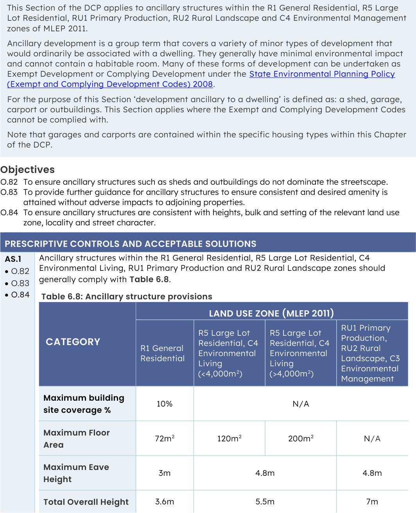
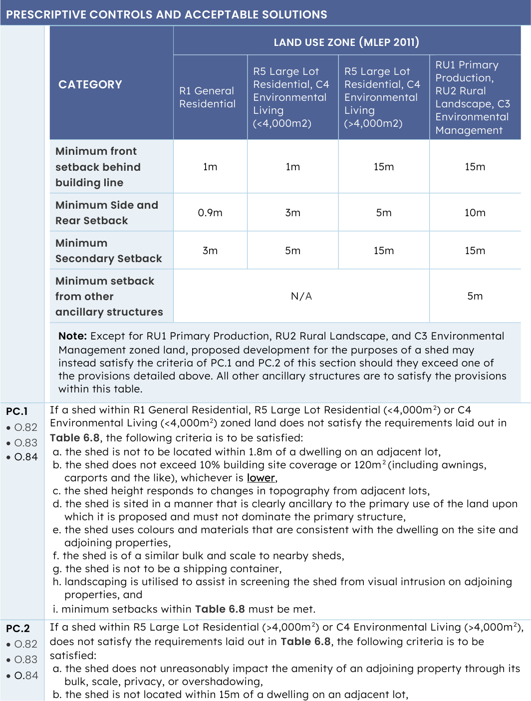
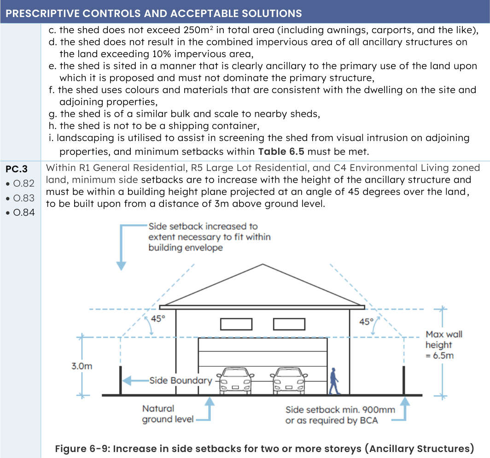

### 6.11. Ancillary structures

> [Picture on page 37: a picture, saved as a picture (images/ch-06-00-residential-uses-page-37-2.gif, 150 dpi).]
> Words printed on the picture (title and legend, copied from the PDF):
> of the DCP.

This Section of the DCP applies to ancillary structures within the R1 General Residential, R5 Large Lot Residential, RU1 Primary Production, RU2 Rural Landscape and C4 Environmental Management zones of MLEP 2011. Ancillary development is a group term that covers a variety of minor types of development that would ordinarily be associated with a dwelling. They generally have minimal environmental impact and cannot contain a habitable room. Many of these forms of development can be undertaken as Exempt Development or Complying Development under the State Environmental Planning Policy (Exempt and Complying Development Codes) 2008. For the purpose of this Section ‘development ancillary to a dwelling’ is defined as: a shed, garage, carport or outbuildings. This Section applies where the Exempt and Complying Development Codes cannot be complied with. Note that garages and carports are contained within the specific housing types within this Chapter

#### Objectives

O.82 To ensure ancillary structures such as sheds and outbuildings do not dominate the streetscape. O.83 To provide further guidance for ancillary structures to ensure consistent and desired amenity is attained without adverse impacts to adjoining properties.

O.84 To ensure ancillary structures are consistent with heights, bulk and setting of the relevant land use zone, locality and street character.

> Words printed on the picture (title and legend, copied from the PDF):
> R5 Large Lot
> R5 Large Lot
> Total Overall Height 3.6m

Table 6.8: Ancillary structure provisions

#### PRESCRIPTIVE CONTROLS AND ACCEPTABLE SOLUTIONS

#### AS.1

Ancillary structures within the R1 General Residential, R5 Large Lot Residential, C4 Environmental Living, RU1 Primary Production and RU2 Rural Landscape zones should generally comply with Table 6.8.

#### LAND USE ZONE (MLEP 2011)

#### CATEGORY

#### Maximum building site coverage %

#### Maximum Floor Area

#### Maximum Eave Height

> [Picture on page 38: a picture, saved as a picture (images/ch-06-00-residential-uses-page-38-1.gif, 150 dpi).]
> Words printed on the picture (title and legend, copied from the PDF):
> • O.82
> • O.83
> • O.84
> adjoining properties,
> properties, and
> • O.82
> • O.83
> • O.84

Table 6.8, the following criteria is to be satisfied:

|  |  | LAND USE ZONE (MLEP 2011) |  |  |
|---|---|---|---|---|
| CATEGORY | R1 General Residential | R5 Large Lot Residential, C4 Environmental Living (<4,000m2) | R5 Large Lot Residential, C4 Environmental Living (>4,000m2) | RU1 Primary Production, RU2 Rural Landscape, C3 Environmental Management |
| Minimum front |  |  |  |  |
| setback behind | 1m | 1m | 15m | 15m |
| building line |  |  |  |  |
| Minimum Side and |  |  |  |  |
| Rear Setback | 0.9m | 3m | 5m | 10m |
| Minimum |  |  |  |  |
| Secondary Setback | 3m | 5m | 15m | 15m |
| Minimum setback |  |  |  |  |
| from other |  | N/A |  | 5m |
| ancillary structures |  |  |  |  |

Note: Except for RU1 Primary Production, RU2 Rural Landscape, and C3 Environmental Management zoned land, proposed development for the purposes of a shed may instead satisfy the criteria of PC.1 and PC.2 of this section should they exceed one of the provisions detailed above. All other ancillary structures are to satisfy the provisions within this table.

#### PC.1

If a shed within R1 General Residential, R5 Large Lot Residential (<4,000m 2) or C4 Environmental Living (<4,000m2) zoned land does not satisfy the requirements laid out in

a. the shed is not to be located within 1.8m of a dwelling on an adjacent lot,

b. the shed does not exceed 10% building site coverage or 120m 2 (including awnings, carports and the like), whichever is lower,

c. the shed height responds to changes in topography from adjacent lots,

d. the shed is sited in a manner that is clearly ancillary to the primary use of the land upon which it is proposed and must not dominate the primary structure,

e. the shed uses colours and materials that are consistent with the dwelling on the site and

f. the shed is of a similar bulk and scale to nearby sheds,

g. the shed is not to be a shipping container,

h. landscaping is utilised to assist in screening the shed from visual intrusion on adjoining

i. minimum setbacks within Table 6.8 must be met.

#### PC.2

If a shed within R5 Large Lot Residential (>4,000m2) or C4 Environmental Living (>4,000m2), does not satisfy the requirements laid out in Table 6.8, the following criteria is to be satisfied:

a. the shed does not unreasonably impact the amenity of an adjoining property through its bulk, scale, privacy, or overshadowing,

b. the shed is not located within 15m of a dwelling on an adjacent lot,

> [Picture on page 39: a picture, saved as a picture (images/ch-06-00-residential-uses-page-39-1.gif, 150 dpi).]
> Words printed on the picture (title and legend, copied from the PDF):
> adjoining properties,
> • O.82
> • O.83
> • O.84

Figure 6-9: Increase in side setbacks for two or more storeys (Ancillary Structures)

c. the shed does not exceed 250m2 in total area (including awnings, carports, and the like),

d. the shed does not result in the combined impervious area of all ancillary structures on the land exceeding 10% impervious area,

e. the shed is sited in a manner that is clearly ancillary to the primary use of the land upon which it is proposed and must not dominate the primary structure,

f. the shed uses colours and materials that are consistent with the dwelling on the site and

g. the shed is of a similar bulk and scale to nearby sheds,

h. the shed is not to be a shipping container,

i. landscaping is utilised to assist in screening the shed from visual intrusion on adjoining properties, and minimum setbacks within Table 6.5 must be met.

#### PC.3

Within R1 General Residential, R5 Large Lot Residential, and C4 Environmental Living zoned land, minimum side setbacks are to increase with the height of the ancillary structure and must be within a building height plane projected at an angle of 45 degrees over the land, to be built upon from a distance of 3m above ground level.
