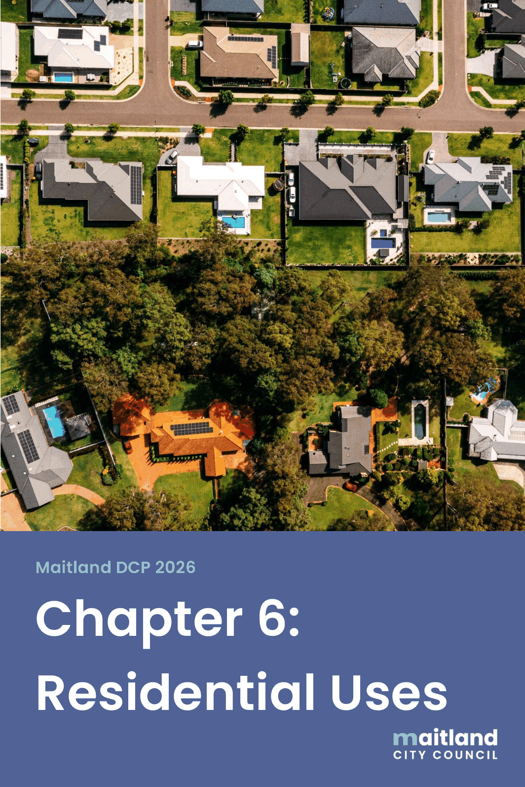

# Maitland Development Control Plan 2026 - Chapter 6 Residential Uses

> This chapter is split into 33 section file(s), one per numbered heading, in the order they appear in the PDF.

Source PDF: [MDCP 2026 - Chapter 6 Residential Uses.pdf](MDCP%202026%20-%20Chapter%206%20Residential%20Uses.pdf)

> [Picture on page 1: a picture, saved as a picture (images/ch-06-00-residential-uses-page-1-1.gif, 150 dpi).]

### Maitland DCP 2026

## Chapter 6: Residential Uses

### Table of Contents – Chapter 6: Residential Uses

6.1. Introduction ....................................................................................................................................................3 6.1.1. Application ................................................................................................................................................. 3 6.1.2. Relationship to other Chapters ........................................................................................................... 3 6.1.3. How to use this Chapter........................................................................................................................ 3 6.1.4. Intent of this Chapter ............................................................................................................................ 3 6.2. General housing controls ......................................................................................................................... 4 6.2.1. Character and design ............................................................................................................................ 4 6.2.2. Development incorporating existing dwellings ............................................................................. 5 6.2.3. Universal accessible design ................................................................................................................ 5 6.2.4. Solar access and cross ventilation ................................................................................................... 6 6.2.5. Visual and acoustic privacy ................................................................................................................ 7 6.2.6. Open space ............................................................................................................................................... 8 6.2.6.1. Communal Open Space (COS) ........................................................................................................ 8 6.2.7. Principal Private Open Space (PPOS) .............................................................................................. 9 6.2.8. Landscaping and landscaped area ................................................................................................. 11 6.2.9. Impervious area .................................................................................................................................... 13 6.2.10. Housing setbacks ............................................................................................................................... 15 6.2.11. Residential building height ............................................................................................................... 19 6.2.12. Fencing and walls ............................................................................................................................... 20 6.2.13. Driveways, carparking and garages ............................................................................................ 21 6.2.13.1. Driveways ........................................................................................................................................... 21 6.2.13.2. Carparking and garages ............................................................................................................... 23 6.2.14. Sites having a boundary to a laneway ........................................................................................ 24 6.3. Dwelling house ........................................................................................................................................... 25 6.4. Dwellings in rural and environmental zones ................................................................................ 25 6.5. Secondary dwellings ............................................................................................................................... 26 6.6. Dual occupancies and semi-detached dwellings ....................................................................... 28 6.7. Attached dwellings ................................................................................................................................... 29 6.8. Boarding houses, Co-living housing, and Group homes ......................................................... 30 6.9. Multi-dwelling housing ............................................................................................................................ 30 6.10. Residential flat buildings and Shop top housing ..................................................................... 33 6.11. Ancillary structures ................................................................................................................................ 37 6.11.1. Swimming Pools ...................................................................................................................................40

<!-- sections -->
## Sections

1. [6.1.1 Application](01-6-1-1-application.md)
2. [6.1.2 Relationship to other Chapters](02-6-1-2-relationship-to-other-chapters.md)
3. [6.1.3 How to use this Chapter](03-6-1-3-how-to-use-this-chapter.md)
4. [6.1.4 Intent of this Chapter](04-6-1-4-intent-of-this-chapter.md)
5. [6.2 General housing controls](05-6-2-general-housing-controls.md)
6. [6.2.1 Character and design](06-6-2-1-character-and-design.md)
7. [6.2.2 Development incorporating existing dwellings](07-6-2-2-development-incorporating-existing.md)
8. [6.2.3 Universal accessible design](08-6-2-3-universal-accessible-design.md)
9. [35 or more](09-35-or-more.md)
10. [6.2.4 Solar access and cross ventilation](10-6-2-4-solar-access-and-cross-ventilation.md)
11. [6.2.5 Visual and acoustic privacy](11-6-2-5-visual-and-acoustic-privacy.md)
12. [6.2.6 Open space](12-6-2-6-open-space.md)
13. [6.2.6.1 Communal Open Space (COS)](13-6-2-6-1-communal-open-space-cos.md)
14. [6.2.7 Principal Private Open Space (PPOS)](14-6-2-7-principal-private-open-space-ppos.md)
15. [6.2.8 Landscaping and landscaped area](15-6-2-8-landscaping-and-landscaped-area.md)
16. [6.2.9 Impervious area](16-6-2-9-impervious-area.md)
17. [6.2.10 Housing setbacks](17-6-2-10-housing-setbacks.md)
18. [6.2.11 Residential building height](18-6-2-11-residential-building-height.md)
19. [6.2.12 Fencing and walls](19-6-2-12-fencing-and-walls.md)
20. [6.2.13 Driveways, carparking and garages](20-6-2-13-driveways-carparking-and-garages.md)
21. [6.2.13.1 Driveways](21-6-2-13-1-driveways.md)
22. [6.2.13.2 Carparking and garages](22-6-2-13-2-carparking-and-garages.md)
23. [6.2.14 Sites having a boundary to a laneway](23-6-2-14-sites-having-a-boundary-to-a-laneway.md)
24. [6.3 Dwelling house](24-6-3-dwelling-house.md)
25. [6.4 Dwellings in rural and environmental zones](25-6-4-dwellings-in-rural-and-environmental.md)
26. [6.5 Secondary dwellings](26-6-5-secondary-dwellings.md)
27. [6.6 Dual occupancies and semi-detached dwellings](27-6-6-dual-occupancies-and-semi-detached.md)
28. [6.7 Attached dwellings](28-6-7-attached-dwellings.md)
29. [6.8 Boarding houses, Co-living housing, and Group homes](29-6-8-boarding-houses-co-living-housing-and.md)
30. [6.9 Multi-dwelling housing](30-6-9-multi-dwelling-housing.md)
31. [6.10 Residential flat buildings and Shop top housing](31-6-10-residential-flat-buildings-and-shop-top.md)
32. [6.11 Ancillary structures](32-6-11-ancillary-structures.md)
33. [6.11.1 Swimming Pools](33-6-11-1-swimming-pools.md)
