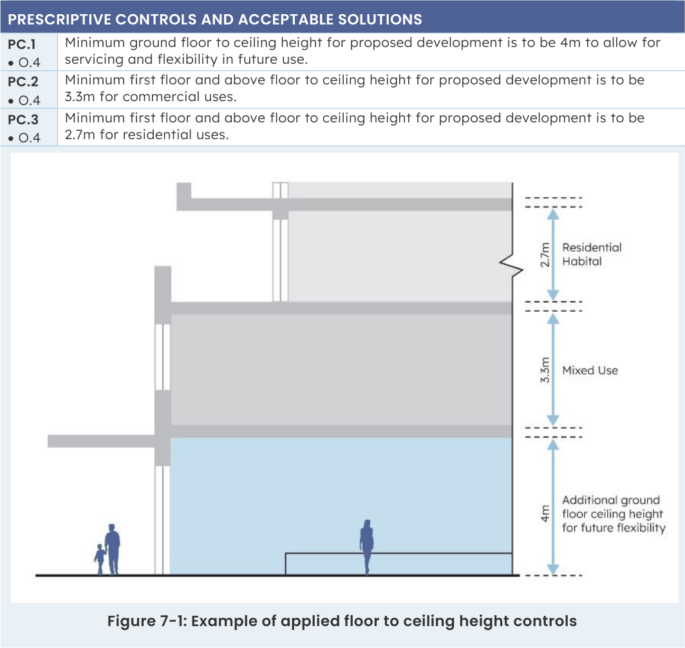
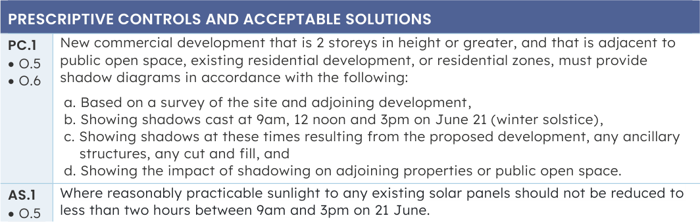
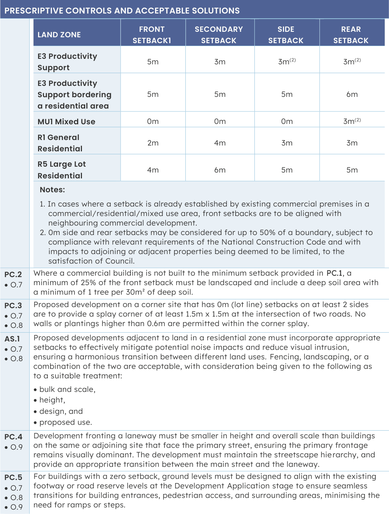

### 7.2. Scale and bulk

#### 7.2.1. Building height

#### Objectives

O.1 To create an appropriate interaction between new commercial uses, existing commercial uses, street widths, and any surrounding land uses.

O.2 To achieve a consistent scale and built height at the street boundary. O.3 To ensure that new commercial development reflects the desired future scale and density of the area while balancing existing built form and streetscape character.

| PRESCRIPTIVE CONTROLS AND ACCEPTABLE SOLUTIONS |  |
|---|---|
| PC.1 • O.1 | The height of proposed development is to be in accordance with the Height of Buildings Map provided under Clause 4.3 of the MLEP 2011. Where no height limit is specified, a merit- based approach is taken. |
| AS.1 • O.1 • O.2 | In areas where development is permitted to the boundary line under Section 7.2.4 Place activation of this Chapter, buildings of three stories or more are encouraged to be stepped back from the third storey and above to provide the appearance of a two-storey wall height to the primary street. |
| PC.2 • O.2 | Where proposed development adjoins low density residential properties, the building height is to be stepped down at the edge of the building envelope to a maximum of two storeys. |
| PC.3 | Proposed building heights are to ensure that adequate solar access is maintained to existing adjoining dwelling’s private open space and communal open space, and areas of developed public open space. |
| • O.1 |  |
| • O.2 |  |
| AS.2 | Ancillary buildings to a proposed development on a laneway should not exceed 6m in height. |
| • O.1 |  |
| • O.2 |  |
| • O.3 |  |
| AS.3 | Proposed development over 15m in height should have a minimum of 20m of site frontage in order to assist in achieving a consistent bulk and scale. |
| • O.1 |  |

#### 7.2.2. Ceiling height

#### Objectives

O.4 To provide floor to ceiling heights within commercial development that allows for a wide range of potential commercial uses throughout the design life of a building.

> [Picture on page 6: a picture, saved as a picture (images/ch-07-00-commercial-uses-page-6-5.gif, 150 dpi).]
> Words printed on the picture (title and legend, copied from the PDF):
> • O.4
> • O.4
> • O.4

Figure 7-1: Example of applied floor to ceiling height controls

#### PRESCRIPTIVE CONTROLS AND ACCEPTABLE SOLUTIONS

Minimum ground floor to ceiling height for proposed development is to be 4m to allow for servicing and flexibility in future use.

#### PC.1

Minimum first floor and above floor to ceiling height for proposed development is to be 3.3m for commercial uses.

#### PC.2

Minimum first floor and above floor to ceiling height for proposed development is to be 2.7m for residential uses.

#### PC.3

#### 7.2.3. Overshadowing and privacy

#### Objectives

O.5 Ensure development retains reasonable levels of solar access to neighbouring properties including for solar panels and private open space.

O.6 Ensure that commercial development does not generate adverse amenity impacts on residential and other sensitive land uses.

> [Picture on page 7: a picture, saved as a picture (images/ch-07-00-commercial-uses-page-7-7.gif, 150 dpi).]
> Words printed on the picture (title and legend, copied from the PDF):
> • O.5
> • O.6
> • O.5

#### PRESCRIPTIVE CONTROLS AND ACCEPTABLE SOLUTIONS

New commercial development that is 2 storeys in height or greater, and that is adjacent to public open space, existing residential development, or residential zones, must provide shadow diagrams in accordance with the following:

#### PC.1

a. Based on a survey of the site and adjoining development,

b. Showing shadows cast at 9am, 12 noon and 3pm on June 21 (winter solstice),

c. Showing shadows at these times resulting from the proposed development, any ancillary structures, any cut and fill, and

d. Showing the impact of shadowing on adjoining properties or public open space. Where reasonably practicable sunlight to any existing solar panels should not be reduced to less than two hours between 9am and 3pm on 21 June.

#### AS.1

#### 7.2.4. Setbacks

#### Objectives

O.7 To ensure commercial buildings in main street environments are built to the front property boundary, reinforcing the spatial character and promoting an active street frontage.

O.8 To ensure commercial developments outside of main streets contribute positively to the streetscape through appropriate setbacks and landscaping.

O.9 To mitigate potential impacts of commercial developments on adjoining sensitive areas.

#### PRESCRIPTIVE CONTROLS AND ACCEPTABLE SOLUTIONS

Unless the proposed development is within a commercial precinct identified under Chapter 10 of this DCP or otherwise have a nominated setback under Section 7.6 of this Chapter, setbacks for development for commercial uses are to be provided in accordance with Table 7.1 below:

#### PC.1

• O.7

• O.8

• O.9

#### Table 7.1: Minimum setbacks for commercial uses

| LAND ZONE | FRONT SETBACK1 | SECONDARY SETBACK | SIDE SETBACK | REAR SETBACK 3m(2) |
|---|---|---|---|---|
| E1 Local Centre | 0m | 0m | 0m |  |
| E1 Local Centre | 0m | 2m | 3m 6m |  |
| bordering a |  |  |  |  |
| residential area |  |  |  |  |
| E2 Commercial | 0m | 0m | 0m 3m(2) |  |
| Centre |  |  |  |  |
| E2 Commercial | 5m | 5m | 5m 6m |  |
| Centre bordering |  |  |  |  |
| a residential area |  |  |  |  |

> [Picture on page 8: a picture, saved as a picture (images/ch-07-00-commercial-uses-page-8-1.gif, 150 dpi).]
> Words printed on the picture (title and legend, copied from the PDF):
> • O.7
> • O.7
> • O.8
> • O.7
> • O.8
> • O.9
> • O.7
> • O.8
> • O.9

|  | FRONT | SECONDARY | SIDE | REAR |
|---|---|---|---|---|
| LAND ZONE | SETBACK1 | SETBACK | SETBACK | SETBACK |
| E3 Productivity | 5m | 3m | 3m(2) | 3m(2) |
| Support |  |  |  |  |
| E3 Productivity |  |  |  |  |
| Support bordering | 5m | 5m | 5m | 6m |
| a residential area |  |  |  |  |
| MU1 Mixed Use | 0m | 0m | 0m | 3m(2) |
| R1 General |  |  |  |  |
| Residential | 2m | 4m | 3m | 3m |
| R5 Large Lot Residential | 4m | 6m | 5m | 5m |
| Notes: |  |  |  |  |

1\. In cases where a setback is already established by existing commercial premises in a commercial/residential/mixed use area, front setbacks are to be aligned with neighbouring commercial development.

2\. 0m side and rear setbacks may be considered for up to 50% of a boundary, subject to compliance with relevant requirements of the National Construction Code and with impacts to adjoining or adjacent properties being deemed to be limited, to the satisfaction of Council.

#### PC.2

Where a commercial building is not built to the minimum setback provided in PC.1, a minimum of 25% of the front setback must be landscaped and include a deep soil area with a minimum of 1 tree per 30m² of deep soil. Proposed development on a corner site that has 0m (lot line) setbacks on at least 2 sides are to provide a splay corner of at least 1.5m x 1.5m at the intersection of two roads. No walls or plantings higher than 0.6m are permitted within the corner splay.

#### PC.3

#### AS.1

Proposed developments adjacent to land in a residential zone must incorporate appropriate setbacks to effectively mitigate potential noise impacts and reduce visual intrusion, ensuring a harmonious transition between different land uses. Fencing, landscaping, or a combination of the two are acceptable, with consideration being given to the following as to a suitable treatment:

• bulk and scale,

• height,

• design, and

• proposed use.

#### PC.4

Development fronting a laneway must be smaller in height and overall scale than buildings on the same or adjoining site that face the primary street, ensuring the primary frontage remains visually dominant. The development must maintain the streetscape hierarchy, and provide an appropriate transition between the main street and the laneway. For buildings with a zero setback, ground levels must be designed to align with the existing footway or road reserve levels at the Development Application stage to ensure seamless transitions for building entrances, pedestrian access, and surrounding areas, minimising the need for ramps or steps.

#### PC.5
