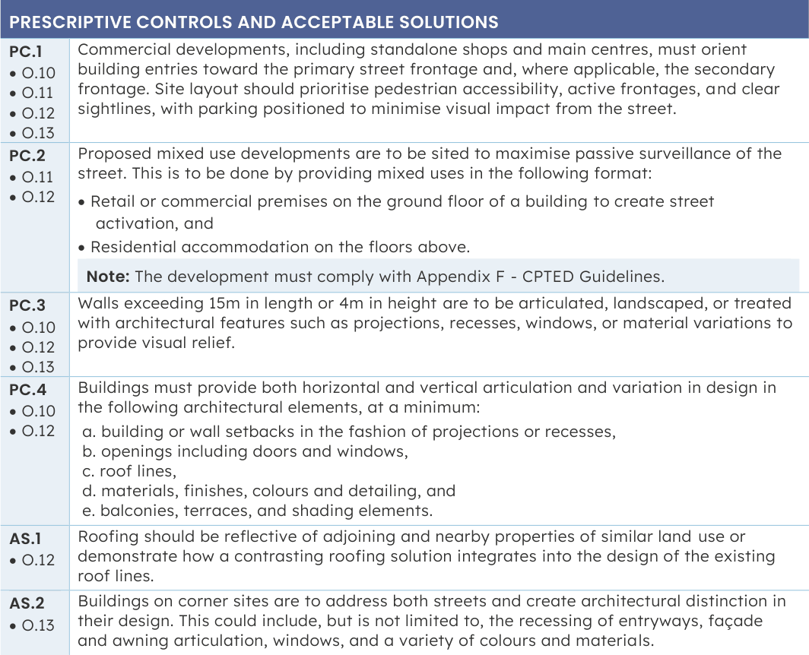
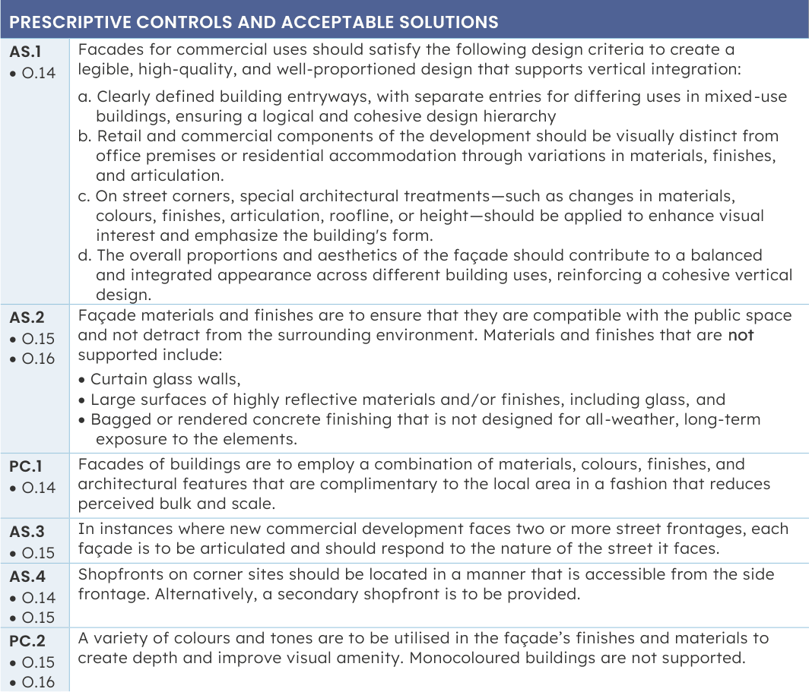
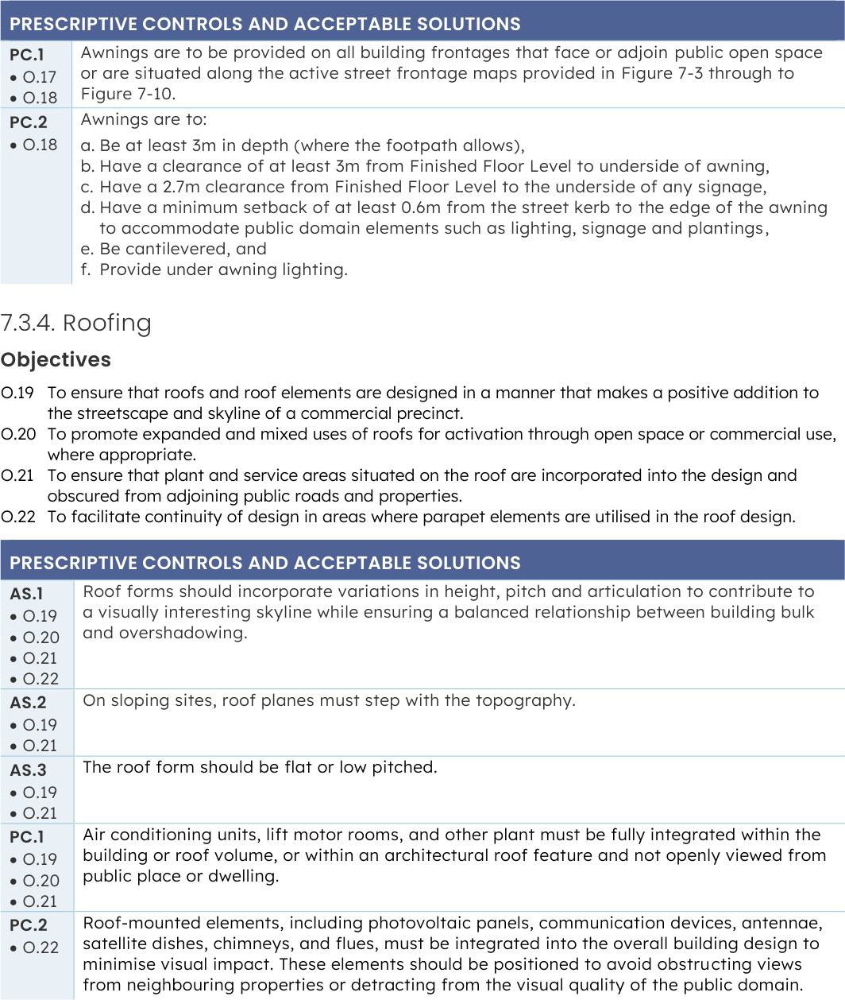
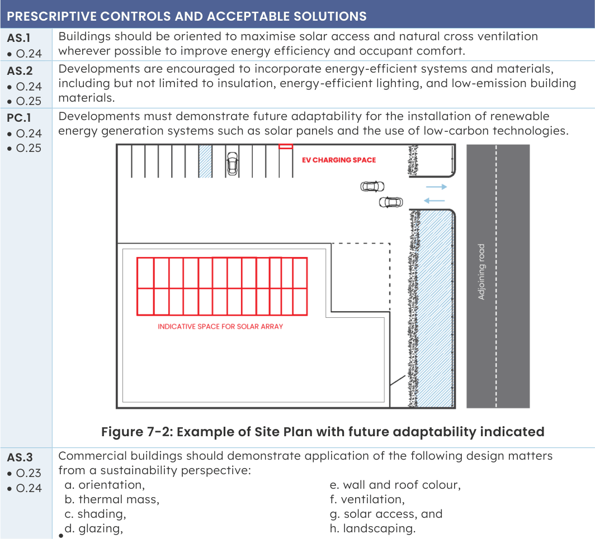

### 7.3. Built form

#### 7.3.1. Appearance and articulation

#### Objectives

O.10 To facilitate a variety of built form that is contextually appropriate and amenable to local character. O.11 To encourage commercial development in new urban areas to address the streetscape and foster easy wayfinding and interaction, while simultaneously promoting improvements in function and innovation.

O.12 To ensure new commercial development is appropriately integrated within existing urban areas by incorporating key design elements that complement the surrounding streetscape.

O.13 To ensure that buildings on key sites, particularly corner sites, incorporate distinctive architectural features that enhance visual interest while maintaining harmony with the surrounding streetscape.

> [Picture on page 9: a map, saved as a picture (images/ch-07-00-commercial-uses-page-9-12.gif, 150 dpi); the street names and other small labels are on the picture.]

#### PRESCRIPTIVE CONTROLS AND ACCEPTABLE SOLUTIONS

Commercial developments, including standalone shops and main centres, must orient building entries toward the primary street frontage and, where applicable, the secondary frontage. Site layout should prioritise pedestrian accessibility, active frontages, and clear sightlines, with parking positioned to minimise visual impact from the street.

#### PC.1

Proposed mixed use developments are to be sited to maximise passive surveillance of the street. This is to be done by providing mixed uses in the following format:

#### PC.2

• Retail or commercial premises on the ground floor of a building to create street

• Residential accommodation on the floors above. Note: The development must comply with Appendix F - CPTED Guidelines. Walls exceeding 15m in length or 4m in height are to be articulated, landscaped, or treated with architectural features such as projections, recesses, windows, or material variations to provide visual relief.

#### PC.3

Buildings must provide both horizontal and vertical articulation and variation in design in the following architectural elements, at a minimum:

#### PC.4

• O.12 a. building or wall setbacks in the fashion of projections or recesses,

b. openings including doors and windows,

c. roof lines,

d. materials, finishes, colours and detailing, and

e. balconies, terraces, and shading elements.

#### AS.1

Roofing should be reflective of adjoining and nearby properties of similar land use or demonstrate how a contrasting roofing solution integrates into the design of the existing roof lines.

#### AS.2

Buildings on corner sites are to address both streets and create architectural distinction in their design. This could include, but is not limited to, the recessing of entryways, façade and awning articulation, windows, and a variety of colours and materials.

#### 7.3.2. Facades

#### Objectives

O.14 To create legible design where the façade of the building reflects and expresses the function and purpose of the building.

O.15 To foster and establish visually interesting building facades in the streetscape that simultaneously integrate and blend with a local area.

O.16 To encourage an increase in detailed and fine grain characteristics to facades for commercial and mixed uses.

> [Picture on page 10: a picture, saved as a picture (images/ch-07-00-commercial-uses-page-10-9.gif, 150 dpi).]
> Words printed on the picture (title and legend, copied from the PDF):
> • O.14
> • O.15
> • O.16
> exposure to the elements.
> • O.14
> • O.15
> • O.14
> • O.15
> • O.15
> • O.16

#### PRESCRIPTIVE CONTROLS AND ACCEPTABLE SOLUTIONS

Facades for commercial uses should satisfy the following design criteria to create a legible, high-quality, and well-proportioned design that supports vertical integration:

#### AS.1

a. Clearly defined building entryways, with separate entries for differing uses in mixed-use buildings, ensuring a logical and cohesive design hierarchy

b. Retail and commercial components of the development should be visually distinct from office premises or residential accommodation through variations in materials, finishes, and articulation.

c. On street corners, special architectural treatments—such as changes in materials, colours, finishes, articulation, roofline, or height—should be applied to enhance visual interest and emphasize the building's form.

d. The overall proportions and aesthetics of the façade should contribute to a balanced

Façade materials and finishes are to ensure that they are compatible with the public space and not detract from the surrounding environment. Materials and finishes that are not supported include:

and integrated appearance across different building uses, reinforcing a cohesive vertical design.

#### AS.2

• Curtain glass walls,

• Large surfaces of highly reflective materials and/or finishes, including glass, and

• Bagged or rendered concrete finishing that is not designed for all-weather, long-term

#### PC.1

Facades of buildings are to employ a combination of materials, colours, finishes, and architectural features that are complimentary to the local area in a fashion that reduces perceived bulk and scale. In instances where new commercial development faces two or more street frontages, each façade is to be articulated and should respond to the nature of the street it faces.

#### AS.3

Shopfronts on corner sites should be located in a manner that is accessible from the side frontage. Alternatively, a secondary shopfront is to be provided.

#### AS.4

A variety of colours and tones are to be utilised in the façade’s finishes and materials to create depth and improve visual amenity. Monocoloured buildings are not supported.

#### PC.2

#### 7.3.3. Awnings

#### Objectives

O.17 To create streetscapes that are more resilient to extreme weather conditions. O.18 To provide continuous shelter and amenity for pedestrians within commercially oriented areas.

> [Picture on page 11: a picture, saved as a picture (images/ch-07-00-commercial-uses-page-11-5.gif, 150 dpi).]
> Words printed on the picture (title and legend, copied from the PDF):
> • O.17
> • O.18

Figure 7-10.

#### PRESCRIPTIVE CONTROLS AND ACCEPTABLE SOLUTIONS

Awnings are to be provided on all building frontages that face or adjoin public open space or are situated along the active street frontage maps provided in Figure 7-3 through to

#### PC.1

Awnings are to:

#### PC.2

• O.18 a. Be at least 3m in depth (where the footpath allows),

b. Have a clearance of at least 3m from Finished Floor Level to underside of awning,

c. Have a 2.7m clearance from Finished Floor Level to the underside of any signage,

d. Have a minimum setback of at least 0.6m from the street kerb to the edge of the awning to accommodate public domain elements such as lighting, signage and plantings,

e. Be cantilevered, and

f. Provide under awning lighting.

#### 7.3.4. Roofing

#### Objectives

O.19 To ensure that roofs and roof elements are designed in a manner that makes a positive addition to the streetscape and skyline of a commercial precinct.

O.20 To promote expanded and mixed uses of roofs for activation through open space or commercial use, where appropriate.

O.21 To ensure that plant and service areas situated on the roof are incorporated into the design and obscured from adjoining public roads and properties.

O.22 To facilitate continuity of design in areas where parapet elements are utilised in the roof design.

#### PRESCRIPTIVE CONTROLS AND ACCEPTABLE SOLUTIONS

Roof forms should incorporate variations in height, pitch and articulation to contribute to a visually interesting skyline while ensuring a balanced relationship between building bulk and overshadowing.

#### AS.1

On sloping sites, roof planes must step with the topography.

#### AS.2

The roof form should be flat or low pitched.

#### AS.3

Air conditioning units, lift motor rooms, and other plant must be fully integrated within the building or roof volume, or within an architectural roof feature and not openly viewed from public place or dwelling.

#### PC.1

#### PC.2

Roof-mounted elements, including photovoltaic panels, communication devices, antennae, satellite dishes, chimneys, and flues, must be integrated into the overall building design to minimise visual impact. These elements should be positioned to avoid obstructing views from neighbouring properties or detracting from the visual quality of the public domain.

#### 7.3.5. Sustainable design

#### Objectives

O.23 To ensure building orientation maximises solar access and natural cross ventilation, promoting energy efficiency and occupant comfort.

O.24 To encourage the integration of energy-efficient systems and materials to reduce the overall environmental impact of commercial development.

O.25 To support the future adaptability of commercial buildings by incorporating design features that facilitate the installation of renewable energy generation and low-carbon technologies.

> [Picture on page 12: a map, saved as a picture (images/ch-07-00-commercial-uses-page-12-9.gif, 150 dpi); the street names and other small labels are on the picture.]
> Words printed on the picture (title and legend, copied from the PDF):
> b. thermal mass,

Figure 7-2: Example of Site Plan with future adaptability indicated

#### PRESCRIPTIVE CONTROLS AND ACCEPTABLE SOLUTIONS

Buildings should be oriented to maximise solar access and natural cross ventilation wherever possible to improve energy efficiency and occupant comfort.

#### AS.1

Developments are encouraged to incorporate energy-efficient systems and materials, including but not limited to insulation, energy-efficient lighting, and low-emission building materials.

#### AS.2

Developments must demonstrate future adaptability for the installation of renewable energy generation systems such as solar panels and the use of low-carbon technologies.

#### PC.1

Commercial buildings should demonstrate application of the following design matters from a sustainability perspective:

#### AS.3

e. wall and roof colour,

f. ventilation,

g. solar access, and

h. landscaping.
