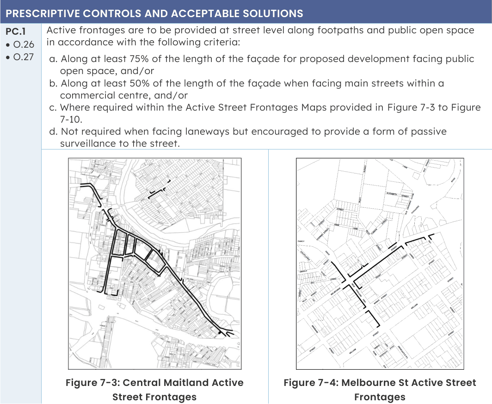
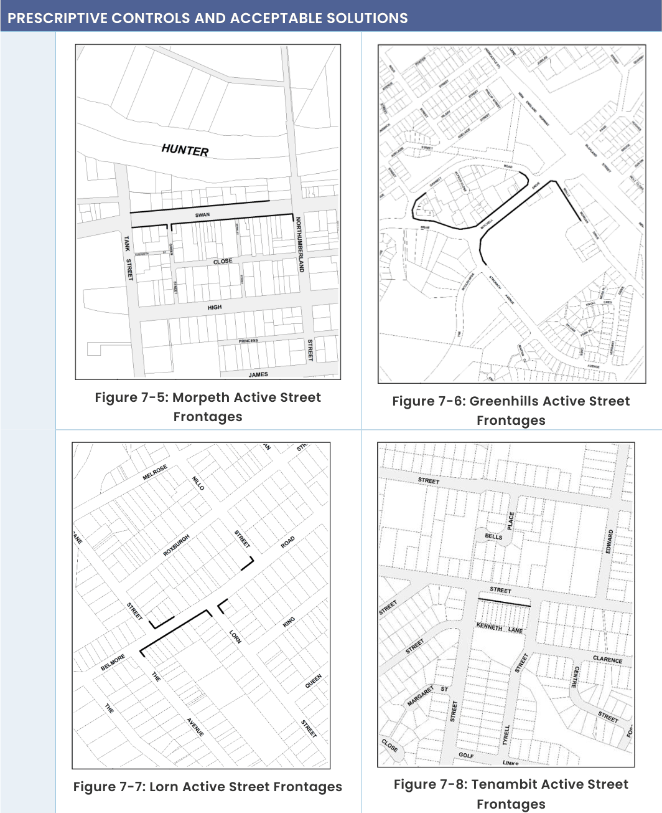
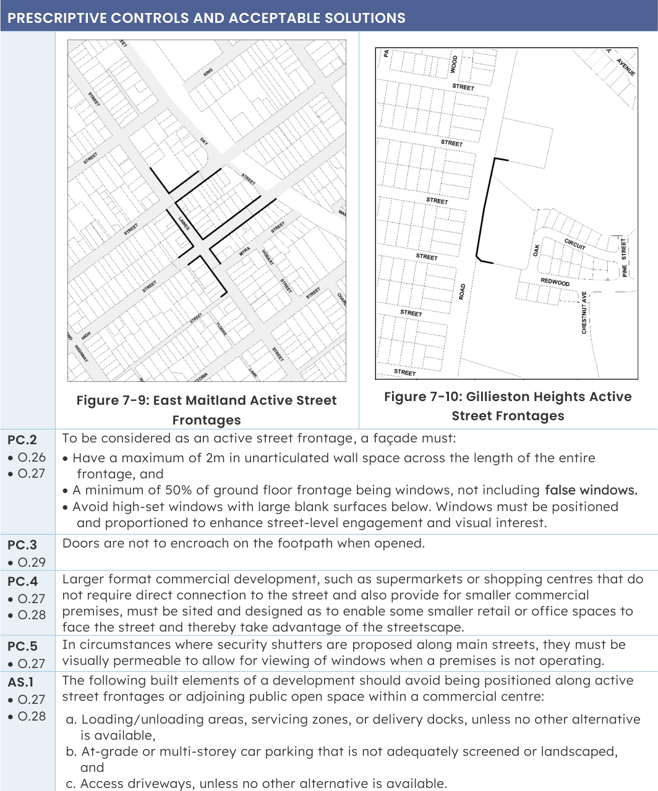
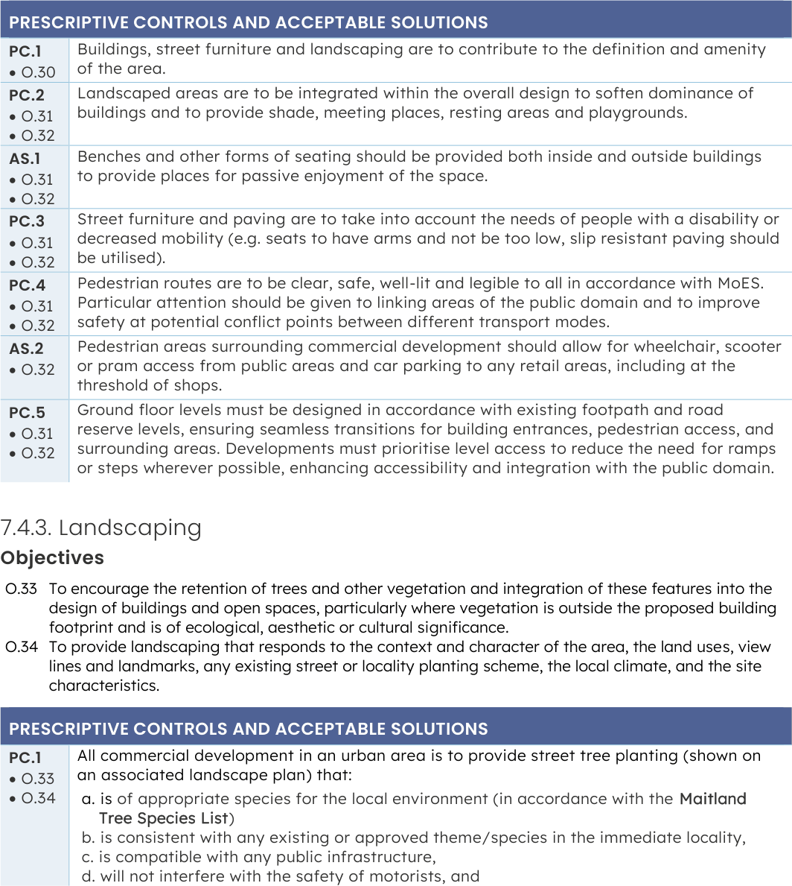
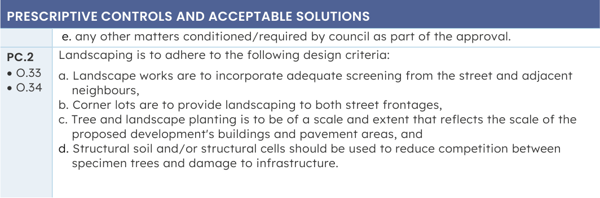
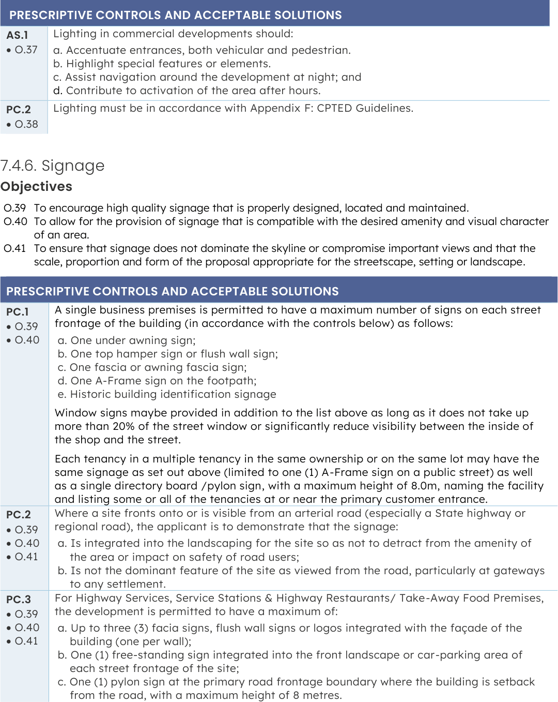
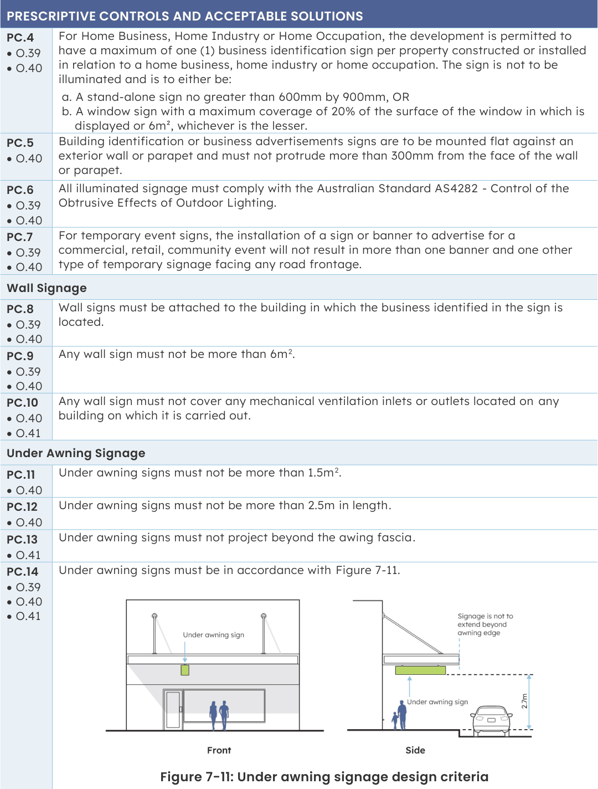
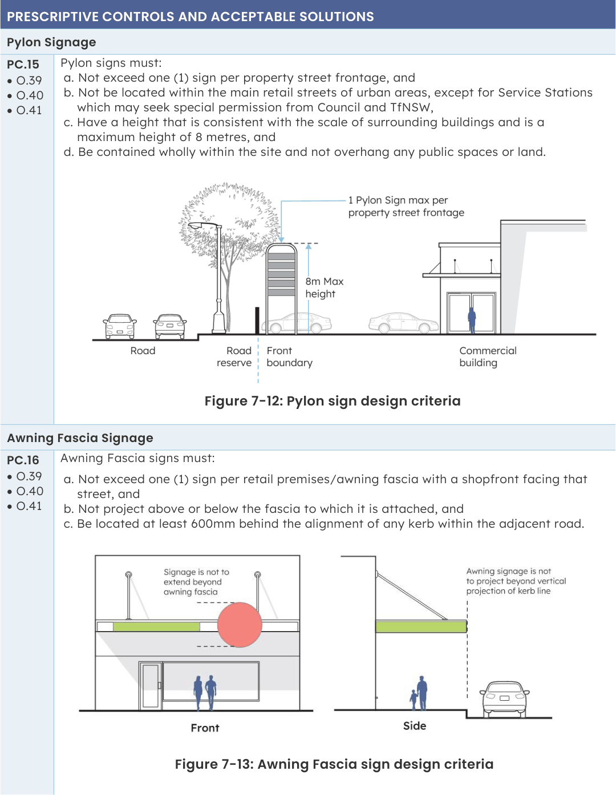
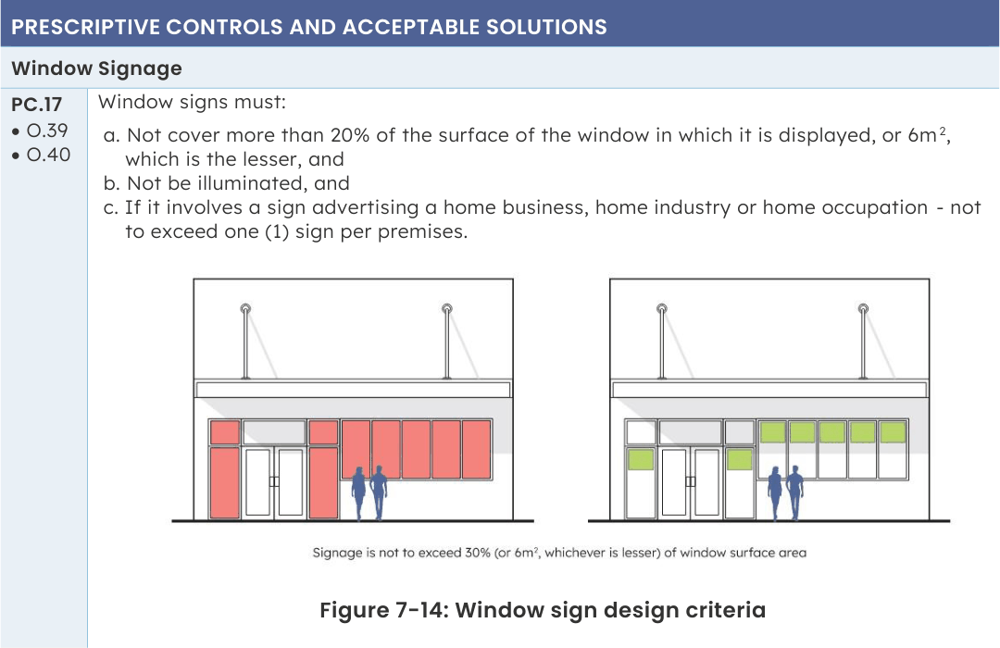

### 7.4. Place activation

#### 7.4.1. Active street frontages

#### Objectives

O.26 To foster activation of street frontages through effective design that encourages amenity, safety, and accessibility.

O.27 To encourage active uses and pedestrian oriented development at ground level in commercial development.

O.28 To optimise social and economic development through enlivening urban environments that encourage pedestrian activity.

O.29 To limit activities that have the potential to damage pedestrian activity or amenity.

> [Picture on page 13: a picture, saved as a picture (images/ch-07-00-commercial-uses-page-13-8.gif, 150 dpi).]
> Words printed on the picture (title and legend, copied from the PDF):
> open space, and/or
> commercial centre, and/or
> 7-10.
> surveillance to the street.

Figure 7-3: Central Maitland Active Figure 7-4: Melbourne St Active Street

#### PRESCRIPTIVE CONTROLS AND ACCEPTABLE SOLUTIONS

Active frontages are to be provided at street level along footpaths and public open space in accordance with the following criteria:

#### PC.1

• O.26

• O.27 a. Along at least 75% of the length of the façade for proposed development facing public

b. Along at least 50% of the length of the façade when facing main streets within a

c. Where required within the Active Street Frontages Maps provided in Figure 7-3 to Figure

d. Not required when facing laneways but encouraged to provide a form of passive

#### Street Frontages

#### Frontages

> [Picture on page 14: a picture, saved as a picture (images/ch-07-00-commercial-uses-page-14-1.gif, 150 dpi).]

Figure 7-5: Morpeth Active Street

Figure 7-6: Greenhills Active Street

Figure 7-8: Tenambit Active Street

Figure 7-7: Lorn Active Street Frontages

#### Frontages

#### Frontages

#### Frontages

> [Picture on page 15: a picture, saved as a picture (images/ch-07-00-commercial-uses-page-15-1.gif, 150 dpi).]
> Words printed on the picture (title and legend, copied from the PDF):
> • O.26
> • O.27
> frontage, and
> • O.29
> • O.27
> • O.28
> • O.27
> is available,
> and

Figure 7-10: Gillieston Heights Active

Figure 7-9: East Maitland Active Street

#### Street Frontages

#### Frontages

To be considered as an active street frontage, a façade must:

#### PC.2

• Have a maximum of 2m in unarticulated wall space across the length of the entire

• A minimum of 50% of ground floor frontage being windows, not including false windows.

• Avoid high-set windows with large blank surfaces below. Windows must be positioned and proportioned to enhance street-level engagement and visual interest. Doors are not to encroach on the footpath when opened.

#### PC.3

#### PC.4

In circumstances where security shutters are proposed along main streets, they must be visually permeable to allow for viewing of windows when a premises is not operating.

Larger format commercial development, such as supermarkets or shopping centres that do not require direct connection to the street and also provide for smaller commercial premises, must be sited and designed as to enable some smaller retail or office spaces to face the street and thereby take advantage of the streetscape.

#### PC.5

The following built elements of a development should avoid being positioned along active street frontages or adjoining public open space within a commercial centre:

#### AS.1

• O.27

• O.28 a. Loading/unloading areas, servicing zones, or delivery docks, unless no other alternative

b. At-grade or multi-storey car parking that is not adequately screened or landscaped,

c. Access driveways, unless no other alternative is available.

#### 7.4.2. Public domain

#### Objectives

O.30 To provide a safe walkable environment around commercial development, with visual interest, pedestrian amenity, and opportunities for social interaction.

O.31 To promote commercial development that is well connected to the street and contributes to the functionality of the public domain.

O.32 To ensure that commercial development is accessible to all members of the community.

> [Picture on page 16: a map, saved as a picture (images/ch-07-00-commercial-uses-page-16-8.gif, 150 dpi); the street names and other small labels are on the picture.]

#### PRESCRIPTIVE CONTROLS AND ACCEPTABLE SOLUTIONS

Buildings, street furniture and landscaping are to contribute to the definition and amenity of the area.

#### PC.1

Landscaped areas are to be integrated within the overall design to soften dominance of buildings and to provide shade, meeting places, resting areas and playgrounds.

#### PC.2

Benches and other forms of seating should be provided both inside and outside buildings to provide places for passive enjoyment of the space.

#### AS.1

Street furniture and paving are to take into account the needs of people with a disability or decreased mobility (e.g. seats to have arms and not be too low, slip resistant paving should be utilised).

#### PC.3

Pedestrian routes are to be clear, safe, well-lit and legible to all in accordance with MoES. Particular attention should be given to linking areas of the public domain and to improve safety at potential conflict points between different transport modes.

#### PC.4

#### AS.2

Pedestrian areas surrounding commercial development should allow for wheelchair, scooter or pram access from public areas and car parking to any retail areas, including at the threshold of shops.

#### PC.5

Ground floor levels must be designed in accordance with existing footpath and road reserve levels, ensuring seamless transitions for building entrances, pedestrian access, and surrounding areas. Developments must prioritise level access to reduce the need for ramps or steps wherever possible, enhancing accessibility and integration with the public domain.

#### 7.4.3. Landscaping

#### Objectives

O.33 To encourage the retention of trees and other vegetation and integration of these features into the design of buildings and open spaces, particularly where vegetation is outside the proposed building footprint and is of ecological, aesthetic or cultural significance.

O.34 To provide landscaping that responds to the context and character of the area, the land uses, view lines and landmarks, any existing street or locality planting scheme, the local climate, and the site characteristics.

> Words printed on the picture (title and legend, copied from the PDF):
> Tree Species List)

#### PRESCRIPTIVE CONTROLS AND ACCEPTABLE SOLUTIONS

All commercial development in an urban area is to provide street tree planting (shown on an associated landscape plan) that:

#### PC.1

• O.33

• O.34 a. is of appropriate species for the local environment (in accordance with the Maitland

b. is consistent with any existing or approved theme/species in the immediate locality,

c. is compatible with any public infrastructure,

d. will not interfere with the safety of motorists, and

> [Picture on page 17: a picture, saved as a picture (images/ch-07-00-commercial-uses-page-17-1.gif, 150 dpi).]
> Words printed on the picture (title and legend, copied from the PDF):
> • O.33
> • O.34 neighbours,

e. any other matters conditioned/required by council as part of the approval. Landscaping is to adhere to the following design criteria:

a. Landscape works are to incorporate adequate screening from the street and adjacent

#### PC.2

b. Corner lots are to provide landscaping to both street frontages,

c. Tree and landscape planting is to be of a scale and extent that reflects the scale of the proposed development's buildings and pavement areas, and

d. Structural soil and/or structural cells should be used to reduce competition between specimen trees and damage to infrastructure.

#### 7.4.4. Fencing

#### Objectives

O.35 Provide privacy, security and noise attenuation while complementing the streetscape and adjacent buildings.

O.36 Provide for active street frontages and pedestrian access.

| PRESCRIPTIVE CONTROLS AND ACCEPTABLE SOLUTIONS |  |
|---|---|
| PC.1 | The use of fencing and walls along primary street frontages is not supported. |
| • O.35 |  |
| PC.2 | Fencing design adjoining public spaces is not to be sheet/metal fencing. |
| • O.35 |  |
| • O.36 |  |
| PC.3 | No fence is to provided at more than a height of 3m above existing ground level. |
| • O.35 |  |
| • O.36 |  |
| PC.4 | Fencing must complement the existing streetscape in relation to scale and materials and use similar or compatible materials to those used in attractive buildings within the locality. |
| • O.35 |  |
| • O.36 |  |
| AS.1 | Fencing should be open for at least 75% of the area of the fence that is more than 1.2m above ground level (existing) if located on the boundary of, or within, the setback area. |
| • O.36 |  |

#### 7.4.5. Lighting

#### Objectives

O.37 To ensure that business development does not result in unacceptable amenity impacts on adjoining land.

O.38 To ensure that lighting is integrated into the design of the building in a way which enhances and compliments its architecture and also promotes the safety of people moving in and around the building.

| PRESCRIPTIVE CONTROLS AND ACCEPTABLE SOLUTIONS |  |
|---|---|
| PC.1 | New commercial development must provide external lighting in accordance with Australian Standards. |
| • O.37 |  |

> [Picture on page 18: a picture, saved as a picture (images/ch-07-00-commercial-uses-page-18-1.gif, 150 dpi).]
> Words printed on the picture (title and legend, copied from the PDF):
> • O.38

Lighting in commercial developments should:

#### AS.1

• O.37 a. Accentuate entrances, both vehicular and pedestrian.

b. Highlight special features or elements.

c. Assist navigation around the development at night; and

d. Contribute to activation of the area after hours. Lighting must be in accordance with Appendix F: CPTED Guidelines.

#### PC.2

#### 7.4.6. Signage

#### Objectives

O.39 To encourage high quality signage that is properly designed, located and maintained. O.40 To allow for the provision of signage that is compatible with the desired amenity and visual character of an area.

O.41 To ensure that signage does not dominate the skyline or compromise important views and that the scale, proportion and form of the proposal appropriate for the streetscape, setting or landscape.

> Words printed on the picture (title and legend, copied from the PDF):
> to any settlement.

#### PRESCRIPTIVE CONTROLS AND ACCEPTABLE SOLUTIONS

A single business premises is permitted to have a maximum number of signs on each street frontage of the building (in accordance with the controls below) as follows:

#### PC.1

• O.40 a. One under awning sign;

b. One top hamper sign or flush wall sign;

c. One fascia or awning fascia sign;

d. One A-Frame sign on the footpath;

e. Historic building identification signage Window signs maybe provided in addition to the list above as long as it does not take up more than 20% of the street window or significantly reduce visibility between the inside of the shop and the street.

Where a site fronts onto or is visible from an arterial road (especially a State highway or regional road), the applicant is to demonstrate that the signage:

a. Is integrated into the landscaping for the site so as not to detract from the amenity of

Each tenancy in a multiple tenancy in the same ownership or on the same lot may have the same signage as set out above (limited to one (1) A-Frame sign on a public street) as well as a single directory board /pylon sign, with a maximum height of 8.0m, naming the facility and listing some or all of the tenancies at or near the primary customer entrance.

#### PC.2

• O.40

• O.41 the area or impact on safety of road users;

b. Is not the dominant feature of the site as viewed from the road, particularly at gateways

For Highway Services, Service Stations & Highway Restaurants/ Take-Away Food Premises, the development is permitted to have a maximum of:

a. Up to three (3) facia signs, flush wall signs or logos integrated with the façade of the

#### PC.3

• O.40

• O.41 building (one per wall);

b. One (1) free-standing sign integrated into the front landscape or car-parking area of each street frontage of the site;

c. One (1) pylon sign at the primary road frontage boundary where the building is setback from the road, with a maximum height of 8 metres.

> [Picture on page 19: a map, saved as a picture (images/ch-07-00-commercial-uses-page-19-1.gif, 150 dpi); the street names and other small labels are on the picture.]

Figure 7-11: Under awning signage design criteria

#### PC.4

For Home Business, Home Industry or Home Occupation, the development is permitted to have a maximum of one (1) business identification sign per property constructed or installed in relation to a home business, home industry or home occupation. The sign is not to be illuminated and is to either be:

a. A stand-alone sign no greater than 600mm by 900mm, OR

b. A window sign with a maximum coverage of 20% of the surface of the window in which is displayed or 6m², whichever is the lesser.

#### PC.5

Building identification or business advertisements signs are to be mounted flat against an exterior wall or parapet and must not protrude more than 300mm from the face of the wall or parapet. All illuminated signage must comply with the Australian Standard AS4282 - Control of the Obtrusive Effects of Outdoor Lighting.

#### PC.6

For temporary event signs, the installation of a sign or banner to advertise for a commercial, retail, community event will not result in more than one banner and one other type of temporary signage facing any road frontage.

#### PC.7

#### Wall Signage

Wall signs must be attached to the building in which the business identified in the sign is located.

#### PC.8

Any wall sign must not be more than 6m2.

#### PC.9

Any wall sign must not cover any mechanical ventilation inlets or outlets located on any building on which it is carried out.

#### PC.10

#### Under Awning Signage

Under awning signs must not be more than 1.5m2.

#### PC.11

Under awning signs must not be more than 2.5m in length.

#### PC.12

Under awning signs must not project beyond the awing fascia.

#### PC.13

Under awning signs must be in accordance with Figure 7-11.

#### PC.14

> [Picture on page 20: a picture, saved as a picture (images/ch-07-00-commercial-uses-page-20-1.gif, 150 dpi).]
> Words printed on the picture (title and legend, copied from the PDF):
> • O.39
> • O.40
> • O.41
> • O.39
> • O.40
> • O.41
> street, and

Figure 7-12: Pylon sign design criteria

Figure 7-13: Awning Fascia sign design criteria

#### Pylon Signage

Pylon signs must:

a. Not exceed one (1) sign per property street frontage, and

b. Not be located within the main retail streets of urban areas, except for Service Stations

#### PC.15

which may seek special permission from Council and TfNSW,

c. Have a height that is consistent with the scale of surrounding buildings and is a maximum height of 8 metres, and

d. Be contained wholly within the site and not overhang any public spaces or land.

#### Awning Fascia Signage

Awning Fascia signs must:

a. Not exceed one (1) sign per retail premises/awning fascia with a shopfront facing that

#### PC.16

b. Not project above or below the fascia to which it is attached, and

c. Be located at least 600mm behind the alignment of any kerb within the adjacent road.

> [Picture on page 21: a picture, saved as a picture (images/ch-07-00-commercial-uses-page-21-1.gif, 150 dpi).]

Figure 7-14: Window sign design criteria

#### Window Signage

Window signs must:

a. Not cover more than 20% of the surface of the window in which it is displayed, or 6m 2,

#### PC.17

• O.39

• O.40 which is the lesser, and

b. Not be illuminated, and

c. If it involves a sign advertising a home business, home industry or home occupation - not to exceed one (1) sign per premises.
