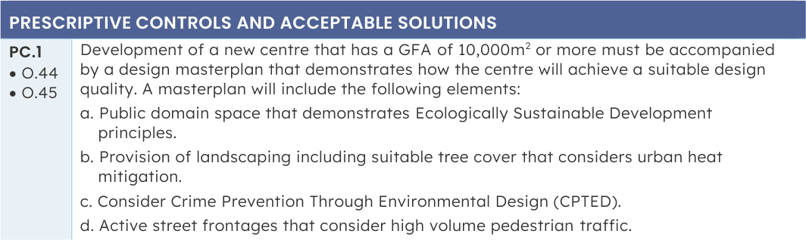
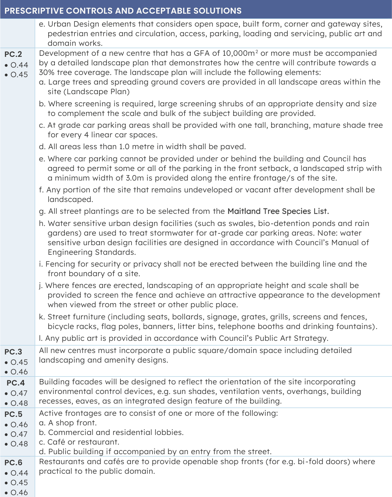
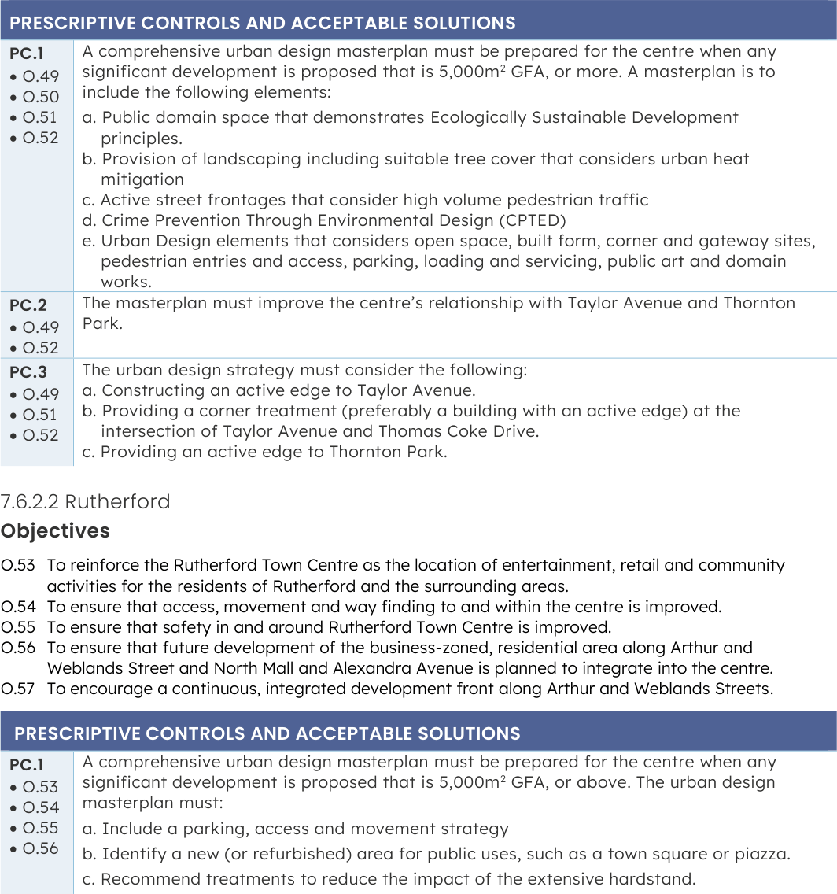
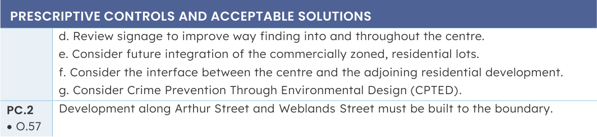
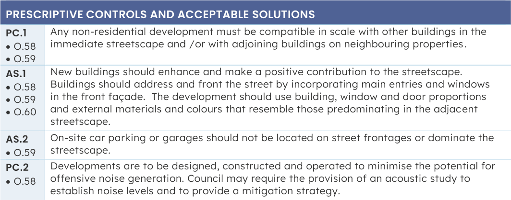

#### MU1 Mixed Use

Melbourne Street, Central Maitland The MU1 Mixed Use Zone is intended to complement and enhance the activity of the local and regional centres, and to serve as a transition between the centre and surrounding residential zones. In addition to these hierarchical centres, there are two other employment zones that are used in Maitland. The E3 Productivity Support, which provides a range of facilities and services, light industries, bulky goods, warehouses and offices.  The remaining zone, E4 General Industrial enables a wide range of business and industrial type uses. These zones are addressed in Chapter 8: Industrial Uses of this DCP.

#### 7.6.1. New centres

#### Objectives

O.44 New centres are designed and planned to provide an attractive, vibrant, safe and accessible public space.

O.45 New centres provide a focal point for the community, with a unique and identifiable built form. O.46 Centres provide space for public events and celebrations. O.47 Bulky and unattractive buildings are avoided. O.48 Overbearing or monotonous building design is avoided where viewed from any public place.

> [Picture on page 23: a picture, saved as a picture (images/ch-07-00-commercial-uses-page-23-33.gif, 150 dpi).]
> Words printed on the picture (title and legend, copied from the PDF):
> • O.44
> • O.45
> principles.
> mitigation.

#### PRESCRIPTIVE CONTROLS AND ACCEPTABLE SOLUTIONS

Development of a new centre that has a GFA of 10,000m2 or more must be accompanied by a design masterplan that demonstrates how the centre will achieve a suitable design quality. A masterplan will include the following elements:

#### PC.1

a. Public domain space that demonstrates Ecologically Sustainable Development

b. Provision of landscaping including suitable tree cover that considers urban heat

c. Consider Crime Prevention Through Environmental Design (CPTED).

d. Active street frontages that consider high volume pedestrian traffic.

> [Picture on page 24: a map, saved as a picture (images/ch-07-00-commercial-uses-page-24-1.gif, 150 dpi); the street names and other small labels are on the picture.]
> Words printed on the picture (title and legend, copied from the PDF):
> site (Landscape Plan)

e. Urban Design elements that considers open space, built form, corner and gateway sites, pedestrian entries and circulation, access, parking, loading and servicing, public art and domain works.

#### PC.2

Development of a new centre that has a GFA of 10,000m2 or more must be accompanied by a detailed landscape plan that demonstrates how the centre will contribute towards a 30% tree coverage. The landscape plan will include the following elements:

a. Large trees and spreading ground covers are provided in all landscape areas within the

b. Where screening is required, large screening shrubs of an appropriate density and size to complement the scale and bulk of the subject building are provided.

c. At grade car parking areas shall be provided with one tall, branching, mature shade tree for every 4 linear car spaces.

d. All areas less than 1.0 metre in width shall be paved.

e. Where car parking cannot be provided under or behind the building and Council has agreed to permit some or all of the parking in the front setback, a landscaped strip with a minimum width of 3.0m is provided along the entire frontage/s of the site.

f. Any portion of the site that remains undeveloped or vacant after development shall be

g. All street plantings are to be selected from the Maitland Tree Species List.

h. Water sensitive urban design facilities (such as swales, bio-detention ponds and rain gardens) are used to treat stormwater for at-grade car parking areas. Note: water sensitive urban design facilities are designed in accordance with Council’s Manual of Engineering Standards.

i. Fencing for security or privacy shall not be erected between the building line and the front boundary of a site.

j. Where fences are erected, landscaping of an appropriate height and scale shall be provided to screen the fence and achieve an attractive appearance to the development when viewed from the street or other public place.

k. Street furniture (including seats, bollards, signage, grates, grills, screens and fences, bicycle racks, flag poles, banners, litter bins, telephone booths and drinking fountains).

l. Any public art is provided in accordance with Council’s Public Art Strategy. All new centres must incorporate a public square/domain space including detailed landscaping and amenity designs.

#### PC.3

Building facades will be designed to reflect the orientation of the site incorporating environmental control devices, e.g. sun shades, ventilation vents, overhangs, building recesses, eaves, as an integrated design feature of the building.

#### PC.4

#### PC.5

Restaurants and cafés are to provide openable shop fronts (for e.g. bi-fold doors) where practical to the public domain.

Active frontages are to consist of one or more of the following:

a. A shop front.

b. Commercial and residential lobbies.

c. Café or restaurant.

d. Public building if accompanied by an entry from the street.

#### PC.6

#### 7.6.2. Existing centres

#### 7.6.2.1 Thornton

#### Objectives

O.49 The amenity of the Thornton town centre is improved. O.50 The Thornton Town Centre will become the focus of entertainment, retail and community activities for the residents of Thornton and the surrounding areas.

O.51 A variety of uses that activates the centre throughout the day and evening is encouraged. O.52 The centre integrates with the adjoining sports and community facilities.

> [Picture on page 25: a picture, saved as a picture (images/ch-07-00-commercial-uses-page-25-9.gif, 150 dpi).]
> Words printed on the picture (title and legend, copied from the PDF):
> • O.49
> • O.50
> • O.51
> • O.52 principles.
> mitigation
> • O.49
> • O.52
> • O.49
> • O.51
> • O.52

#### PRESCRIPTIVE CONTROLS AND ACCEPTABLE SOLUTIONS

A comprehensive urban design masterplan must be prepared for the centre when any significant development is proposed that is 5,000m2 GFA, or more. A masterplan is to include the following elements:

a. Public domain space that demonstrates Ecologically Sustainable Development

#### PC.1

b. Provision of landscaping including suitable tree cover that considers urban heat

c. Active street frontages that consider high volume pedestrian traffic

d. Crime Prevention Through Environmental Design (CPTED)

e. Urban Design elements that considers open space, built form, corner and gateway sites,

The masterplan must improve the centre’s relationship with Taylor Avenue and Thornton Park.

pedestrian entries and access, parking, loading and servicing, public art and domain works.

#### PC.2

The urban design strategy must consider the following:

a. Constructing an active edge to Taylor Avenue.

b. Providing a corner treatment (preferably a building with an active edge) at the

#### PC.3

intersection of Taylor Avenue and Thomas Coke Drive.

c. Providing an active edge to Thornton Park.

#### 7.6.2.2 Rutherford

#### Objectives

O.53 To reinforce the Rutherford Town Centre as the location of entertainment, retail and community activities for the residents of Rutherford and the surrounding areas.

O.54 To ensure that access, movement and way finding to and within the centre is improved. O.55 To ensure that safety in and around Rutherford Town Centre is improved. O.56 To ensure that future development of the business-zoned, residential area along Arthur and Weblands Street and North Mall and Alexandra Avenue is planned to integrate into the centre.

O.57 To encourage a continuous, integrated development front along Arthur and Weblands Streets.

#### PRESCRIPTIVE CONTROLS AND ACCEPTABLE SOLUTIONS

A comprehensive urban design masterplan must be prepared for the centre when any significant development is proposed that is 5,000m2 GFA, or above. The urban design masterplan must:

a. Include a parking, access and movement strategy

#### PC.1

b. Identify a new (or refurbished) area for public uses, such as a town square or piazza.

c. Recommend treatments to reduce the impact of the extensive hardstand.

> [Picture on page 26: a picture, saved as a picture (images/ch-07-00-commercial-uses-page-26-1.gif, 150 dpi).]
> Words printed on the picture (title and legend, copied from the PDF):
> • O.57

d. Review signage to improve way finding into and throughout the centre.

e. Consider future integration of the commercially zoned, residential lots.

f. Consider the interface between the centre and the adjoining residential development.

g. Consider Crime Prevention Through Environmental Design (CPTED). Development along Arthur Street and Weblands Street must be built to the boundary.

#### PC.2

#### 7.6.2.3 Central Maitland

#### Objectives

O.58 To promote the development of Central Maitland as a regional commercial, entertainment and recreation centre and to ensure it functions effectively as a centre.

O.59 To ensure the preservation of the existing historical character of Central Maitland, and of individual historic buildings and precincts.

O.60 To maintain the viability of Central Maitland by encouraging shop top housing where appropriate.

> [Picture on page 26: a picture, saved as a picture (images/ch-07-00-commercial-uses-page-26-15.gif, 150 dpi).]
> Words printed on the picture (title and legend, copied from the PDF):
> • O.58
> • O.59
> • O.58
> • O.59
> • O.60
> • O.59
> • O.58

#### PRESCRIPTIVE CONTROLS AND ACCEPTABLE SOLUTIONS

Any non-residential development must be compatible in scale with other buildings in the immediate streetscape and /or with adjoining buildings on neighbouring properties.

#### PC.1

#### AS.1

New buildings should enhance and make a positive contribution to the streetscape. Buildings should address and front the street by incorporating main entries and windows in the front façade.  The development should use building, window and door proportions and external materials and colours that resemble those predominating in the adjacent streetscape. On-site car parking or garages should not be located on street frontages or dominate the streetscape.

#### AS.2

#### PC.2

Developments are to be designed, constructed and operated to minimise the potential for offensive noise generation. Council may require the provision of an acoustic study to establish noise levels and to provide a mitigation strategy.
