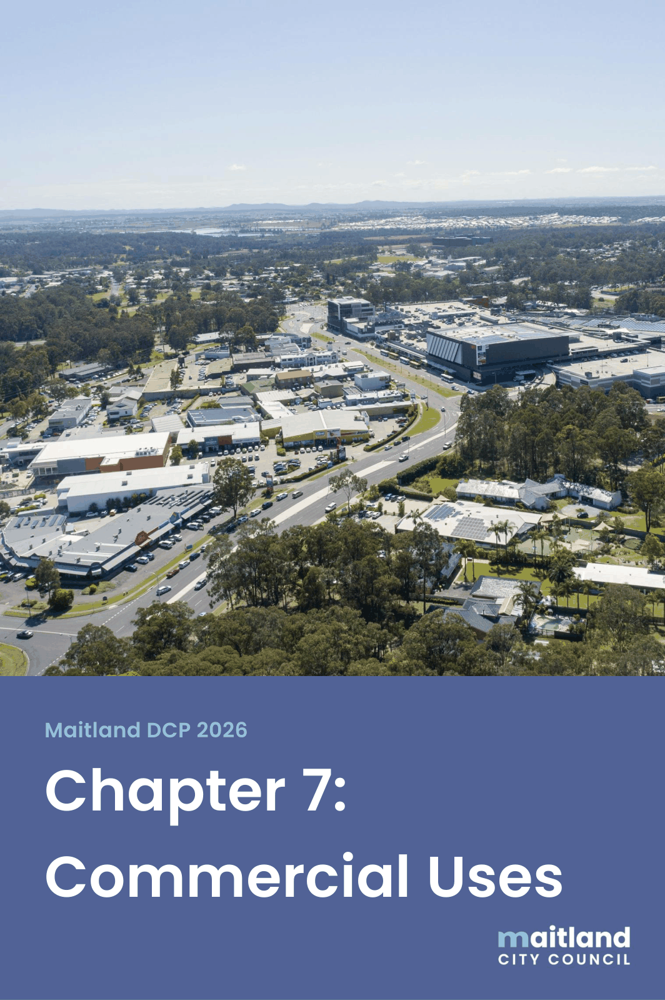

# Maitland Development Control Plan 2026 - Chapter 7 Commercial Uses

> This chapter is split into 9 section file(s), one per numbered heading, in the order they appear in the PDF.

Source PDF: [MDCP 2026 - Chapter 7 Commercial Uses.pdf](MDCP%202026%20-%20Chapter%207%20Commercial%20Uses.pdf)

> [Picture on page 1: a picture, saved as a picture (images/ch-07-00-commercial-uses-page-1-1.gif, 150 dpi).]

### Maitland DCP 2026

## Chapter 7: Commercial Uses

### Table of Contents – Chapter 7: Commercial Uses

7.1. Introduction ....................................................................................................................................................3 7.1.1. Application..................................................................................................................................................... 3 7.1.2. Relationship to other Chapters .............................................................................................................. 3 7.1.3. How to use this Chapter ........................................................................................................................... 3 7.1.4. Intent of this Chapter ................................................................................................................................ 4 7.2. Scale and bulk .............................................................................................................................................. 5 7.2.1. Building height ............................................................................................................................................. 5 7.2.2. Ceiling height ............................................................................................................................................... 6 7.2.3. Overshadowing and privacy ................................................................................................................... 7 7.2.4. Setbacks ........................................................................................................................................................ 7 7.3. Built form ........................................................................................................................................................ 9 7.3.1. Appearance and articulation .................................................................................................................. 9 7.3.2. Facades ........................................................................................................................................................ 10 7.3.3. Awnings ......................................................................................................................................................... 11 7.3.4. Roofing.......................................................................................................................................................... 11 7.3.5. Sustainable design ................................................................................................................................... 12 7.4. Place activation ......................................................................................................................................... 12 7.4.1. Active street frontages ........................................................................................................................... 12 7.4.2. Public domain ............................................................................................................................................ 16 7.4.3. Landscaping ............................................................................................................................................... 16 7.4.4. Fencing ......................................................................................................................................................... 17 7.4.5. Lighting ......................................................................................................................................................... 17 7.4.6. Signage ........................................................................................................................................................ 18 7.5. Servicing ....................................................................................................................................................... 21 7.5.1. Utilities .......................................................................................................................................................... 21 7.5.2. Waste management and circular economy ..................................................................................... 22 7.6. Centre place-based controls ................................................................................................................ 23 7.6.1. New centres ................................................................................................................................................ 23 7.6.2. Existing centres ......................................................................................................................................... 25

7.6.2.1 Thornton ..................................................................................................................................................... 25

7.6.2.2 Rutherford ................................................................................................................................................. 25

7.6.2.3 Central Maitland ..................................................................................................................................... 26

<!-- sections -->
## Sections

1. [7.1 Introduction](01-7-1-introduction.md)
2. [7.2 Scale and bulk](02-7-2-scale-and-bulk.md)
3. [7.3 Built form](03-7-3-built-form.md)
4. [7.4 Place activation](04-7-4-place-activation.md)
5. [7.5 Servicing](05-7-5-servicing.md)
6. [7.6 Centre place-based controls](06-7-6-centre-place-based-controls.md)
7. [E1 Local Centre](07-e1-local-centre.md)
8. [E2 Commercial Centre](08-e2-commercial-centre.md)
9. [MU1 Mixed Use](09-mu1-mixed-use.md)
