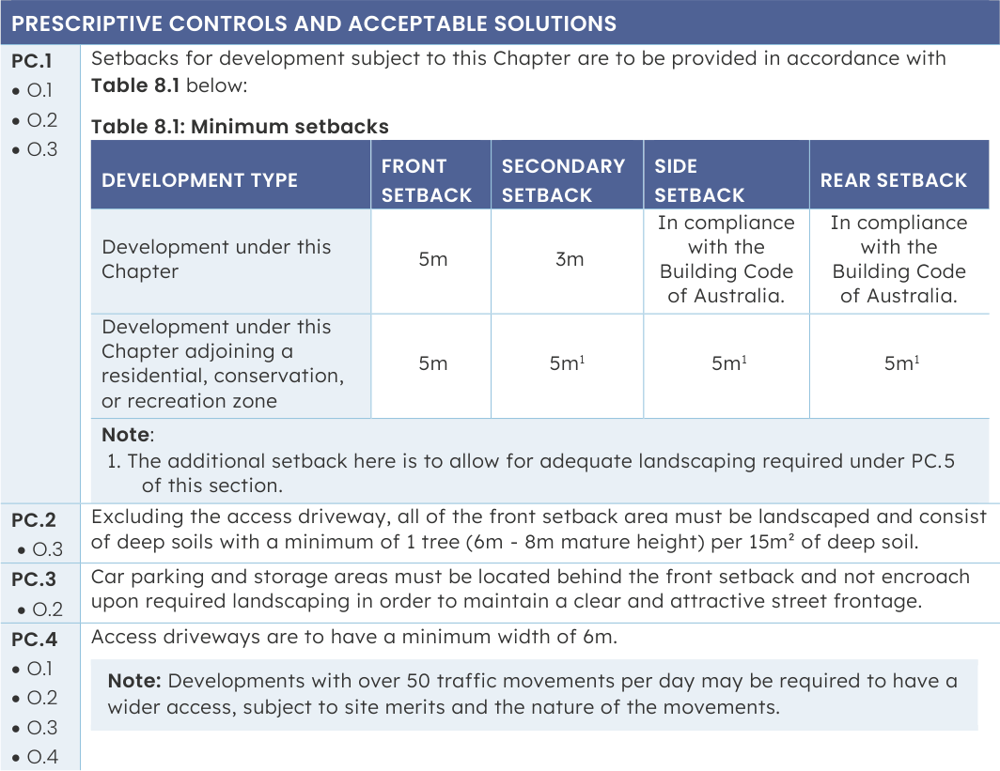
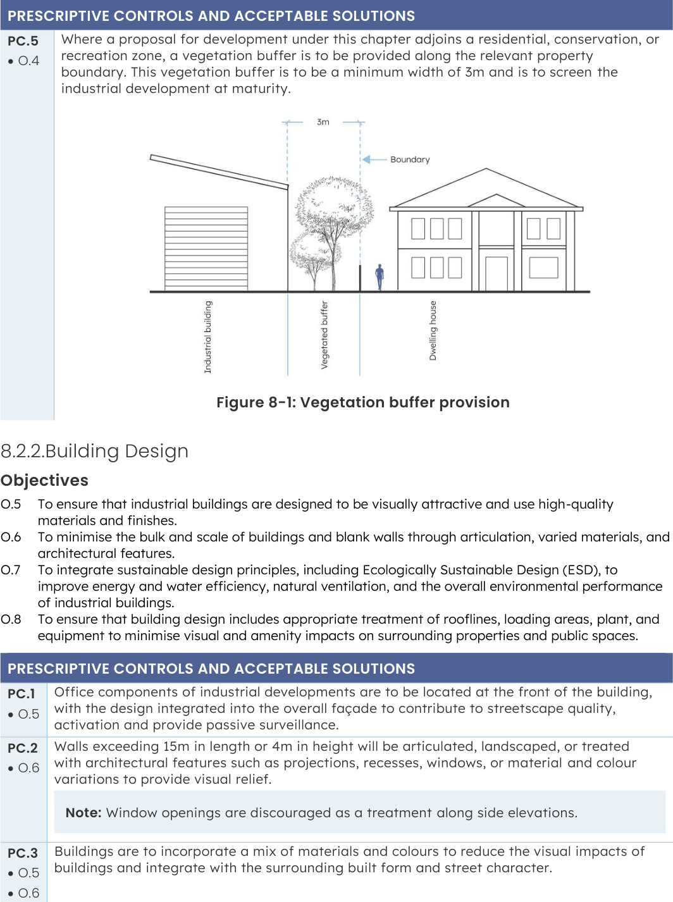
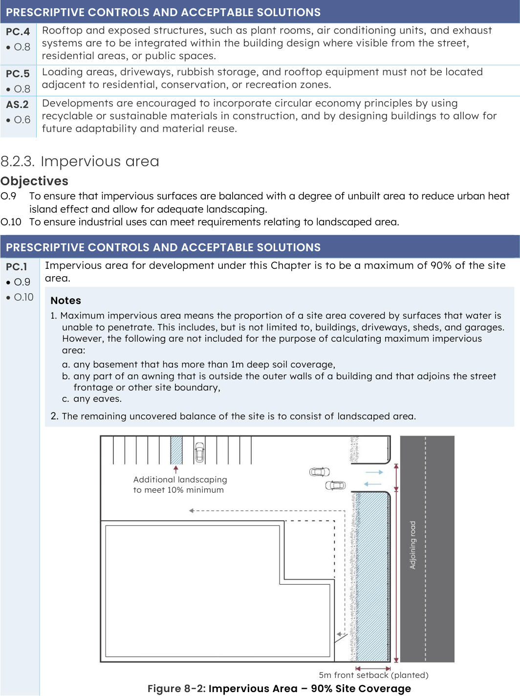
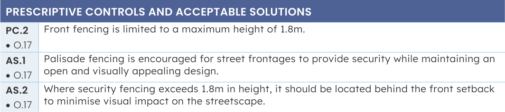
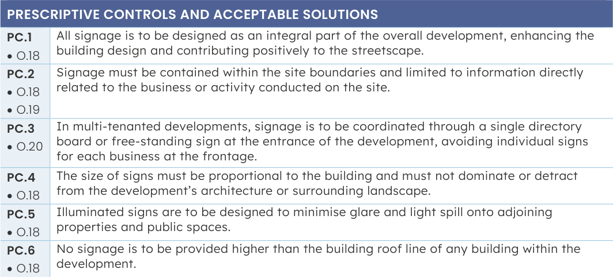
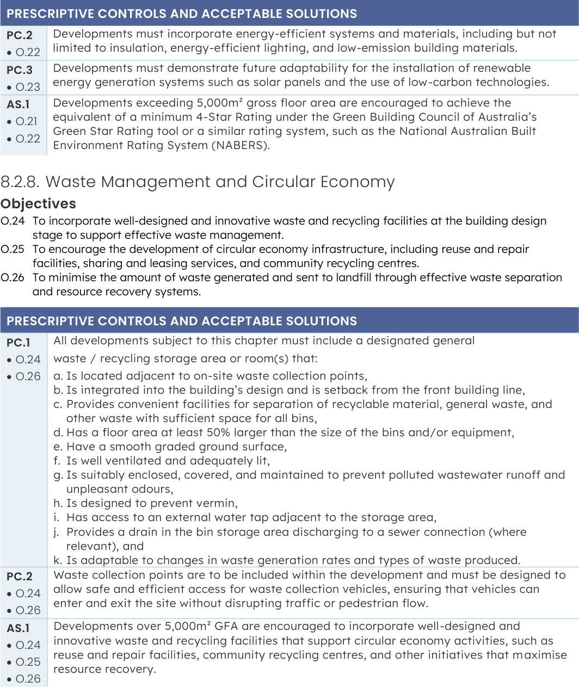

### 8.2. Design Requirements

#### 8.2.1. Setbacks and Streetscape

#### Objectives

O.1 To ensure that industrial developments maintain an appropriate relationship with the streetscape and surrounding areas.

O.2 To minimise the visual impact of industrial buildings on the streetscape while promoting an attractive and functional street frontage.

O.3 To ensure setbacks provide adequate space for landscaping that contributes positively to the streetscape.

O.4 To mitigate potential impacts of industrial developments on adjoining sensitive areas.

> [Picture on page 4: a picture, saved as a picture (images/ch-08-00-industrial-uses-page-4-11.gif, 150 dpi).]
> Words printed on the picture (title and legend, copied from the PDF):
> • O.1
> • O.2
> • O.3
> • O.3
> • O.2
> • O.1
> • O.2
> • O.3
> • O.4

Table 8.1 below:

Table 8.1: Minimum setbacks

#### PRESCRIPTIVE CONTROLS AND ACCEPTABLE SOLUTIONS

#### PC.1

Setbacks for development subject to this Chapter are to be provided in accordance with

| DEVELOPMENT TYPE | FRONT SETBACK | SECONDARY SETBACK | SIDE SETBACK | REAR SETBACK In compliance with the Code Australia. |
|---|---|---|---|---|
| Development under this Chapter | 5m | 3m | In compliance with the Building Code Building of Australia. of |  |
| Development under this | 5m | 5m1 | 5m1 |  |
| Chapter adjoining a |  |  |  |  |
| residential, conservation, |  |  |  |  |
| or recreation zone |  |  |  |  |
| 5m1 Note: |  |  |  |  |
| 1. The additional setback here is to allow for adequate landscaping required under PC.5 |  |  |  |  |
| of this section. |  |  |  |  |

#### PC.2

Excluding the access driveway, all of the front setback area must be landscaped and consist of deep soils with a minimum of 1 tree (6m - 8m mature height) per 15m² of deep soil.

#### PC.3

Car parking and storage areas must be located behind the front setback and not encroach upon required landscaping in order to maintain a clear and attractive street frontage. Access driveways are to have a minimum width of 6m.

#### PC.4

Note: Developments with over 50 traffic movements per day may be required to have a wider access, subject to site merits and the nature of the movements.

> [Picture on page 5: a picture, saved as a picture (images/ch-08-00-industrial-uses-page-5-1.gif, 150 dpi).]
> Words printed on the picture (title and legend, copied from the PDF):
> • O.4

Figure 8-1: Vegetation buffer provision

#### PC.5

Where a proposal for development under this chapter adjoins a residential, conservation, or recreation zone, a vegetation buffer is to be provided along the relevant property boundary. This vegetation buffer is to be a minimum width of 3m and is to screen the industrial development at maturity.

### 8.2.2.Building Design

#### Objectives

O.5 To ensure that industrial buildings are designed to be visually attractive and use high-quality materials and finishes.

O.6 To minimise the bulk and scale of buildings and blank walls through articulation, varied materials, and architectural features.

O.7 To integrate sustainable design principles, including Ecologically Sustainable Design (ESD), to improve energy and water efficiency, natural ventilation, and the overall environmental performance of industrial buildings.

O.8 To ensure that building design includes appropriate treatment of rooflines, loading areas, plant, and equipment to minimise visual and amenity impacts on surrounding properties and public spaces.

#### PRESCRIPTIVE CONTROLS AND ACCEPTABLE SOLUTIONS

#### PC.1

Office components of industrial developments are to be located at the front of the building, with the design integrated into the overall façade to contribute to streetscape quality, activation and provide passive surveillance.

#### PC.2

Walls exceeding 15m in length or 4m in height will be articulated, landscaped, or treated with architectural features such as projections, recesses, windows, or material and colour variations to provide visual relief.

Note: Window openings are discouraged as a treatment along side elevations.

#### PC.3

Buildings are to incorporate a mix of materials and colours to reduce the visual impacts of buildings and integrate with the surrounding built form and street character.

> [Picture on page 6: a picture, saved as a picture (images/ch-08-00-industrial-uses-page-6-1.gif, 150 dpi).]
> Words printed on the picture (title and legend, copied from the PDF):
> • O.8
> • O.8
> • O.6

#### PC.4

Rooftop and exposed structures, such as plant rooms, air conditioning units, and exhaust systems are to be integrated within the building design where visible from the street, residential areas, or public spaces.

#### PC.5

Loading areas, driveways, rubbish storage, and rooftop equipment must not be located adjacent to residential, conservation, or recreation zones.

#### AS.2

Developments are encouraged to incorporate circular economy principles by using recyclable or sustainable materials in construction, and by designing buildings to allow for future adaptability and material reuse.

#### 8.2.3. Impervious area

#### Objectives

O.9 To ensure that impervious surfaces are balanced with a degree of unbuilt area to reduce urban heat island effect and allow for adequate landscaping.

O.10 To ensure industrial uses can meet requirements relating to landscaped area.

> Words printed on the picture (title and legend, copied from the PDF):
> 1\. Maximum impervious area means the proportion of a site area covered by surfaces that water is
> unable to penetrate. This includes, but is not limited to, buildings, driveways, sheds, and garages.
> However, the following are not included for the purpose of calculating maximum impervious
> a. any basement that has more than 1m deep soil coverage,
> b. any part of an awning that is outside the outer walls of a building and that adjoins the street
> frontage or other site boundary,
> c. any eaves.
> to meet 10% minimum
> 5m front setback (planted)

Figure 8-2: Impervious Area – 90% Site Coverage

#### PRESCRIPTIVE CONTROLS AND ACCEPTABLE SOLUTIONS

#### PC.1

Impervious area for development under this Chapter is to be a maximum of 90% of the site area.

#### Notes

2\. The remaining uncovered balance of the site is to consist of landscaped area.

#### 8.2.4. Landscaping

#### Objectives

O.11 To provide landscaping to improve and complement the appearance of industrial developments and enhance streetscape.

O.12 To contribute to the Maitland Environmental Sustainability Strategy’s target of achieving 30% tree canopy cover across the LGA.

O.13 To provide functional areas of planting that enhance the presentation of a building, provide amenity, cooling and shade, and contribute to overall streetscape character.

O.14 To promote the use of durable, low-maintenance plant species suitable for industrial environments, ensuring longevity and cost-effectiveness.

O.15 To help create a greener industrial park environment.

| PRESCRIPTIVE CONTROLS AND ACCEPTABLE SOLUTIONS |  |
|---|---|
| PC.1 | A detailed landscape plan is to be submitted as part of development, in accordance with the requirements under Appendix A: Application Requirements – Other Development. |
| • O.11 |  |
| PC.2 • O.11 • O.12 • O.13 | Trees of appropriate species for the local environment (in accordance with the Maitland Tree Species List) are to be planted within the following areas to provide canopy cover, shading, biodiversity connectivity, and visual screening at maturity: a. the front setback area, being 5m at a minimum, b. the secondary setback area, being 3m at a minimum (where applicable), and c. the side and rear setbacks, where visible from, or adjoining, residential, conservation, recreation, or public facing areas. Note: Consideration is also to be given to the requirements of Section 3.4.2 and 3.4.3 of Chapter 3: Site Requirements of this DCP. |
| PC.3 | Landscaped areas must include functional plantings, such as trees and shrubs, that provide shade, cooling, and enhance the appearance of the streetscape. |
| • O.13 |  |
| • O.14 |  |
| PC.4 • O.12 | Where an industrial development adjoins a biodiversity corridor or natural area, landscaping is to be appropriately located to enhance connectivity and biodiversity outcomes. |
| AS.1 • O.14 • O.15 | All landscaped areas are encouraged to use low-maintenance, durable and drought resilient plant species in accordance with the Maitland Tree Species List, alongside automated watering systems that are suitable for industrial environments to ensure longevity and reduce maintenance needs. |
| PC.5 | A physical barrier kerb is to be constructed between all landscaped areas, and areas for the standing or manoeuvring of vehicles on the site. |
| • O.13 |  |

#### 8.2.5. Fencing

#### Objectives

O.16 To ensure that the design and location of fencing is integrated within the overall development and is suitable for its purpose and setting.

O.17 To ensure that fencing provides necessary security and is constructed to a high standard, complementing the landscape design and contributing to an attractive streetscape.

#### PRESCRIPTIVE CONTROLS AND ACCEPTABLE SOLUTIONS

| PC.1 | Fencing along street frontages is to be open style fencing that does not obstruct views of |
|---|---|
| • O.16 | the landscaped areas or reduce passive surveillance. |

> [Picture on page 8: a picture, saved as a picture (images/ch-08-00-industrial-uses-page-8-1.gif, 150 dpi).]
> Words printed on the picture (title and legend, copied from the PDF):
> • O.17
> • O.17
> • O.17

Front fencing is limited to a maximum height of 1.8m.

#### PC.2

#### AS.1

Palisade fencing is encouraged for street frontages to provide security while maintaining an open and visually appealing design.

#### AS.2

Where security fencing exceeds 1.8m in height, it should be located behind the front setback to minimise visual impact on the streetscape.

#### 8.2.6. Signage

#### Objectives

O.18 To ensure that signage is carefully integrated into the design of industrial developments and used as a positive design element.

O.19 To allow the display of information identifying the premises, the business, and the activity conducted on the site.

O.20 To ensure a coordinated and consistent approach to signage where multiple tenancies or businesses occupy a site, preventing visual clutter.

> [Picture on page 8: a picture, saved as a picture (images/ch-08-00-industrial-uses-page-8-18.gif, 150 dpi).]
> Words printed on the picture (title and legend, copied from the PDF):
> • O.18
> • O.18
> • O.19
> • O.20
> • O.18
> • O.18
> • O.18

#### PRESCRIPTIVE CONTROLS AND ACCEPTABLE SOLUTIONS

#### PC.1

All signage is to be designed as an integral part of the overall development, enhancing the building design and contributing positively to the streetscape.

#### PC.2

Signage must be contained within the site boundaries and limited to information directly related to the business or activity conducted on the site.

#### PC.3

In multi-tenanted developments, signage is to be coordinated through a single directory board or free-standing sign at the entrance of the development, avoiding individual signs for each business at the frontage.

#### PC.4

The size of signs must be proportional to the building and must not dominate or detract from the development’s architecture or surrounding landscape.

#### PC.5

Illuminated signs are to be designed to minimise glare and light spill onto adjoining properties and public spaces.

#### PC.6

No signage is to be provided higher than the building roof line of any building within the development.

#### 8.2.7. Sustainable Design

#### Objectives

O.21 To ensure building orientation maximises solar access and natural cross ventilation, promoting energy efficiency and occupant comfort.

O.22 To encourage the integration of energy-efficient systems and materials to reduce the overall environmental impact of industrial developments.

O.23 To support the future adaptability of industrial buildings by incorporating design features that facilitate the installation of renewable energy generation and low-carbon technologies.

#### PRESCRIPTIVE CONTROLS AND ACCEPTABLE SOLUTIONS

#### PC.1

• O.21

Where ancillary office spaces are provided, buildings are to be oriented to maximise solar access and natural cross ventilation wherever possible to improve energy efficiency and occupant comfort.

> [Picture on page 9: a picture, saved as a picture (images/ch-08-00-industrial-uses-page-9-1.gif, 150 dpi).]
> Words printed on the picture (title and legend, copied from the PDF):
> • O.22
> • O.23
> • O.21
> • O.22

#### PC.2

Developments must incorporate energy-efficient systems and materials, including but not limited to insulation, energy-efficient lighting, and low-emission building materials.

#### PC.3

Developments must demonstrate future adaptability for the installation of renewable energy generation systems such as solar panels and the use of low-carbon technologies.

#### AS.1

Developments exceeding 5,000m² gross floor area are encouraged to achieve the equivalent of a minimum 4-Star Rating under the Green Building Council of Australia’s Green Star Rating tool or a similar rating system, such as the National Australian Built Environment Rating System (NABERS).

#### 8.2.8. Waste Management and Circular Economy

#### Objectives

O.24 To incorporate well-designed and innovative waste and recycling facilities at the building design stage to support effective waste management.

O.25 To encourage the development of circular economy infrastructure, including reuse and repair facilities, sharing and leasing services, and community recycling centres.

O.26 To minimise the amount of waste generated and sent to landfill through effective waste separation and resource recovery systems.

> Words printed on the picture (title and legend, copied from the PDF):
> • O.26 a. Is located adjacent to on-site waste collection points,

#### PRESCRIPTIVE CONTROLS AND ACCEPTABLE SOLUTIONS

All developments subject to this chapter must include a designated general

#### PC.1

waste / recycling storage area or room(s) that:

b. Is integrated into the building’s design and is setback from the front building line,

c. Provides convenient facilities for separation of recyclable material, general waste, and other waste with sufficient space for all bins,

d. Has a floor area at least 50% larger than the size of the bins and/or equipment,

e. Have a smooth graded ground surface,

f. Is well ventilated and adequately lit,

g. Is suitably enclosed, covered, and maintained to prevent polluted wastewater runoff and

h. Is designed to prevent vermin,

i. Has access to an external water tap adjacent to the storage area,

j. Provides a drain in the bin storage area discharging to a sewer connection (where

k. Is adaptable to changes in waste generation rates and types of waste produced.

#### PC.2

Waste collection points are to be included within the development and must be designed to allow safe and efficient access for waste collection vehicles, ensuring that vehicles can enter and exit the site without disrupting traffic or pedestrian flow.

#### AS.1

Developments over 5,000m² GFA are encouraged to incorporate well-designed and innovative waste and recycling facilities that support circular economy activities, such as reuse and repair facilities, community recycling centres, and other initiatives that maximise resource recovery.

#### 8.2.9. Multi-Unit Industrial Development

#### Objectives

O.27 To ensure that all industrial activities are conducted within the building or within dedicated areas to minimise adverse impacts on surrounding properties and the environment.

O.28 To encourage high-quality site design and flexibility within common property for access, landscaping, waste servicing, parking, and loading areas in strata subdivisions.

O.29 To help ensure that multi-unit industrial developments are adequately provisioned for in regards to parking, loading zones, and servicing.

| PRESCRIPTIVE CONTROLS AND ACCEPTABLE SOLUTIONS All proposed activities must be contained within the tenancies of each building or appropriately located and identified outdoor areas, including any storage areas. Any areas must be located away from sensitive receivers, such as residential areas, and from view. must be stored inside each unit or in a designated, communally managed The location of trade waste storage must not interfere with parking or vehicle areas and must be screened from public view. areas, and car parking are to be included as common property in any use is unknown, applicants are to nominate a theoretical use for |  |
|---|---|
| PC.1 • O.27 outdoor be screened |  |
| PC.2 Trade waste • O.27 storage area. manoeuvring |  |
| PC.3 | Landscaping, access strata subdivision. |
| • O.28 |  |
| PC.4 | Where the specific future each tenancy. |
| • O.29 |  |
