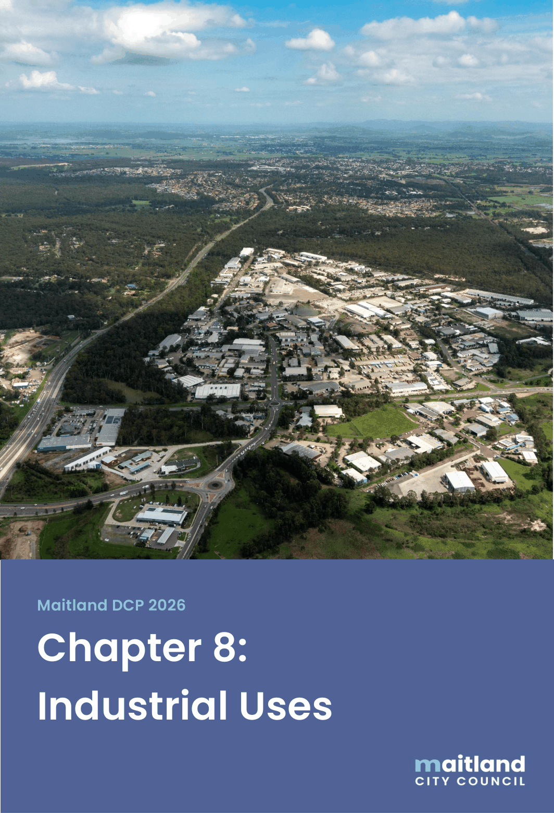

# Maitland Development Control Plan 2026 - Chapter 8 Industrial Uses

> This chapter is split into 2 section file(s), one per numbered heading, in the order they appear in the PDF.

Source PDF: [MDCP 2026 - Chapter 8 Industrial Uses.pdf](MDCP%202026%20-%20Chapter%208%20Industrial%20Uses.pdf)

> [Picture on page 1: a picture, saved as a picture (images/ch-08-00-industrial-uses-page-1-1.gif, 150 dpi).]

### Maitland DCP 2026

## Chapter 8: Industrial Uses

### Table of Contents – Chapter 8: Industrial Uses

| 8.1. | Introduction............................................................................................................................................... 2 |
|---|---|
| 8.1.1. | Application of this Chapter ............................................................................................................. 2 |
| 8.1.2. | Relationship to other Chapters ..................................................................................................... 2 |
| 8.1.3. | How to use this Chapter................................................................................................................... 3 |
| 8.1.4. | Intent of this Chapter ........................................................................................................................ 3 |
| 8.1.5. | Application Requirements ............................................................................................................... 3 |
| 8.2. | Design Requirements ............................................................................................................................ 4 |
| 8.2.1. | Setbacks and Streetscape .............................................................................................................. 4 |
| 8.2.2. | Building Design .................................................................................................................................... 5 |
| 8.2.3. | Impervious area .................................................................................................................................. 6 |
| 8.2.4. | Landscaping ......................................................................................................................................... 7 |
| 8.2.5. | Fencing.................................................................................................................................................... 7 |
| 8.2.6. | Signage ................................................................................................................................................... 8 |
| 8.2.7. | Sustainable Design ............................................................................................................................ 8 |
| 8.2.8. | Waste Management and Circular Economy ........................................................................... 9 |
| 8.2.9. | Multi-Unit Industrial Development ............................................................................................. 10 |

<!-- sections -->
## Sections

1. [8.1 Introduction](01-8-1-introduction.md)
2. [8.2 Design Requirements](02-8-2-design-requirements.md)
