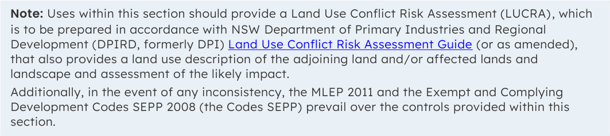
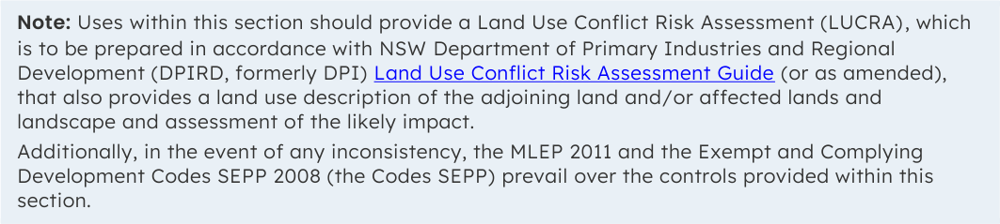

#### 9.1.3. How to use this Chapter

This Chapter has been organised to create three distinct sections:

#### Rural Land Uses

This section provides controls relating to a series of different rural land uses common throughout the Maitland LGA and seeks to provide additional guidance in the effective and efficient management of rural structures and operations. Additionally, it seeks to action the principles of Maitland’s Rural Land Strategy 2041 to assist in fostering a diverse and resilient rural economy.

> [Picture on page 3: a picture, saved as a picture (images/ch-09-00-rural-and-other-land-uses-page-3-32.gif, 150 dpi).]

Note: Uses within this section should provide a Land Use Conflict Risk Assessment (LUCRA), which is to be prepared in accordance with NSW Department of Primary Industries and Regional Development (DPIRD, formerly DPI) Land Use Conflict Risk Assessment Guide (or as amended), that also provides a land use description of the adjoining land and/or affected lands and landscape and assessment of the likely impact. Additionally, in the event of any inconsistency, the MLEP 2011 and the Exempt and Complying Development Codes SEPP 2008 (the Codes SEPP) prevail over the controls provided within this section.

#### Agritourism

This section addresses agritourism within the rural, environmental, and tourist zones of the Maitland LGA, seeking to provide further guidance for applicants around Council’s expectations for these types of facilities, notably farm stay accommodation and eco-tourist facilities.

> [Picture on page 4: a picture, saved as a picture (images/ch-09-00-rural-and-other-land-uses-page-4-5.gif, 150 dpi).]

Note: Uses within this section should provide a Land Use Conflict Risk Assessment (LUCRA), which is to be prepared in accordance with NSW Department of Primary Industries and Regional Development (DPIRD, formerly DPI) Land Use Conflict Risk Assessment Guide (or as amended), that also provides a land use description of the adjoining land and/or affected lands and landscape and assessment of the likely impact. Additionally, in the event of any inconsistency, the MLEP 2011 and the Exempt and Complying Development Codes SEPP 2008 (the Codes SEPP) prevail over the controls provided within this section.

#### Other Land Uses

This section provides controls for a variety of different land uses that do not comfortably fit within one of the other chapters of the DCP yet still require some form of guidance to be provided. The structure of the controls and acceptable solutions reflects either the rarity, complexity, or other planning pathways available for these kinds of development.

Note: In the event of any inconsistency, the MLEP 2011 and the Exempt and Complying Development Codes SEPP 2008 (the Codes SEPP) prevail over the controls provided within this section.
