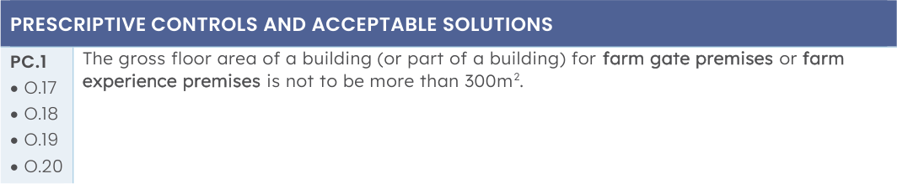

#### 9.2.7. Farm Gate Premises and Farm Experience Premises

#### Objectives

O.17 To allow for tourism and related commercial uses at a scale that does not adversely affect the principal use of land for primary production.

O.18 To ensure farm gate premises and farm experience premises do not detract from existing environmental values, scenic values, infrastructure and adjoining land uses.

O.19 To protect the amenity and privacy of adjoining properties, including visual and acoustic privacy, from farm gate premises and farm experience premises.

O.20 To provide for the sale of locally grown and manufactured produce in appropriate rural locations. O.21 To adequately provide services and facilities for visitors and guests on the property, including accessible facilities.

O.22 To manage the number of visitors to a landholding to address cumulative effects of traffic on roads.

> [Picture on page 9: a picture, saved as a picture (images/ch-09-00-rural-and-other-land-uses-page-9-19.gif, 150 dpi).]
> Words printed on the picture (title and legend, copied from the PDF):
> • O.17
> • O.18
> • O.19
> • O.20

#### PRESCRIPTIVE CONTROLS AND ACCEPTABLE SOLUTIONS

#### PC.1

The gross floor area of a building (or part of a building) for farm gate premises or farm experience premises is not to be more than 300m2.

| PRESCRIPTIVE CONTROLS AND ACCEPTABLE SOLUTIONS |  |
|---|---|
| PC.2 | The total footprint of all buildings used for farm gate premises and farm experience premises on the landholding is not to exceed 600m2. |
| • O.17 |  |
| • O.18 |  |
| • O.19 |  |
| • O.20 |  |
| PC.3 | The height of a building for farm gate premises or farm experience premises is not to exceed 10 metres. |
| • O.18 |  |
| • O.19 |  |
| PC.4 • O.19 | The hours of operation for farm gate premises are: a. 8am to 5pm Sunday to Friday and public holidays, and b. 7am to 6pm on Saturdays. |
| PC.5 • O.19 | The hours of operation of farm experience premises are: a. 8am to 6pm Sunday to Thursday and public holidays, and b. 7am to 12am Friday and Saturday. |
| PC.6 | The maximum number of visitors to farm gate premises is not to exceed 120 on a landholding at any one time. |
| • O.17 |  |
| • O.18 |  |
| • O.22 |  |
| PC.7 | The maximum number of visitors to farm experience premises is not to exceed 100 on a landholding at any one time. |
| • O.17 |  |
| • O.18 |  |
| • O.22 |  |
| PC.8 | The maximum number of visitors to combined farm gate premises and farm experience premises is 110 on a landholding at any one time. |
| • O.17 |  |
| • O.18 |  |
| • O.22 |  |
| PC.9 | Farm experience premises are limited to 54 events per year, including a maximum of 6 events per year after 6pm that have amplified noise. |
| • O.18 |  |
| • O.19 |  |
| PC.10 | Adequate toilet facilities are to be provided. At least one toilet must be a unisex accessible toilet. |
| • O.21 |  |
| PC.11 | Amplified noise for farm gate premises and farm experience premises must be a maximum of 40 dB at the closest residential dwelling on a neighbouring allotment. |
| • O.18 |  |
| • O.19 |  |
| AS.1 | Farm gate premises and farm experience premises should be setback a minimum of 10m from any boundary. Should this control be varied, a Visual Impact Assessment is to be prepared by a suitably qualified person that satisfies O.18 and O.19. |
| • O.18 |  |
| • O.19 |  |
